# 基于 Fireblocks + TaaS 的资金归集平台规划（二期）

> 定位：项目二期的**业务与流程规划**，讲清楚各系统怎么分工、资金和订单怎么流转。不涉及技术实现和任务排期。
> 背景：一期（本项目代码）是自建的 HD 钱包，自己完成签名、广播、补 Gas 和归集。二期引入 Fireblocks 作为底层钱包和签名基础设施，由公司基于 Fireblocks 搭建的管理平台 **TaaS** 统一承载审批和运营。
> 相关文档：[主流资产归集流程.md](./主流资产归集流程.md)（各链归集原理）、[HD钱包原理与托管实践.md](./HD钱包原理与托管实践.md)（HD 钱包原理）、[归集重点问题深度解析.md](./归集重点问题深度解析.md)（一期的重点问题）。
> 说明：TaaS 目前已经上线的是代币发行与运营（模板库、部署、Mint/Burn、多级审核）；本文中 TaaS 的资金管理能力属于**规划**内容。

---

## 0. 一句话结论

> **资金归集业务接入 TaaS，复用它已有的"订单 + 多级审核 + Fireblocks 签名"体系；Fireblocks 负责钱包、策略和签名；客户余额、订单状态和对账仍然由我们自己负责。**

一期和二期最大的区别：

| | 一期（自建） | 二期（Fireblocks + TaaS） |
|---|---|---|
| 关注重点 | 链上细节：nonce、UTXO、广播、补 Gas | 业务治理：审批、策略、分层、对账 |
| 私钥 | 助记词加密存放，在进程内签名 | MPC 分片，完整私钥从不出现 |
| 谁能动钱 | 拿到服务器就能签名 | 必须同时通过业务审批、Fireblocks Policy、Callback 校验和 MPC 签名 |
| 热冷分层 | 无 | 热、温、冷三层 + 交易所流动性 |
| 对账 | 无 | 账本、Fireblocks、链上三方对账 |

---

## 1. 系统全景

### 1.1 分层架构

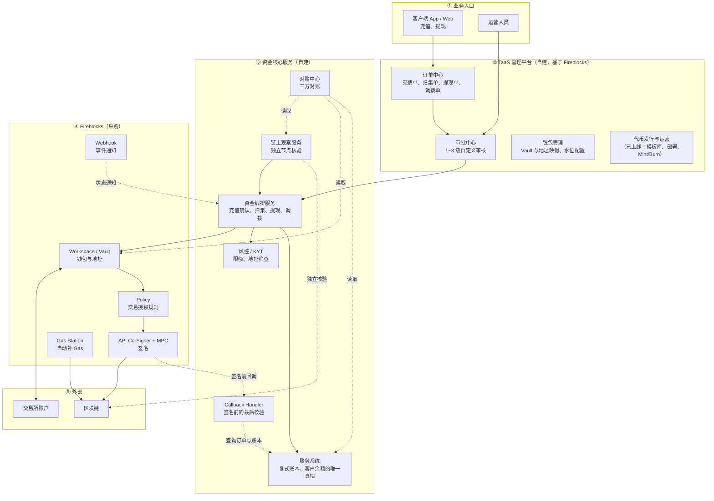

### 1.2 各系统职责

| 系统 | 归属 | 负责 | 不负责 |
|---|---|---|---|
| 客户端 | 自建 | 展示充值地址、发起提现、查询余额 | 任何资金判断 |
| **TaaS 订单中心** | 自建 | 所有资金操作统一生成订单，记录申请人、状态、关联交易 | 签名 |
| **TaaS 审批中心** | 自建 | 判断"这笔**业务**能不能发起"：大额提现、调拨、冷钱包动用需要人工审核 | 判断链上交易能不能签名 |
| **TaaS 钱包管理** | 自建 | 维护客户与 Vault、地址的映射；配置热温冷水位 | 生成私钥 |
| **账务系统** | 自建 | 客户可用、冻结、在途余额；所有资金变动记复式分录 | 链上操作 |
| **风控 / KYT** | 自建 + 第三方 | 客户限额、行为风控；地址风险筛查（可以通过 Fireblocks 对接 Chainalysis 等） | 最终签名决策 |
| **资金编排服务** | 自建 | 驱动充值、归集、提现、调拨的流程和状态机 | 保管密钥 |
| **链上观察服务** | 自建 | 用独立节点核验交易和余额，不完全依赖 Fireblocks 的数据 | 签名 |
| **对账中心** | 自建 | 账本、Fireblocks、链上三方对账，差异告警 | 修改余额 |
| **Callback Handler** | 自建 | 在 Co-Signer 签名前，核对订单、金额、地址、冻结状态，默认拒绝 | 发起交易 |
| **Fireblocks Vault** | 采购 | 钱包、地址、余额、交易执行（nonce、UTXO 选择、广播） | 客户账务 |
| **Fireblocks Policy** | 采购 | 判断"这笔**交易**能不能签名"：来源、目标、资产、金额、审批人、签名人 | 业务合理性 |
| **API Co-Signer** | 采购，部署在自己的环境里 | 持有公司的 MPC 分片，参与签名 | 业务判断（交给 Callback） |
| **Gas Station** | 采购 | 给 Vault 自动补 EVM 手续费 | 成本策略 |

> **职责边界一句话**：Fireblocks 解决"**谁批准、谁签名、是否符合资金策略、怎么安全上链**"；我们自己解决"**为什么发生这笔交易、属于哪个客户、怎么记账、出了异常怎么办**"。

### 1.3 和一期系统的对应关系

| 一期（本项目） | 二期 | 变化 |
|---|---|---|
| HD 助记词 + age 加密文件 | Fireblocks Workspace（MPC 主密钥） | 私钥管理交给 Fireblocks |
| 用户充值地址 `m/44'/60'/0'/0/i` | 客户 Vault Account 下的 Asset Wallet 地址 | Vault ID 就是 HD 的 account 层 |
| 平台热钱包（index 0） | OMNIBUS-HOT Vault | 增加温钱包、冷钱包两层 |
| 自建 Gas Station | Fireblocks Gas Station | 补 Gas 自动化 |
| 扫块服务 | 链上观察服务 + Webhook | 从"主要数据来源"变为"独立核验" |
| nonce 行锁分配、UTXO 锁、RBF | Fireblocks 负责 | 链上复杂度下沉 |
| 状态机、先落库后广播 | 状态机 + 幂等键（`externalTxId`） | 思路不变，锚点从 txid 变为订单号 |
| 账本（余额表 + 流水表） | 复式账本 | 继续沿用并增强 |
| 无 | TaaS 审批、Policy、Callback、对账 | **二期新增的企业能力** |

---

## 2. 账户与资金结构规划

### 2.1 Workspace 与 Vault 规划

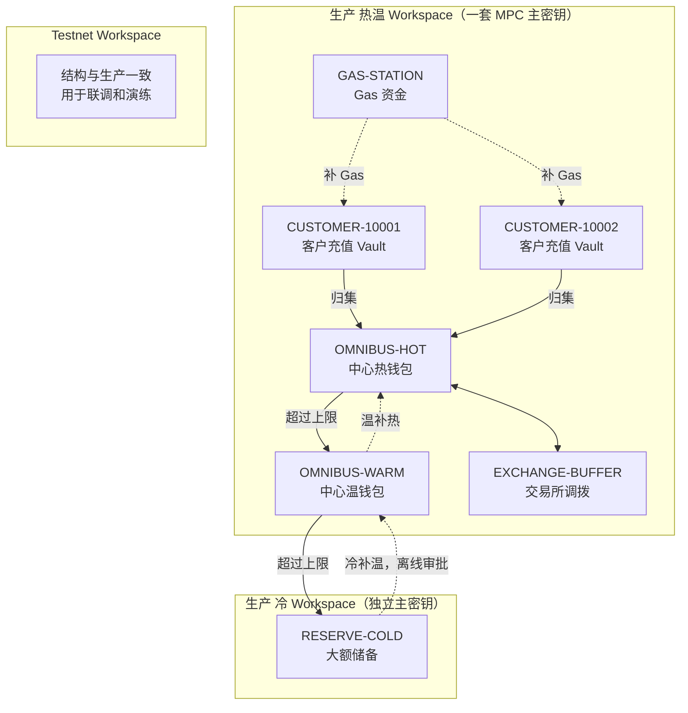

| Vault | 用途 | 谁能动它 |
|---|---|---|
| CUSTOMER-xxx | 每个客户一个，**只负责收充值、识别归属** | 只能转到 OMNIBUS-HOT（归集），由程序自动签名 |
| OMNIBUS-HOT | 统一处理提现、接收归集 | 小额自动签名，大额需要审批 |
| OMNIBUS-WARM | 给热钱包补充资金，处理大额提现 | 手机人工审批 |
| RESERVE-COLD | 大额储备，放在独立 Workspace | 离线设备，扫码审批 |
| GAS-STATION | 补 EVM 手续费 | Gas Station 自动处理 |
| EXCHANGE-BUFFER | 和交易所之间调拨流动性 | 按调拨限额控制 |

**为什么这样拆**

| 原则 | 说明 |
|---|---|
| **按"爆炸半径"拆 Workspace** | 一个 Workspace 共用一套主密钥，所以热和冷必须分开，生产和测试必须分开 |
| **按用途拆 Vault** | 客户、中心、Gas、交易所各自独立，Policy 才能精确控制"谁能转给谁" |
| **不按链拆** | 一个 Vault 里可以按需开多条链的钱包；按链拆只会让 Policy、Co-Signer、灾备配置成倍增加 |
| **多链地址按需创建** | 客户第一次申请某条链的地址时，才创建对应的 Asset Wallet |

### 2.2 一个客户的多链地址

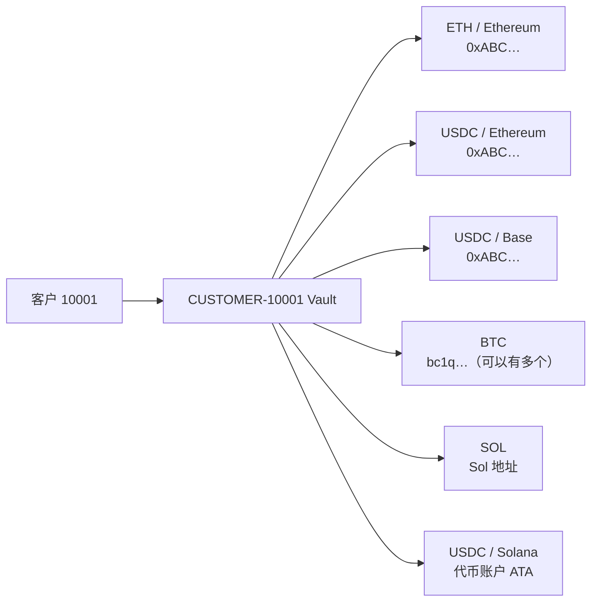

| 要点 | 说明 |
|---|---|
| EVM 各链共用一个地址 | 地址相同，但每条链、每个代币的余额**各自独立**；识别充值时必须同时区分"网络 + 资产 + 合约地址" |
| BTC 可以有多个地址 | 一个 BTC 钱包下可以生成多个充值地址，UTXO 都归属这个客户 |
| Solana 代币用 ATA | SOL 用基础地址，SPL 代币用各自的代币账户 |
| 地址映射的唯一键 | `环境 + Workspace + Vault + 链 + 资产 + 地址 + memo`，**不能只用地址** |
| 只认白名单资产 | 地址上收到不在白名单里的代币（比如垃圾空投）一律不入账 |

### 2.3 资金分层

| 层级 | 存放位置 | 用途 | 控制方式 | 规模怎么定 |
|---|---|---|---|---|
| 热 | OMNIBUS-HOT | 日常提现、接收归集 | Policy + Co-Signer 自动签名 | 按 1~2 天提现量**动态计算** |
| 温 | OMNIBUS-WARM | 补充热钱包、大额提现 | 手机人工审批 | 按补充周期计算 |
| 冷 | RESERVE-COLD | 大额储备 | 离线审批 | 剩余资产 |
| 交易 | 交易所账户 | 交易、兑换、流动性 | Fireblocks 调拨 + 交易所自身的安全设置 | 按交易需要 |

> 进了交易所的资产仍然由交易所托管，Fireblocks 消除不了交易所本身的风险。所以交易所**只放流动性需要的部分**，这正是引入 Fireblocks 的初衷："不把鸡蛋放在一个篮子里"。

---

## 3. 角色与审批规划

### 3.1 两层审批

TaaS 审批和 Fireblocks Policy 是**两道独立的关卡，不能互相替代**：

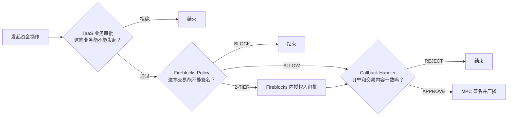

| 关卡 | 由谁执行 | 看的是什么 | 例子 |
|---|---|---|---|
| ① TaaS 业务审批 | 自建（TaaS） | 业务是否合理：客户、额度、用途 | "这个客户今天提现 50 万，要风控和财务审批" |
| ② Fireblocks Policy | Fireblocks | 资金安全底线：来源、目标、资产、金额 | "客户 Vault 只能转到 OMNIBUS-HOT" |
| ③ Callback Handler | 自建 | 交易内容是否和订单完全一致 | "这笔交易的金额和地址，与提现单 W123 一致吗？余额冻结了吗？" |
| ④ MPC 签名 | Fireblocks + Co-Signer | 密码学上的签名 | 公司分片和 Fireblocks 分片协同签名 |

> **为什么要两层**：即使业务系统被攻破、伪造了一个"审批通过"的订单，攻击者仍然绕不过 Fireblocks Policy 和 MPC 签名；反过来，即使 Policy 配置有疏漏，业务审批和 Callback 也能拦住。

### 3.2 角色分离

| 角色 | 所属 | 职责 | 不能做的事 |
|---|---|---|---|
| 提现发起人（API User） | Fireblocks | 创建客户提现交易 | 修改 Policy |
| 归集发起人（API User） | Fireblocks | 创建"客户 Vault → 中心 Vault"的交易 | 向外部地址提现 |
| 调拨发起人（API User） | Fireblocks | 创建 Vault 和交易所之间的调拨 | 客户提现 |
| 签名人（与 Co-Signer 配对） | Fireblocks | 参与 MPC 签名 | 发起任何交易 |
| 风控审批人 | TaaS + Fireblocks | 审批高风险、大额交易 | 管理密钥 |
| 财务审批人 | TaaS + Fireblocks | 审批调拨、大额提现 | 运维签名组件 |
| Workspace 管理员 | Fireblocks | 管理用户和 Policy（改动需要多名管理员共同批准，即 Admin Quorum） | 日常业务操作 |

**核心原则**：发起权、审批权、签名权、改规则权、运维权，**五权分离**。

### 3.3 Policy 规则规划

规则**按顺序匹配**：最严格的放前面，最后一条兜底拒绝。

| 顺序 | 条件 | 动作 |
|---:|---|---|
| 1 | 核心托管 Vault 调用任意智能合约 | BLOCK |
| 2 | 转到未登记的一次性地址（One-Time Address） | BLOCK |
| 3 | 24 小时累计转出超过平台限额 | BLOCK |
| 4 | 客户 Vault 转到中心热钱包以外的任何地方 | BLOCK |
| 5 | 客户 Vault → OMNIBUS-HOT（归集） | ALLOW，由归集签名人自动签名 |
| 6 | 客户大额提现 | 2-TIER，风控和财务审批 |
| 7 | 客户小额提现到白名单地址 | ALLOW，由提现签名人自动签名 |
| 8 | 向交易所大额调拨 | 2-TIER，财务审批 |
| 9 | 向白名单交易所小额调拨 | ALLOW |
| 10 | 以上都没覆盖到的交易 | **BLOCK（兜底）** |

---

## 4. 核心业务流程

### 4.1 客户开户与分配充值地址

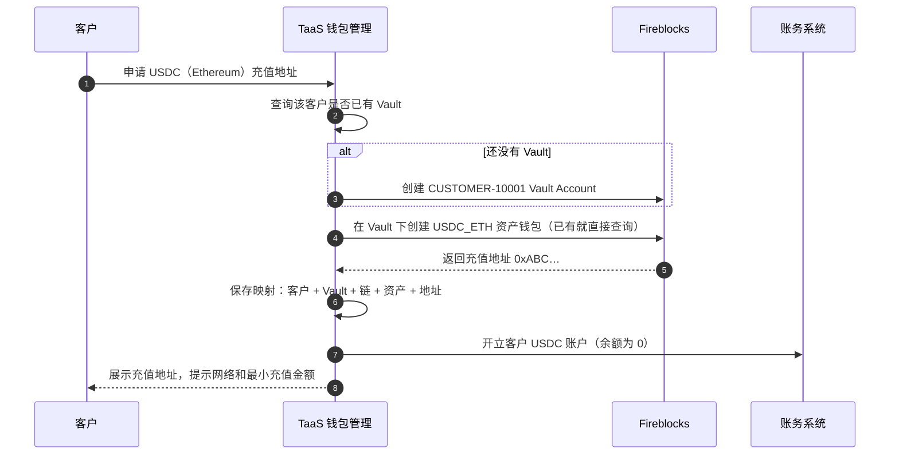

| 关键点 | 说明 |
|---|---|
| 按需创建 | 客户注册时不必一次开全所有链，用到哪条链才开哪条 |
| 地址映射由我们保存 | Fireblocks 只知道 Vault，不知道客户是谁 |
| 提示网络 | EVM 多链共用一个地址，必须明确告诉客户用哪个网络，避免转错链 |

### 4.2 充值入账

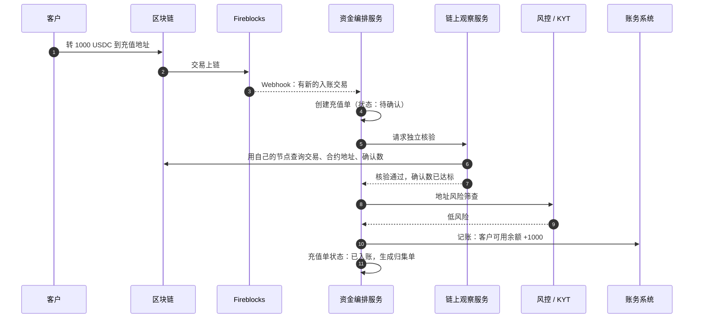

| 关键点 | 说明 |
|---|---|
| **Webhook 只是通知** | 可能重复、乱序、丢失，不能直接据此记账 |
| **独立核验** | 用自己的节点核对交易是否存在、合约地址是否在白名单、确认数是否达标 |
| 风险资金 | 高风险充值冻结，转人工处理，**不进入归集** |
| 幂等 | 同一笔链上交易（链 + 交易哈希 + 日志序号）只能生成一张充值单 |

### 4.3 归集（核心流程）

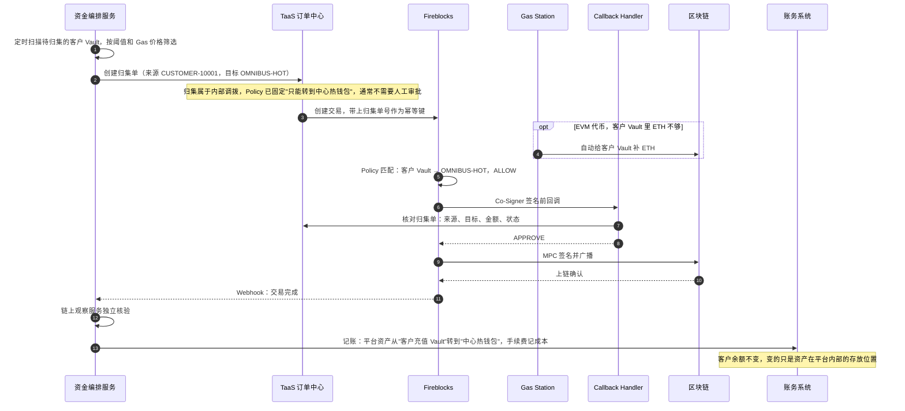

**各链归集在 Fireblocks 下的差异**

| 链 | Fireblocks 负责 | 我们仍需决定 |
|---|---|---|
| BTC | UTXO 选择、找零、签名、广播 | 什么时候归集（避开高费率时段）、小额 UTXO 要不要归集 |
| ETH | nonce、Gas、签名、广播 | 归集阈值（金额要远大于手续费） |
| ERC-20 | Gas Station 自动补 ETH，nonce 管理 | Gas 补充阈值、Gas 价格异常时暂停、多笔充值合并后再归集 |
| SOL / SPL | 交易构造、代币账户处理 | 归集阈值，Token-2022 扩展的兼容性评估 |

**和一期对比**：一期需要自己实现补 Gas 的两步时序、nonce 行锁分配、UTXO 锁；二期这些交给了 Fireblocks，**我们的重心变成"策略"：什么时候归集、值不值得归集**。

### 4.4 提现

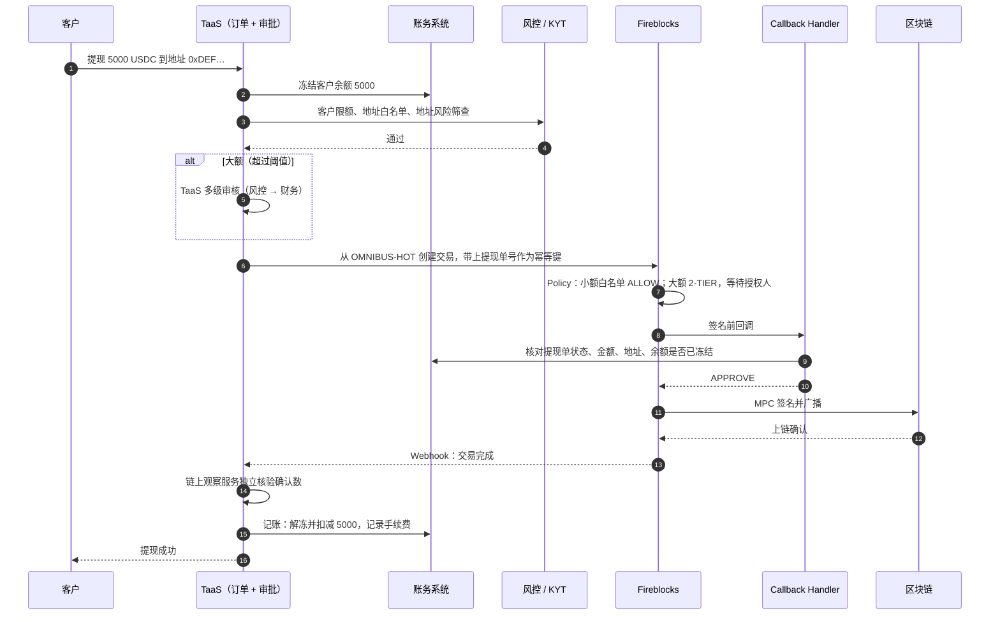

| 关键点 | 说明 |
|---|---|
| **先冻结，后发起** | 余额冻结之后才能创建 Fireblocks 交易 |
| **幂等键** | 用提现单号作为 Fireblocks 的 `externalTxId`，网络重试也不会重复出款 |
| **失败要解冻** | Policy 拒绝、Callback 拒绝、交易失败时，按订单状态解冻余额 |
| **热钱包余额不足** | 触发"温补热"，提现单进入排队，而不是直接失败 |

### 4.5 热、温、冷调拨（水位管理）

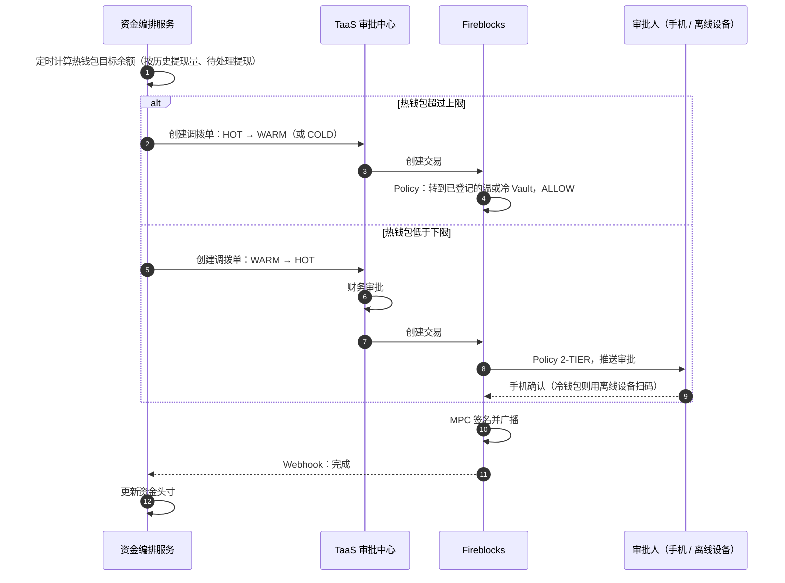

| 方向 | 审批强度 | 原因 |
|---|---|---|
| 热 → 温 → 冷（资金往安全处走） | 低，可以自动 | 资金越来越安全 |
| 冷 → 温 → 热（资金往风险处走） | 高，人工 + 离线 | 一旦被滥用，损失巨大 |

### 4.6 交易所流动性补充与撤回

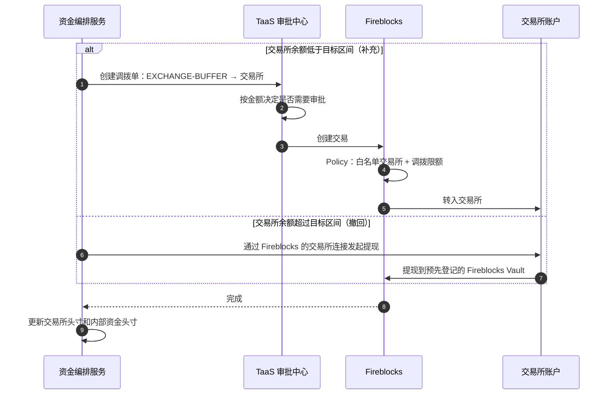

> 注意：直接在交易所后台发起的操作会**绕过 Fireblocks 的工作流**，所以交易所自身也要配置提现白名单、API 权限和多人审批。

### 4.7 三方对账

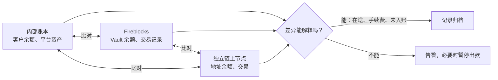

| 对账项 | 说明 |
|---|---|
| 链上已到账，但没给客户入账 | 漏单，可能是 Webhook 丢了 |
| 客户已入账，但归集长期失败 | 资金卡在客户 Vault |
| Fireblocks 余额和独立节点不一致 | 数据源异常，需要排查 |
| 订单长期停在中间状态 | 卡单 |
| 出现不认识的出账交易 | **可能是安全事件，立即告警** |
| 交易所提现和 Vault 入账对不上 | 调拨异常 |

---

## 5. 订单状态流转

所有资金订单（充值、归集、提现、调拨）都有**内部状态**；Fireblocks 交易有自己的状态，**两套状态要做映射，最终以内部状态为准**。

### 5.1 提现单状态

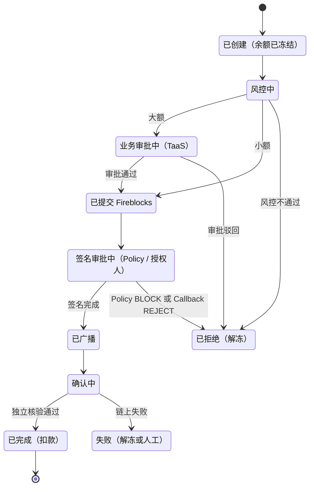

### 5.2 内部状态与 Fireblocks 状态的对应

| 内部状态 | Fireblocks 交易状态（示意，以官方文档为准） | 资金处理 |
|---|---|---|
| 已提交 Fireblocks | SUBMITTED | 保持冻结 |
| 签名审批中 | PENDING_AUTHORIZATION / PENDING_SIGNATURE | 保持冻结 |
| 已广播 | BROADCASTING | 保持冻结 |
| 确认中 | CONFIRMING | 保持冻结 |
| 已完成 | COMPLETED **且独立核验通过** | 扣减冻结金额 |
| 已拒绝 | REJECTED / BLOCKED / CANCELLED | 解冻 |
| 失败 | FAILED | 先确认链上确实没有成功，再解冻；拿不准就转人工 |

> **核心原则**：Fireblocks 显示 COMPLETED 不等于业务完成，必须经过独立链上核验；Fireblocks 显示 FAILED 也不等于可以解冻，要先确认链上确实没有成功。

---

## 6. 异常场景处理

| 场景 | 处理方式 |
|---|---|
| Webhook 重复或乱序 | 按 Fireblocks 交易 ID 和状态做幂等处理；状态只能向前推进 |
| Webhook 丢失 | 定时主动查询未完成订单的交易状态，加上对账兜底 |
| 网络超时，不知道交易创建成功没有 | 带同一个幂等键（订单号）重试，Fireblocks 会返回原来那笔交易 |
| Policy BLOCK | 订单转为"已拒绝"，解冻余额并通知运营；检查是规则需要调整，还是确实有异常 |
| Callback REJECT | 说明交易内容和订单不一致，**按安全事件排查**（可能有人伪造交易） |
| Callback 服务故障 | 默认拒绝（Fail Closed），宁可暂停签名，也不能放行 |
| 补 Gas 失败或 Gas 价格暴涨 | 暂停小额归集，大额归集等待 |
| 热钱包余额不足 | 提现单排队，触发温补热 |
| Co-Signer 故障 | 切换到备用 Co-Signer；必要时走手机人工签名 |
| Fireblocks 整体不可用 | 启动灾备流程：用灾备恢复材料在隔离环境恢复私钥（需要事先演练过） |
| 链上回滚 | 由链上观察服务发现，按一期的冲正机制处理 |

---

## 7. 职责边界总结

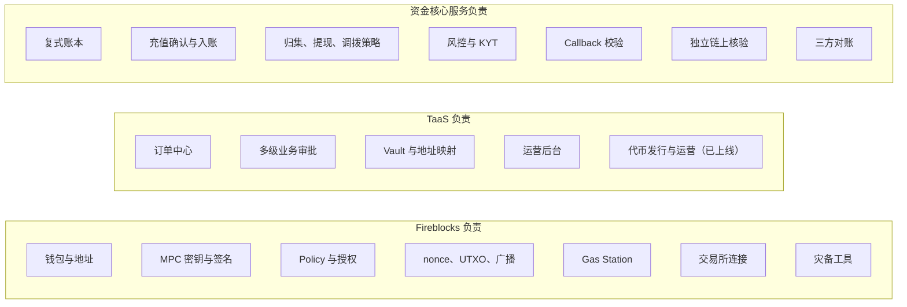

**三条底线**

1. **内部账本是客户余额的唯一真相**：Fireblocks、交易所、区块链的数据只用来核验和对账。
2. **每一笔动钱的操作都要经过两层审批**：业务审批（TaaS）和交易授权（Policy + Callback）。
3. **所有外部数据都要独立核验**：Webhook 是通知，不是记账依据。

---

## 8. 面试时怎么讲

> 项目一期我自建了 HD 钱包，自己处理 nonce、UTXO、补 Gas、广播、回滚，把托管钱包的底层原理吃透了。
>
> 二期结合公司实际在用的 Fireblocks 做了规划：底层的钱包、签名、nonce、补 Gas 交给 Fireblocks；业务层基于公司的 TaaS 平台，复用它的订单和多级审批。
>
> 系统设计上我坚持三点：内部账本是唯一真相；业务审批和 Fireblocks Policy 两层控制，再加上 Callback Handler 在签名前做最后核对；Webhook 只当通知，必须用独立节点核验，再做三方对账。
>
> 资金结构上按爆炸半径拆 Workspace（热温一个、冷一个），按用途拆 Vault（客户充值、中心热钱包、Gas、交易所），每个客户一个充值 Vault，归集到中心热钱包，再按水位逐级转温、转冷。
