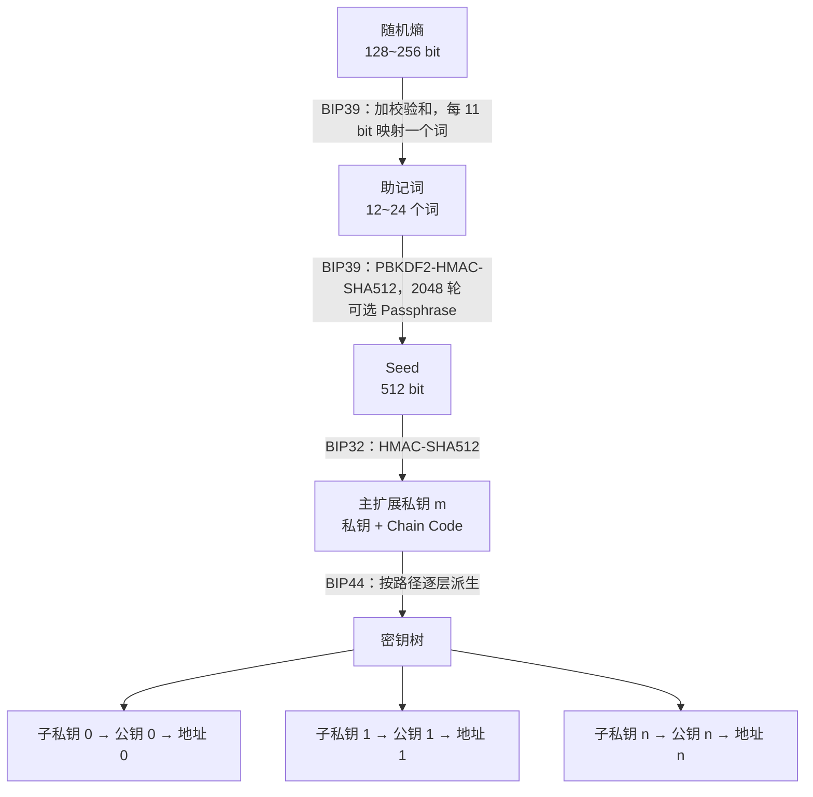
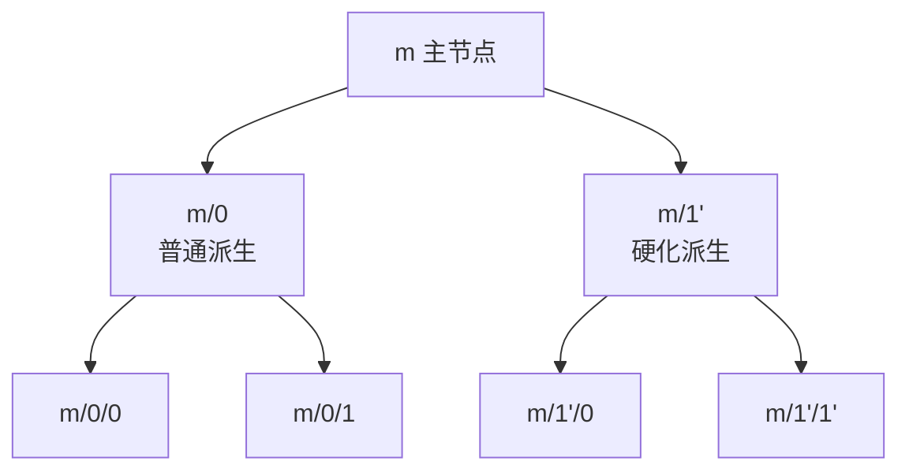
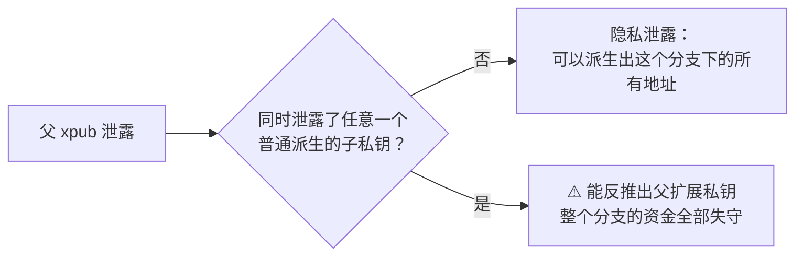
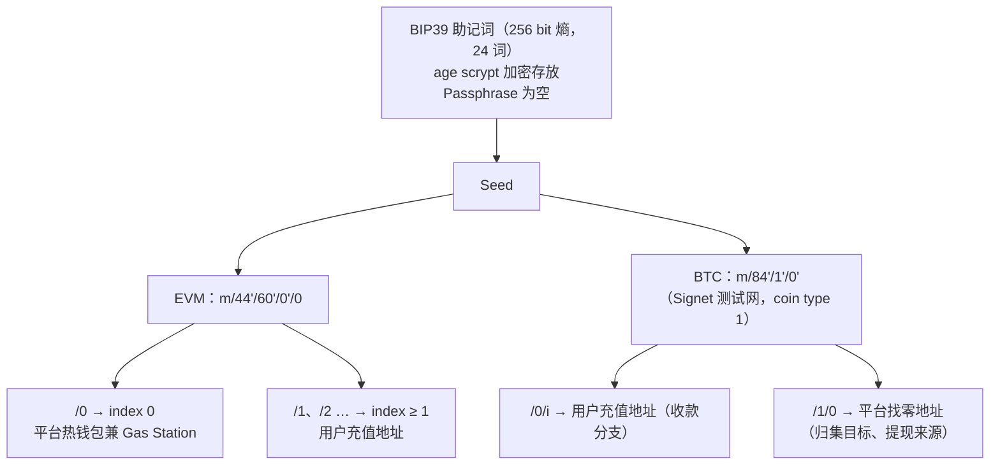
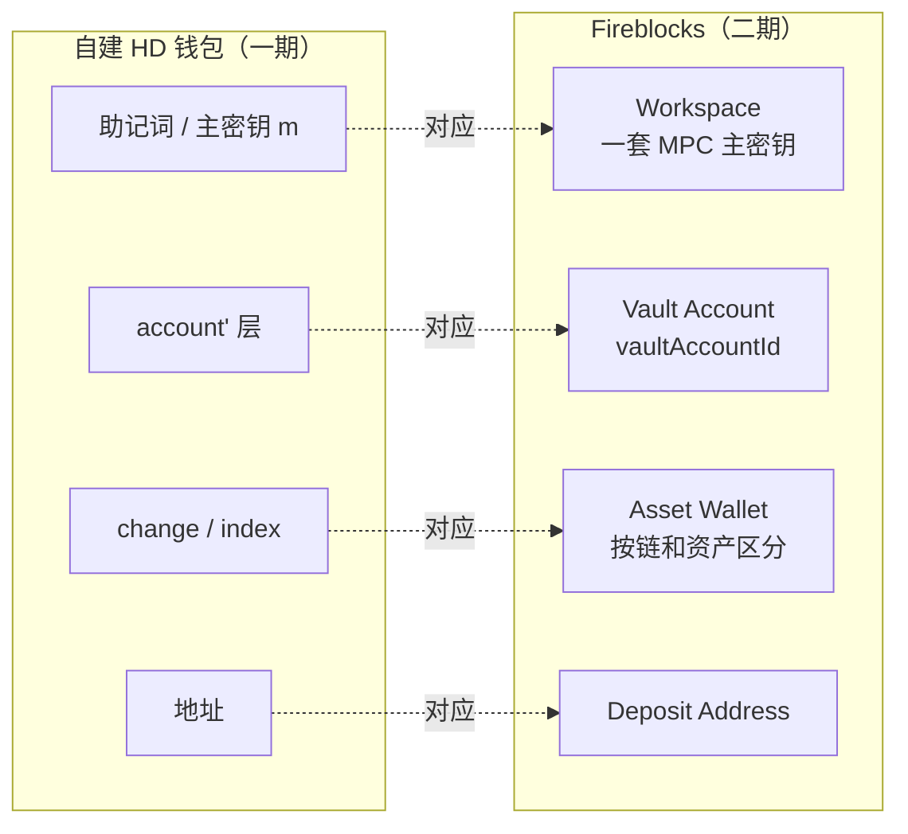
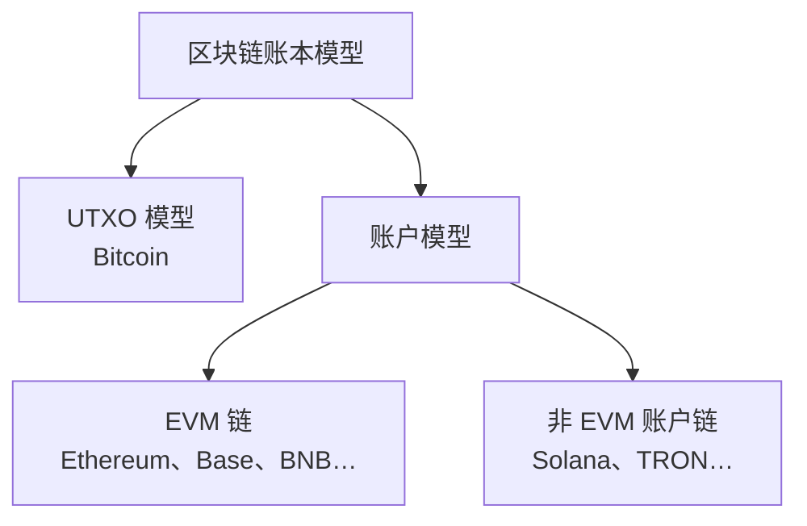

# HD 钱包原理与托管实践

> 基于《HD钱包技术原理与安全说明》优化：**以图表为主**，并结合本项目的实际实现和 Fireblocks。
> 相关文档：[Fireblocks资金归集平台规划.md](./Fireblocks资金归集平台规划.md)（二期规划）、[归集重点问题深度解析.md](./归集重点问题深度解析.md)（专题七：签名与私钥安全）。

---

## 0. 一图看懂



**核心结论**

| # | 结论 |
|---|---|
| 1 | 一份根秘密，可以确定性地派生出无数个私钥和地址 |
| 2 | 子私钥**没有**自己的助记词；恢复根助记词，就能重新派生出所有子账户 |
| 3 | BIP39 管"根秘密怎么生成和备份"，BIP32 管"怎么长成一棵树"，BIP44 管"树的每一层是什么含义" |
| 4 | 钱包里的"创建钱包"是生成新的根秘密，"添加账户"只是换一条派生路径 |
| 5 | 不存在一个能在链上控制其他账户的"主账户" |
| 6 | 账户模型（链怎么记账）和 HD 派生（钱包怎么生成密钥）是两回事 |
| 7 | 正常的 12 词助记词有 128 bit 熵，现实中不可能穷举 |
| 8 | **真正的风险是随机数不够随机**，而不是单词不够多 |
| 9 | 量子风险分两类：Grover 搜索助记词、Shor 破解公钥，后者更直接 |

---

## 1. 三个标准的分工


| 标准 | 输入 | 输出 | 不负责 |
|---|---|---|---|
| BIP39 | 随机熵、可选 Passphrase | 助记词、512 bit Seed | 路径和地址格式 |
| BIP32 | Seed | 主扩展密钥、子扩展密钥 | 每一层代表哪种币、哪个账户 |
| BIP44 | BIP32 密钥树 | 多币种、多账户、收款 / 找零的路径约定 | 生成助记词、底层派生算法 |

---

## 2. BIP39：助记词与 Seed

### 2.1 单词数与熵

| 助记词 | 原始熵 | 校验和 | 总长度 | 有效组合数 |
|---|---:|---:|---:|---:|
| 12 词 | 128 bit | 4 bit | 132 bit | 2¹²⁸ |
| 15 词 | 160 bit | 5 bit | 165 bit | 2¹⁶⁰ |
| 18 词 | 192 bit | 6 bit | 198 bit | 2¹⁹² |
| 21 词 | 224 bit | 7 bit | 231 bit | 2²²⁴ |
| 24 词 | 256 bit | 8 bit | 264 bit | 2²⁵⁶ |

> 12 词的有效组合不是 2048¹² = 2¹³²，因为最后 4 bit 是校验和，所以有效组合只有 2¹²⁸。

### 2.2 从助记词到 Seed

| 参数 | 值 |
|---|---|
| 算法 | PBKDF2-HMAC-SHA512 |
| password | 助记词（UTF-8 NFKD 规范化） |
| salt | `"mnemonic"` + Passphrase |
| 轮数 | 2048 |
| 输出 | 512 bit Seed |

### 2.3 Passphrase：能做什么、不能做什么

| ✅ 能做到 | ❌ 做不到 / 有代价 |
|---|---|
| 助记词泄露后，攻击者还得再猜 Passphrase | 人自己想的短语，实际熵远低于看上去的长度 |
| 不同的 Passphrase 对应完全不同的钱包 | **输错不会报错**，只会进入另一个空钱包 |
| 高熵的 Passphrase 显著提高破解成本 | 丢了就无法恢复，企业场景下"丢失风险"往往比"被破解风险"更现实 |
| | 助记词和 Passphrase 一起泄露时，没有任何额外保护 |
| | 挡不住量子计算机用 Shor 算法攻击已公开的公钥 |

---

## 3. BIP32：密钥树

### 3.1 树的结构



- 每个节点包含：私钥（或公钥）+ 256 bit Chain Code + 深度、父指纹、索引等元数据。
- 路径里的 `'` 表示**硬化派生**，也可以写成 `h` 或 `H`。

### 3.2 普通派生 vs 硬化派生

| 能力 | 普通派生 | 硬化派生 |
|---|---|---|
| 父私钥 → 子私钥 | ✅ | ✅ |
| 父公钥（xpub）→ 子公钥 | ✅ | ❌ |
| 适合"只读"地址生成服务 | ✅ | ❌ 跨不过硬化层 |
| xpub + 任一子私钥泄露 → 反推父私钥 | ⚠️ **会** | 不受影响 |

### 3.3 xpub 的风险（面试高频）



| 结论 | 实践 |
|---|---|
| xpub 不能直接签名，但**不是公开信息** | 当作敏感数据管理，做访问控制和审计 |
| xpub 泄露会暴露整个分支的地址 | 客户地址全集和交易关联都会被看到 |
| xpub + 普通子私钥 = 父私钥 | 账户层用硬化派生；签名服务和观察服务隔离 |

---

## 4. 派生路径

### 4.1 BIP44 路径的五层

```text
m / purpose' / coin_type' / account' / change / address_index
```

| 层 | 含义 | 是否硬化 | 示例 |
|---|---|---|---|
| purpose' | 路径方案 | 硬化 | 44'、49'、84'、86' |
| coin_type' | 币种或网络 | 硬化 | BTC 主网 0'，测试网 1'，ETH 60'，SOL 501' |
| account' | 逻辑账户 | 硬化 | 0'、1'、2' |
| change | 0 = 收款，1 = 找零 | 普通 | 0 / 1 |
| address_index | 地址序号 | 普通 | 0、1、2… |

### 4.2 各链常用路径

| 链 / 地址类型 | 路径 | 曲线 | 派生算法 |
|---|---|---|---|
| BTC 老式（P2PKH） | `m/44'/0'/a'/c/i` | secp256k1 | BIP32 |
| BTC 嵌套 SegWit | `m/49'/0'/a'/c/i` | secp256k1 | BIP32 |
| BTC 原生 SegWit（bc1q） | `m/84'/0'/a'/c/i` | secp256k1 | BIP32 |
| BTC Taproot（bc1p） | `m/86'/0'/a'/c/i` | secp256k1 | BIP32 |
| EVM | `m/44'/60'/0'/0/i` | secp256k1 | BIP32 |
| Solana | `m/44'/501'/a'/0'` | **Ed25519** | **SLIP-0010（只支持硬化派生）** |

> **同一组助记词，路径不同，地址就不同**。恢复钱包后余额是 0，不一定是助记词错了，也可能是路径、地址类型、Passphrase 或扫描范围不一致。

---

## 5. 本项目的密钥树

### 5.1 实际派生结构



| 项目 | 实现 | 代码位置 |
|---|---|---|
| 生成助记词 | 256 bit 熵 → BIP39 助记词 | `backend/internal/wallet/keyfile.go` |
| 存储 | age scrypt 口令加密成文件，启动时解密 | `keyfile.go`、`secrets/custody-root.age` |
| EVM 派生 | go-ethereum-hdwallet，BIP44 | `backend/internal/wallet/provider.go` |
| BTC 派生 | btcd hdkeychain，账户层 `m/84'/1'/0'` 用硬化派生，预先派生后缓存 | `backend/internal/wallet/bitcoin.go` |
| 签名 | 进程内派生私钥后签名（BTC 使用 BIP143，EVM 使用 EIP-155） | 同上 |

### 5.2 对照企业级建议，项目还差什么

| 建议 | 本项目现状 | 差距与改进 |
|---|---|---|
| 按爆炸半径拆根密钥 | EVM、BTC、热钱包、用户地址**共用一份助记词** | 热钱包和用户充值地址至少拆成两份根秘密 |
| 生产和测试隔离 | 只有测试网 | 生产环境必须使用独立的根秘密 |
| 业务服务只拿 xpub | 业务进程持有完整助记词 | 地址生成只用 xpub，签名放到独立服务 |
| 硬化账户层 | ✅ BTC 账户层是硬化派生 | 保持 |
| 派生路径注册表 | 路径写在代码常量里 | 统一登记：链、曲线、路径模板、索引分配规则 |
| 测试向量回归 | — | 用标准测试向量验证"Seed → 路径 → 地址"，升级钱包库后回归 |
| 恢复演练 | — | 在隔离环境用助记词恢复，比对地址并做小额转账验证 |

---

## 6. 与 Fireblocks 的对应



| 对比项 | 自建 HD | Fireblocks |
|---|---|---|
| 根秘密 | 一组助记词，可以抄写 | MPC 分片，**不提供可抄写的助记词** |
| 隔离边界 | 根秘密 | Workspace（每个 Workspace 一套主密钥） |
| Vault 之间是否隔离 | — | 共用主密钥，**不是密钥级隔离**；要真正隔离就拆 Workspace |
| 恢复方式 | 助记词 + 路径 + Passphrase | 灾备恢复包（Disaster Recovery Kit）+ 解密密钥 + 官方恢复流程 |

**几种技术各自解决什么问题**

| 技术 | 解决的问题 |
|---|---|
| HD / BIP32 | 从一份根秘密确定性地派生出大量密钥和地址 |
| HSM | 在专用硬件里生成、保存和使用密钥，私钥不可导出 |
| MPC | 把签名能力拆给多方，签名时不重建完整私钥 |
| Fireblocks Policy / 审批 | 控制谁能对什么资产发起什么操作 |

---

## 7. 钱包产品里的概念

| 用户看到的 | 底层实际发生的 |
|---|---|
| 创建新钱包 | 生成**新的根秘密**，和原来的钱包没有派生关系 |
| 添加账户 | 在**同一个根秘密**下换一条路径（改 account' 或 address_index） |
| Account 1 / 主账户 | 只是索引 0，不能控制其他账户 |
| 同一地址出现在 Ethereum、Base、Arbitrum 上 | 同一个私钥在各个 EVM 链上地址相同，但**余额和 nonce 各自独立** |

"主账户"一词在不同语境下的含义：

| 语境 | 含义 |
|---|---|
| BIP32 主节点 `m` | 密钥树的根，不是链上账户 |
| BIP44 的 `account'` 层 | 密钥树里的逻辑分组 |
| 钱包界面的 Account 1 | 默认显示的第一个派生账户 |

---

## 8. 账户模型和 HD 派生是两个维度



| 维度 | 描述的是 | 例子 |
|---|---|---|
| 账本模型 | 链上资产怎么记录 | UTXO / 账户 |
| HD 派生 | 钱包怎么生成密钥 | BIP32 secp256k1 / SLIP-0010 Ed25519 |

> **EVM 链只是账户模型链的一部分**。Solana 是账户模型，但不是 EVM；它也用助记词，但派生算法是 SLIP-0010，不是完整的 BIP32。

---

## 9. 安全性分析

### 9.1 为什么正常的助记词无法被穷举

| 项目 | 数值 |
|---|---|
| 12 词有效组合 | 2¹²⁸ ≈ 3.4 × 10³⁸ |
| 随机猜中指定钱包的概率 | 1 / 2¹²⁸ |
| 假设每秒测试 10¹⁸ 组（不现实的高速） | 平均需要约 **5.4 × 10¹² 年** |
| 实际每次测试的开销 | 还要跑 PBKDF2、BIP32 派生、曲线运算、地址生成 |

| 容易混淆的概念 | 正确理解 |
|---|---|
| 生日碰撞让 12 词只剩 64 bit 安全 | 生日碰撞是"在一大堆钱包里找任意两个相同的"；盗取**指定**钱包是原像搜索，仍然接近 2¹²⁸ |
| 派生出的子私钥都有 256 bit 安全 | 整棵树由 128 bit 根熵决定，安全上限是 128 bit（但这已经足够） |

### 9.2 真正的风险：随机数不够随机


- 24 个格式正确的单词，**不代表**真的有 256 bit 熵；安全性取决于**生成过程**。
- 攻击者可以边生成、边派生、边比对，不需要预先存储所有候选。

**案例：COLDCARD 熵事件**（据原研究文档记录，来源为 Coinkite 2026-07-30 发布的技术说明）

| 项目 | 内容 |
|---|---|
| 原因 | 固件集成时符号解析出错，生成 Seed 时调用了 MicroPython 的通用 PRNG，而不是硬件真随机数生成器 |
| 影响 | 部分 Mk2/Mk3 固件的有效搜索空间约 40 bit；Mk4/Q/Mk5 因为混入了安全芯片的熵，约 72 bit |
| 结论 | 不是 2¹²⁸ 的 BIP39 空间被攻破，而是**实现缺陷让真实空间远小于设计值** |
| 修复 | 升级固件只能修复以后生成的 Seed；旧 Seed 必须生成新的根秘密，并把资产迁移到链上的新地址 |

（具体受影响的型号和版本以厂商最新公告为准。）

### 9.3 量子计算风险

| 攻击 | 目标 | 原理 | 影响 |
|---|---|---|---|
| **Grover** | 搜索助记词 | 无结构搜索，查询次数从 2ⁿ 降到约 2ⁿ/² | 12 词：2¹²⁸ → 约 2⁶⁴；24 词：2²⁵⁶ → 约 2¹²⁸ |
| **Shor** | 从公钥求私钥 | 解椭圆曲线离散对数 | **不需要助记词**，拿到一个有资产地址的公钥就够了 |

各链的公钥暴露情况：

| 链 / 地址类型 | 公钥什么时候暴露 |
|---|---|
| BTC P2PKH / P2WPKH | 花费前只显示公钥哈希；**花费过或地址复用后**公钥暴露 |
| BTC Taproot | 输出里直接包含公钥，长期暴露 |
| EVM | 地址是公钥哈希，但**发出过交易**就能从签名里恢复公钥 |
| Solana | 地址本身就是公钥 |

> 24 词能增加对 Grover 的安全余量，但**挡不住 Shor**。长期的解决办法是链协议迁移到后量子签名算法；多签如果用的还是同一类椭圆曲线，也不抗量子。

---

## 10. 企业托管的建议清单

| 方面 | 建议 |
|---|---|
| **随机数** | 用经过评估的 CSPRNG、HSM 或 MPC 生成密钥；熵源失败时直接报错（Fail Closed），不能悄悄降级 |
| | 检查构建产物里实际调用的是哪个随机数函数，不能只看源码 |
| | Seed 不能出现在日志、监控、数据库明文、内存转储里 |
| **密钥隔离** | 按爆炸半径拆根密钥：生产 / 测试、客户资产 / 公司资产、热 / 冷、DeFi / 核心托管 |
| | 子地址再多也不是安全隔离，真正的隔离靠独立根密钥、独立 MPC 密钥组或独立 HSM 域 |
| **路径治理** | 建立注册表：链、曲线、派生算法、路径模板、地址格式、钱包版本 |
| | 明确索引怎么递增，防止不同服务重复使用同一路径 |
| | BTC 地址发现要管理 Gap Limit，不能只扫第一个地址 |
| **xpub 与观察服务** | 地址生成和链上观察只用必要范围的 xpub |
| | 不要让父 xpub 和同分支的普通子私钥同时出现在不可信的系统里 |
| | 观察服务不能具备签名能力 |
| **备份恢复** | 助记词 + Passphrase + 派生路径 + 钱包类型，四样一起才能恢复 |
| | Passphrase 和助记词分开保管，设计多人授权和继任流程 |
| | 备份是否可用，必须通过隔离环境恢复、地址比对、小额转账来验证 |

---

## 11. 常见误区

| ❌ 误区 | ✅ 正确理解 |
|---|---|
| 子私钥也有自己的助记词 | 普通 BIP32 子节点没有（BIP85 是另一套额外协议） |
| 24 个单词看起来很随机，就一定有 256 bit 熵 | 安全性取决于生成时的真实熵 |
| 添加账户 = 创建一个独立的钱包 | 通常只是同一个 Seed 下的新路径 |
| Account 1 是能控制其他账户的主账户 | 它只是索引 0 |
| 账户链就是 EVM 链 | Solana 等非 EVM 链也是账户模型 |
| 用助记词的链都完整使用 BIP32 | Ed25519 链通常用 SLIP-0010，只支持硬化派生 |
| 数学上能枚举，所以 12 词不安全 | 能枚举不等于现实可计算 |
| 生日攻击让 12 词只有 64 bit 安全 | 攻击指定钱包仍然接近 128 bit |
| 用 24 词就能解决量子风险 | 能防 Grover，防不了 Shor |
| 多签天然抗量子 | 用的还是同类曲线，不抗量子 |
| xpub 可以随便公开 | xpub 会暴露全部地址；再加上一个子私钥，还能推出父私钥 |
| Fireblocks 的不同 Vault 是密钥级隔离 | 同一个 Workspace 共用主密钥，要隔离就拆 Workspace |

---

## 12. 面试速答

**Q：BIP39、BIP32、BIP44 分别是什么？**
BIP39 把随机熵变成助记词，再生成 Seed；BIP32 把 Seed 变成一棵可派生的密钥树；BIP44 约定这棵树每一层的含义（用途 / 币种 / 账户 / 收款或找零 / 序号）。

**Q：硬化派生和普通派生有什么区别？为什么账户层要用硬化派生？**
普通派生可以从父公钥派生子公钥，适合只读服务生成地址；但父 xpub 加上任意一个子私钥，就能反推出父私钥。硬化派生切断了这条路径，所以账户层及以上都用硬化派生。

**Q：你的项目怎么管理密钥？有什么不足？**
用 256 bit 熵生成助记词，age 加密存放，启动时解密；EVM 走 BIP44，BTC 走 BIP84，账户层是硬化派生。不足在于所有资产共用一份根秘密，业务进程持有完整助记词，签名也在业务进程里。改进方向是按爆炸半径拆根密钥，业务服务只拿 xpub，签名放进独立服务，再往后用 HSM 或 MPC（Fireblocks）。

**Q：Fireblocks 的 Vault Account 和 HD 钱包是什么关系？**
vaultAccountId 相当于 BIP44 的 account 层，一个 Workspace 共用一套 MPC 主密钥。所以 Vault 之间不是密钥级隔离，热和冷要拆成不同的 Workspace。

**Q：12 词助记词安全吗？**
正常生成的 12 词有 128 bit 熵，经典计算机不可能穷举。真正的风险是随机数生成器有缺陷，比如 COLDCARD 事件中有效空间只剩约 40 bit。量子方面，Grover 会把 128 bit 降到约 64 bit 的查询量，但更直接的威胁是 Shor 从公钥算出私钥。
