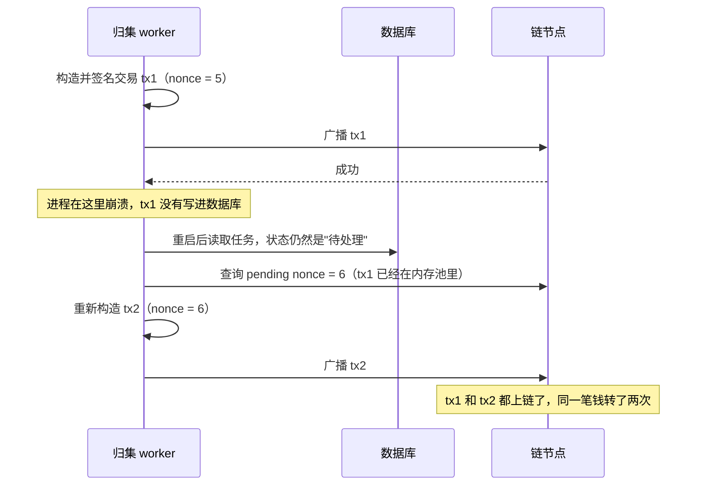
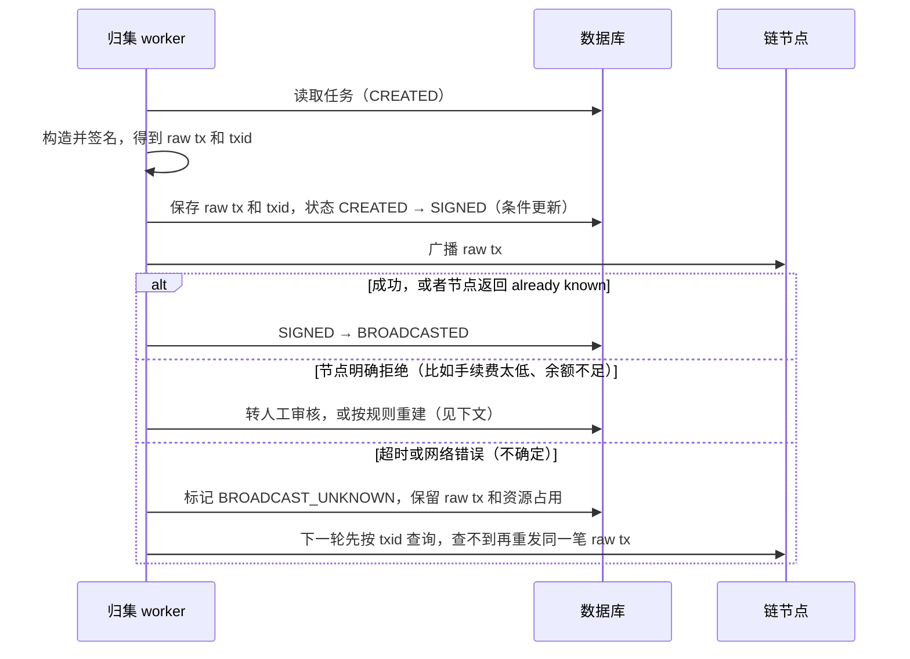
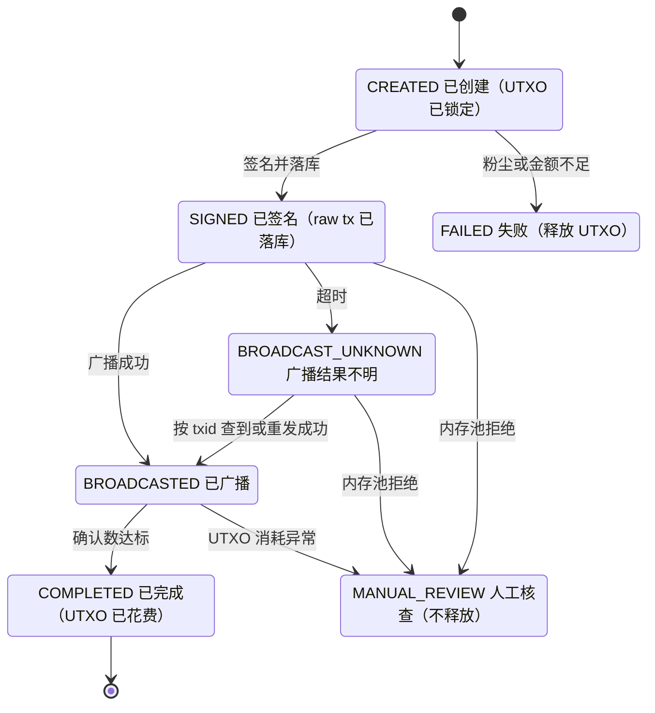
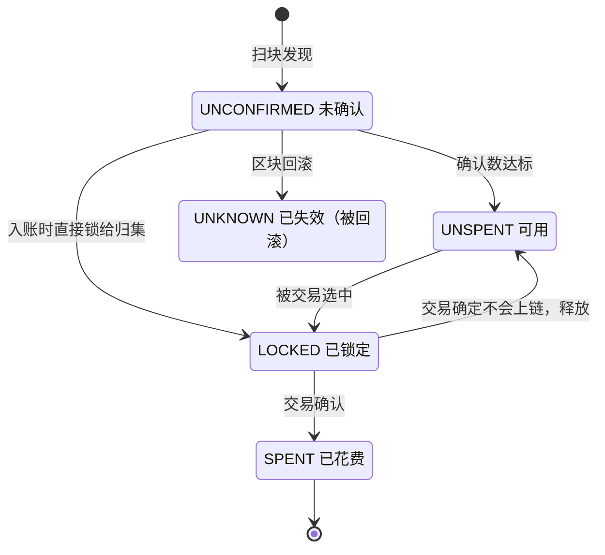
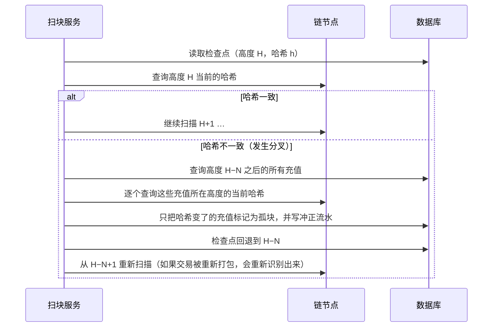
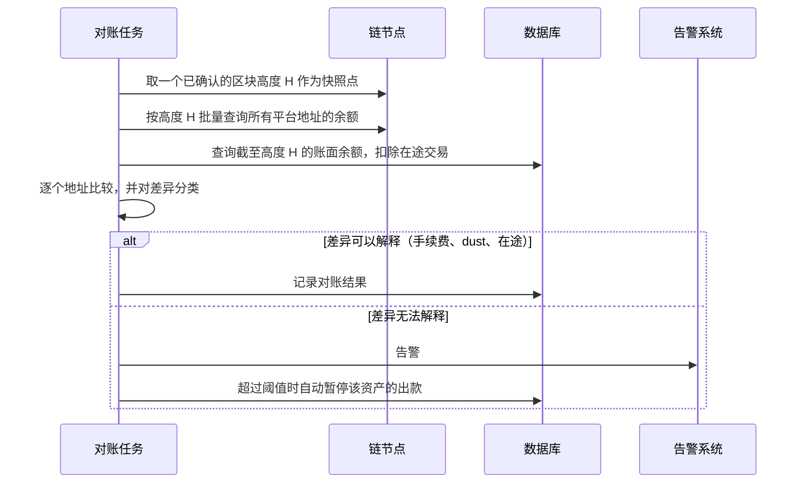

# 资金归集重点问题深度解析（面试笔记）

> 用途：面试复习。流程图见 [asset-sweep-flows.md](./asset-sweep-flows.md)，考前快速过一遍用 [sweep-interview-qa.md](./sweep-interview-qa.md)（44 题问答速记）。
> 结构：第一部分讲怎么介绍项目；**第二部分是 7 个重点专题的深度分析（核心）**；第三部分是链特性速答。
> 「本项目」相关内容均对照代码核实过，路径相对 `backend/`。

## 目录

- 第一部分 项目怎么讲
- 第二部分 重点专题
  - 专题一 幂等：先落库后广播，以及广播结果不确定
  - 专题二 状态机与多 worker 并发
  - 专题三 ETH nonce 并发管理
  - 专题四 BTC UTXO 锁
  - 专题五 区块回滚与冲正
  - 专题六 对账
  - 专题七 签名与私钥安全
- 第三部分 链特性速答（BTC / ETH / SOL / 对比 / 场景题 / 易错点 / 术语）

---

# 第一部分 项目怎么讲

## 1.1 一句话介绍（30 秒）

> 用 Go 实现了一个迷你托管钱包，跑在 Sepolia 测试网和 Bitcoin Signet 上，支持 ETH、ERC-20、BTC 三种资产的充值识别、入账、归集和提现。重点处理了**交易幂等、nonce 并发、UTXO 锁、区块回滚冲正**这几类资金安全问题。

## 1.2 技术栈与实现概览

- **技术栈**：Go 1.23 + PostgreSQL 17。没有用消息队列，任务协调靠数据库事务、唯一约束和行锁。
- **链交互**：go-ethereum（EVM）、btcd（BTC）。
- **密钥**：BIP39 助记词，用 age 加密成文件，启动时解密。
  - EVM 地址按 `m/44'/60'/0'/0/i` 派生，index 0 是热钱包兼 Gas Station。
  - BTC 地址按 BIP84 派生：用户地址 `m/84'/1'/0'/0/i`，平台找零地址 `m/84'/1'/0'/1/0`。

| 资产 | 实现方式 |
|---|---|
| ETH | **不归集**（隔离子钱包）：提现直接从用户自己的地址出 |
| ERC-20 | Gas Station 先补 ETH，确认后再把代币转到热钱包；提现统一从热钱包出 |
| BTC | 单输入单输出归集到平台找零地址；提现只花平台 UTXO |

## 1.3 主动说出不足（面试加分）

| 现状 | 生产上怎么改 |
|---|---|
| BTC 每个 UTXO 单独一笔交易，费率是固定配置 | 多输入合并；动态估算费率；设手续费上限；支持 RBF |
| ETH 不归集 | 改为归集到热钱包，统一出款 |
| worker 领取任务没用 `SKIP LOCKED`，只能单实例运行 | 用租约领取任务，按地址分片（见专题二） |
| 没有对账 | 做三层对账（见专题六） |
| 签名和业务在同一个进程 | 拆出独立签名服务，加策略校验，用 HSM / MPC（见专题七） |
| 没有热转冷 | 增加水位管理和多签冷钱包 |

---

# 第二部分 重点专题

> 每个专题都按同一个结构写：**① 问题背景 → ② 事故场景 → ③ 根因 → ④ 方案对比与推荐 → ⑤ 边界情况 → ⑥ 本项目实现与差距 → ⑦ 面试怎么答**

---

## 专题一 幂等：先落库后广播，以及广播结果不确定

### ① 问题背景

一次归集要跨三个系统：**数据库、签名、链节点**。

- 链不可能参与数据库事务，所以没有办法做"签名 + 广播 + 落库"的原子操作。
- 进程崩溃、网络超时可能发生在任意一步之间。
- 链上交易**不可撤回**。一旦重复广播成功，就是真金白银的损失（提现场景就是重复出款）。

### ② 事故场景：先广播后落库



- **ETH**：重新取到的 nonce 不同，两笔交易都能成功。归集场景下第二笔可能因为余额不足失败；**提现场景就是实实在在的重复出款**。
- **BTC**：重新构造时如果费率变了，就会生成一笔花费同一个 UTXO 但 txid 不同的交易。两笔交易冲突，最后上链的是哪一笔不确定，数据库里记的 txid 可能和链上对不上。

### ③ 根因

**"决定"没有在执行之前被持久化**，重启后系统不知道自己已经做过什么，只能重新做一次决定。

关键的认识是：**一笔签好的交易，txid 是确定的，而链本身对同一个 txid 是幂等的**。同一笔交易广播多少次，链上只会执行一次。所以只要签名结果先落库，后面的重试就都是安全的。

### ④ 方案：先落库，后广播 + 三态广播结果

**正确的流程**



**逐个故障点分析：每个位置崩溃后，重启都是安全的**

| 崩溃位置 | 重启后数据库状态 | 处理方式 | 为什么安全 |
|---|---|---|---|
| 签名之前 | CREATED | 重新构造、签名 | 签名结果没人见过 |
| 签名之后、落库之前 | CREATED | 重新签名 | 交易还没广播过 |
| 落库之后、广播之前 | SIGNED | 广播库里的 raw tx | 用的是同一笔交易 |
| 广播之后、标记之前 | SIGNED | 再广播一次，节点返回 already known | 链对同一 txid 幂等 |
| 广播超时 | BROADCAST_UNKNOWN | 先查 txid，查不到就重发原交易 | 同上 |

**广播结果要分成三类，不能只分成功和失败**

| 类别 | BTC 节点返回 | ETH 节点返回 | 处理 |
|---|---|---|---|
| 明确成功 | 成功；`txn-already-in-mempool`；`transaction already in block chain` | 成功；`already known` | 标记已广播 |
| 明确失败 | `min relay fee not met`；脚本或签名错误 | `insufficient funds`；`intrinsic gas too low` | 资源不释放，转人工或按规则重建 |
| 需要核查 | `bad-txns-inputs-missingorspent`（输入已被花掉：可能是自己的交易已经上链，也可能被别人双花了） | `nonce too low`（nonce 已被消费：要确认是不是自己的交易） | 查链上，确认是哪笔交易消费了资源 |
| 不确定 | 超时、连接断开 | 超时、连接断开 | 标记 BROADCAST_UNKNOWN |

**什么情况下可以"重建"交易？** 这是面试的深挖点。

> 重建是否安全，取决于**是否沿用同一个"幂等锚点"**：
> - BTC 的锚点是**同一组 UTXO**。重建时花费同样的输入，链上最多只有一笔能成功，天然防双花。
> - ETH 的锚点是**同一个 nonce**。用同一个 nonce 加价替换，最多只有一笔能上链。
> - SOL 的锚点是**同一个 blockhash 的有效期**。旧交易过期之后才能重建（见第三部分）。
>
> **危险的是换了锚点**：换了一组 UTXO、换了一个新 nonce、在旧 blockhash 过期前就重建，都可能导致重复执行。

### ⑤ 幂等要分层做

| 层次 | 防止什么 | 做法 |
|---|---|---|
| 请求层 | 用户重复提交提现 | `UNIQUE(user_id, idempotency_key)` |
| 任务层 | 同一笔充值生成多个归集任务 | `UNIQUE(deposit_id)`；同一地址同一资产最多一个活跃任务（部分唯一索引） |
| 交易层 | 重复广播 | 先落库后广播，只重发原 raw tx |
| 记账层 | 重复记账 | 流水表 `UNIQUE(entry_type, reference_type, reference_id)` + `ON CONFLICT DO NOTHING` |

**边界情况**
- 加价替换会产生多个 txid，**其中任何一个都可能上链**，所以确认时要查所有候选 txid 的回执。
- "already known" 的报错文本各个节点实现不一样，要多做几种匹配，并且错误链要逐层 unwrap。
- 落库本身也会失败。签名后落库失败，就当没签过，不能继续广播。

### ⑥ 本项目实现

- **先落库**：`SaveBTCSweepSigned` 执行 `UPDATE … SET raw_tx, txid, status='SIGNED' WHERE id=$1 AND status='CREATED'`，影响行数不是 1 就返回状态错误（`internal/store/postgres/bitcoin.go`）。ERC-20 归集、补 Gas、ETH 提现也是同样的模式。
- **BTC 广播三态**（`internal/btc/sweep_worker.go`）：
  1. 先用 `getrawtransaction` 按 txid 查，查到就标记已广播；
  2. 任务还是 SIGNED 时，先跑 `testmempoolaccept` 预检，被拒就转 MANUAL_REVIEW；
  3. 发送失败标记 BROADCAST_UNKNOWN，保留原交易和 UTXO 锁。
- **EVM**：`SendIdempotent` 把 already known 当作成功（`internal/chain/evm/worker_helpers.go`）。遇到 nonce too low，先查所有候选交易的回执；如果 nonce 已被消费，但没有一笔是我们的交易，就转人工（`internal/token/sweep/worker.go` 里的 `handleNonceTooLow` 和 `checkNonceConsumed`）。
- **记账幂等**：`balance_entries` 上有 `UNIQUE(entry_type, reference_type, reference_id)`，写流水时用 `ON CONFLICT DO NOTHING`。
- **差距**：ERC-20 归集没有单独的 BROADCAST_UNKNOWN 状态，靠 `evm_tx_attempts` 记录每次签名的候选哈希，再去重发和查回执。

### ⑦ 面试怎么答（1 分钟版）

> 链不能参与数据库事务，所以我的原则是**先落库后广播**：签名后先把 raw tx 和 txid 写进库，再广播；重试时只重发这一笔原交易，绝不重新构造。因为同一个 txid 在链上只会执行一次，所以重试是安全的。
>
> 广播结果我分成三类：成功、明确失败、不确定。超时属于不确定，标记 BROADCAST_UNKNOWN，下一轮先按 txid 查链上，查不到再重发，**期间不释放 UTXO 或 nonce**。
>
> 另外，幂等是分层做的：请求层用幂等键，任务层用唯一约束，交易层先落库，记账层用流水唯一键。

**追问：为什么不能先广播再落库，然后靠对账来发现问题？**
因为对账是事后发现，重复出款的钱已经转出去了，很难追回。资金安全要**事前防住**，对账只是兜底。

---

## 专题二 状态机与多 worker 并发

### ① 问题背景

归集是一个长流程（几分钟到几小时），中间要经过签名、广播、等待确认，每一步都可能失败或遇到重启。

所以 worker 必须是**无状态、可重入**的：所有进度都记在数据库的状态字段里，任何时候重启都能从断点继续。

### ② 事故场景

- **状态被并发覆盖**：worker A 读到任务是 SIGNED，worker B 也读到 SIGNED。A 把它推进到 BROADCASTED，B 又按旧状态把它写回 BROADCAST_UNKNOWN，状态倒退了。
- **资源释放过早**：交易已经广播，因为"超时"被直接标记成 FAILED，于是 UTXO 被释放、又被别的交易选中。结果原交易上了链，新交易失败，数据库和链上对不上。

### ③ 设计原则

1. **状态表示"已经完成的事实"，而不是"正在做的动作"**。例如 SIGNED 的意思是"raw tx 已经落库"。只有外部步骤本身是异步的（比如 MPC 签名要好几秒），才需要 SIGNING 这类中间状态。
2. **状态转换用条件更新（CAS）**：`UPDATE … SET status = 新状态 WHERE id = ? AND status = 旧状态`，影响行数是 1 才算成功。
3. **资源释放和状态绑定**：只有能确定"交易不会上链"时才能释放资源（未签名，或者已经签了但从未广播）。**签名并广播之后，绝不自动释放资源**，判断不了的就转人工。
4. **终态不可逆**：COMPLETED 和 FAILED 不能再转出去；MANUAL_REVIEW 只能由人工处理后转入终态。
5. **每次转换都留痕**：错误表 / 事件表要记录原因，便于审计和排查。

### ④ 状态机设计（以 BTC 归集为例）



| 状态 | 已经完成的事实 | 占用的资源 | 失败时能否自动释放 |
|---|---|---|---|
| CREATED | 任务已创建，UTXO 已锁定 | UTXO | ✅ 能（交易从没签过） |
| SIGNED | raw tx 已落库 | UTXO | ❌ 不能（交易可能已经流出去了） |
| BROADCAST_UNKNOWN | 至少尝试过一次广播 | UTXO | ❌ 不能 |
| BROADCASTED | 节点已接收 | UTXO | ❌ 不能 |
| COMPLETED | 已确认，UTXO 已花费 | 无 | — |

### ⑤ 多 worker 并发：怎么领取任务

只靠 CAS 能保证**正确性**：并发时只有一个 worker 能推进成功。但是多个实例会重复做无用功（重复签名、重复调用 RPC），还会产生大量冲突报错。要横向扩展，必须解决"谁来处理这个任务"的问题。

| 方案 | 做法 | 优点 | 缺点 |
|---|---|---|---|
| 单实例 + 主备选举 | 用 advisory lock 或 etcd 选出主节点，只有主节点干活 | 最简单 | 吞吐量上不去 |
| **数据库租约领取（推荐）** | `FOR UPDATE SKIP LOCKED` 领取任务，并写入租约 | 不需要额外组件，崩溃后租约到期自动接管 | 数据库压力会大一些 |
| 按地址分片 | `hash(地址) % N` 决定任务归哪个实例 | 同一地址的任务天然串行（对 nonce 友好） | 扩缩容时要重新分配 |
| 消息队列分区 | Kafka 按地址做分区键 | 吞吐量高 | 要多维护一套组件，还要保证消息和数据库一致 |

**推荐写法：领取时只在一个短事务里持锁，写入租约后立刻提交，不要持锁去调用 RPC**

```sql
UPDATE btc_sweeps
SET claimed_by = $1, lease_until = now() + interval '60 seconds'
WHERE id IN (
    SELECT id FROM btc_sweeps
    WHERE status IN ('CREATED', 'SIGNED', 'BROADCAST_UNKNOWN', 'BROADCASTED')
      AND (lease_until IS NULL OR lease_until < now())
    ORDER BY id
    LIMIT 50
    FOR UPDATE SKIP LOCKED
)
RETURNING *;
```

**边界情况**
- **租约过期了，但原来的 worker 还在跑**（比如 GC 停顿太久）：后续每一步状态推进仍然必须用 CAS，租约只是用来减少冲突的，不能代替 CAS。
- **持锁调用 RPC 会拖垮数据库**：RPC 可能卡几十秒，长事务会占住连接、阻塞清理。
- **ETH 同一地址的任务必须串行**（nonce 是顺序的），适合按地址分片，或者在分配 nonce 时用钱包行锁串行化。

### ⑥ 本项目实现与差距

- 状态常量和数据库 CHECK 约束都定义好了；状态推进全部用 `WHERE status = …` 的条件更新。
- `FailBTCSweep` 只允许从 CREATED 失败并释放 UTXO；SIGNED 或 BROADCAST_UNKNOWN 被拒时转 MANUAL_REVIEW，**保留 UTXO 锁**。
- `CompleteBTCSweep` 先锁住任务行，已经 COMPLETED 就直接返回（幂等）。
- **差距**：
  - BTC 定义了 SIGNING 和 CONFIRMING 状态但实际没有使用；
  - worker 用普通的 `SELECT … LIMIT` 领取任务，没有 SKIP LOCKED，也没有租约，**只能单实例部署**。正确性靠 CAS 保证，但多实例会产生冲突。

### ⑦ 面试怎么答

> 状态机我遵循三条原则：
> 1. 状态表示已经完成的事实；
> 2. 每次转换都用 `WHERE status = 旧状态` 做 CAS；
> 3. 资源释放和状态绑定，只有在确定交易不会上链时才释放，签名广播之后判断不了的一律转人工，**宁可卡住，不能错发**。
>
> 多实例的话，用 `FOR UPDATE SKIP LOCKED` 加租约领取任务，短事务持锁，不持锁调用 RPC；ETH 按地址分片，保证 nonce 串行。

---

## 专题三 ETH nonce 并发管理

### ① 问题背景

ETH 账户的每一笔交易都带一个 nonce，**必须从 0 开始严格连续递增**，链按 nonce 顺序执行。

- 并发发交易最多的是**热钱包**（提现）和 **Gas 钱包**（补 Gas）。
- 充值地址一般一次只有一笔归集交易，冲突较少。

### ② 事故场景

| 场景 | 过程 | 后果 |
|---|---|---|
| **重复 nonce** | 两个 worker 同时查到 pending nonce = 5，各签了一笔 nonce = 5 的交易 | 后发的那笔要么被拒（替换交易价格不够），要么把前一笔替换掉，**一笔提现悄悄消失**，数据库却以为两笔都发出去了 |
| **nonce 空洞** | 已经分配了 5、6、7，结果 5 签名失败或被丢弃，没有上链 | 6、7 永远卡在内存池的排队区，**整个钱包停止出款** |
| **节点不一致** | 负载均衡后面的节点 A 看到 pending = 6，节点 B 还没同步到那笔交易，返回 5 | 用了 5，与已有交易冲突 |
| **外部交易** | 运维人员手工用热钱包转了一笔 | 数据库里的 next_nonce 落后于链上，报 nonce too low |
| **交易被丢弃** | 低价交易被挤出内存池 | nonce 实际没被消费，数据库却以为已经用掉了，形成空洞 |

### ③ 根因

nonce 是**分布式环境下的共享序列号**。"读取 → 使用"之间如果不是原子的，就会产生竞争；而节点给出的"当前值"既不可靠，也不一致。

### ④ 方案对比

| 方案 | 做法 | 问题 |
|---|---|---|
| 每次查节点的 pending nonce | `eth_getTransactionCount(addr, "pending")` | 有竞争；多节点结果不一致。❌ 不适合并发场景 |
| 进程内存计数 + 锁 | 内存里自增 | 只能单实例；重启后丢失 |
| Redis INCR | 分布式计数器 | 和业务库不在一个事务里：分配了 nonce，业务记录却写失败，就会产生空洞 |
| **数据库行锁分配（推荐）** | 锁住钱包行，计算 nonce，自增；在**同一个事务**里把 nonce 写进业务记录 | 同一地址串行（本来也必须串行）；吞吐量靠多个热钱包扩展 |
| 每个地址一个串行队列 | 每个地址一个 goroutine / actor 顺序处理 | 最干净；但多实例时需要分片 |

**推荐方案的细节**

```sql
-- 事务外：先调用 RPC 拿到 chain_pending（不要在持锁时调用 RPC）
BEGIN;
SELECT next_nonce FROM platform_wallets WHERE id = $1 FOR UPDATE;
-- 在代码里计算：nonce = max(chain_pending, next_nonce)
UPDATE platform_wallets SET next_nonce = nonce + 1 WHERE id = $1;
INSERT INTO internal_transfers (..., nonce, status) VALUES (..., nonce, 'CREATED');
COMMIT;
```

**为什么要取 `max(链上 pending, 数据库 next_nonce)`？**
- 数据库领先的情况：我们分配出去的交易还在路上，节点还没看到。如果只信节点，就会重复使用 nonce。
- 链上领先的情况：有外部交易（比如人工转账）。如果只信数据库，就会报 nonce too low。
- 取两者的最大值，**永远不会重复使用**。代价是可能跳号产生空洞，所以必须配合下面的空洞处理。

### ⑤ 空洞预防、检测与修复

**预防：nonce 一旦分配，就必须被消费掉**
- **所有可能失败的检查，都放在分配 nonce 之前**：余额是否足够、参数是否合法、Gas 估算是否成功。
- 分配之后，任务不能被简单地标记为 FAILED。只有两种出路：要么上链，要么被一笔"占位交易"替换掉。

**检测**
- 定时比较「链上已确认 nonce（latest）」和「数据库里最小的未确认 nonce」。
- 如果某个 nonce 长时间没被消费，后面又有排队的交易，就说明出现了空洞。

**修复**
1. 原交易还在库里：重发原交易，必要时加价替换。
2. 原交易已经作废：用同一个 nonce 发一笔**给自己转 0 ETH 的占位交易**，把空洞填上。

**交易卡住时的加价替换**
- 相同 nonce，maxFee 和 tip 都至少提高 10%（geth 的替换规则）。
- **每次替换都要记录新的 txid**。确认时要查所有候选 txid，因为任何一笔都可能是最终上链的那笔。

**遇到 nonce too low**

说明这个 nonce 已经被某笔交易消费了：
- 先查所有候选 txid 的回执。找到了，说明是我们自己的交易上链了，正常推进状态。
- 一笔都没找到，说明是**外部交易占用了这个 nonce**，转人工处理。这可能意味着私钥泄露。

### ⑥ 本项目实现

- **行锁分配**：
  - 用户地址：`AllocateTokenSweepNonce` 锁住 `wallet_addresses` 行，计算 `max(chainPendingNonce, next_nonce)`，自增，并在同一个事务里写入归集任务（`internal/store/postgres/token_sweep_transaction.go`）。
  - 平台钱包：补 Gas 时锁住 `platform_wallets` 行，同样处理（`internal_transfer_transaction.go`）。
  - 链上 pending nonce 在事务外查好，通过参数传进来，**不在持锁期间调用 RPC**。
- **先检查后分配**：测试用例 `TestWorkerReleasesBeforeAllocatingNonceWhenChainBalanceInsufficient` 验证了"链上余额不足时，在分配 nonce 之前就释放，绝不产生空洞"。
- **分配幂等**：任务如果已经是 SIGNING 状态并且有 nonce，直接返回原来的 nonce；同时校验金额一致，不一致就报幂等冲突。
- **加价替换**：超过 180 秒没确认就加价 15% 替换，最多 3 次；每次替换都记录到 `evm_tx_attempts`，确认时查全部候选交易。
- **nonce 被越过**：已确认 nonce 超过了任务的 nonce，但所有候选交易都没有回执，转 MANUAL_REVIEW（有测试用例 `TestWorkerMovesNonceGapSweepToManualReview`）。
- **差距**：没有自动发送占位交易来填补空洞，异常时转人工处理。

### ⑦ 面试怎么答

> nonce 我用数据库行锁来分配：在事务外先查好链上 pending nonce，然后锁住钱包行，取 `max(链上 pending, 数据库 next_nonce)`，自增，并在同一个事务里写入业务记录。取最大值是为了同时应对"在途交易节点还没看到"和"有外部交易"这两种情况。
>
> 空洞的预防靠两点：一是所有可能失败的检查都放在分配 nonce 之前；二是 nonce 一旦分配就必须被消费，卡住了就用同一个 nonce 加价替换，作废了就发一笔 0 ETH 的占位交易。
>
> 遇到 nonce too low，就查所有候选 txid 的回执。都不是我们的，就转人工，因为这可能意味着私钥泄露。

**追问：单个热钱包吞吐量不够怎么办？**
同一个地址必须串行，没办法改变，所以要**横向扩展热钱包数量**：多个热钱包轮流出款，每个钱包有自己独立的 nonce 序列。

---

## 专题四 BTC UTXO 锁

### ① 问题背景

BTC 没有 nonce，并发冲突表现为**两笔交易花了同一个 UTXO**（双花）。

节点会拒绝第二笔（`txn-mempool-conflict`），或者第二笔费率更高时用 RBF 把第一笔替换掉。

### ② 事故场景

| 场景 | 后果 |
|---|---|
| 归集和提现同时选中同一个 UTXO | 其中一笔失败；或者提现交易被归集交易替换掉，**用户的提现消失了，数据库却显示已广播** |
| 两笔提现并发，选中了同一批 UTXO | 一笔失败，需要重新选币 |
| 交易失败后，UTXO 一直没释放 | 资金被永久"冻结"，可用余额越来越少 |
| 交易已经广播了，却以超时为由释放 UTXO | UTXO 被新交易选中，与原交易冲突 |

### ③ UTXO 生命周期



### ④ 方案对比

| 方案 | 做法 | 问题 |
|---|---|---|
| 不加锁，靠节点拒绝 | 冲突了再重试 | ❌ RBF 会悄悄替换掉已有交易，不可控 |
| 乐观锁 | `UPDATE … SET status='LOCKED' WHERE id IN (…) AND status='UNSPENT'`，影响行数不等于选中数量就重新选 | 并发高时重试多 |
| **两阶段选币 + SKIP LOCKED（推荐）** | 第一步不加锁地预选；第二步只对预选的 UTXO 执行 `FOR UPDATE SKIP LOCKED` 并复核状态，然后在同一个事务里写入 LOCKED | 并发的选币请求会互相跳过，冲突少 |
| 租约 | 记录 `locked_by` 和 `locked_until`，过期自动释放 | 只适用于"还没签名"的阶段 |
| **资金池隔离（推荐，配合使用）** | 归集只花用户充值 UTXO，提现只花平台 UTXO | 从根本上消除归集和提现之间的竞争 |

**能不能释放，取决于交易的状态**

| 交易状态 | 能否释放 UTXO | 原因 |
|---|---|---|
| 未签名 | ✅ 能 | 交易还不存在 |
| 已签名，但确定从没广播过 | ✅ 能（要谨慎） | 需要能证明交易没流出去 |
| 已广播 / 广播结果不明 | ❌ 不能 | 交易随时可能上链 |
| 冲突交易已经确认 | ✅ 释放，或标记为已花费 | 链上已经有定论 |

> **核心原则：只有当原交易确定不可能上链时，才能释放 UTXO。** 租约过期自动释放，只能用在签名之前的阶段。

**选币的 SQL 写法（第二阶段）**

```sql
SELECT u.id, u.value_sats
FROM btc_utxos u
WHERE u.id = ANY($1)          -- 第一阶段预选出来的 ID
  AND u.status = 'UNSPENT'    -- 复核状态
FOR UPDATE OF u SKIP LOCKED;
-- 锁到的金额不够，就重新选；够了，就在同一个事务里 UPDATE 成 LOCKED 再提交
```

### ⑤ 边界情况

- **花费未确认的 UTXO**：会形成交易链，节点对祖先交易数有上限（默认 25 个）；而且父交易一旦被替换，子交易就跟着失效。所以**归集产生的输出最好等确认后再登记为可用**。
- **找零输出**：提现的找零属于自己，但在确认之前也不应该被下一笔交易使用（理由同上）。
- **区块回滚**：充值 UTXO 所在的区块被回滚后，基于它的归集交易也会失效，要把 UTXO 标记为 UNKNOWN，并联动处理归集任务。
- **完成时校验**：把 UTXO 标记为 SPENT 时，检查影响行数是否和预期一致。不一致说明状态被别处改过了，要回滚并转人工。

### ⑥ 本项目实现

- **入账时就锁定**：`CreditBTCDeposit` 在同一个事务里给用户入账、锁定充值 UTXO（`locked_by='btc-sweep'`，租约设为 36500 天，相当于永不过期），并插入归集任务。`btc_sweeps` 上的 `UNIQUE(deposit_id)` 和 `UNIQUE(utxo_id)` 保证一个 UTXO 只对应一个归集任务（`internal/store/postgres/bitcoin.go`）。
- **释放规则**：`FailBTCSweep` 只能从 CREATED 状态失败，并把 UTXO 改回 UNSPENT；SIGNED 或广播不明的情况转 MANUAL_REVIEW，**不释放**。
- **完成时校验**：`CompleteBTCSweep` 把 UTXO 从 LOCKED 改成 SPENT，影响行数不等于 1 就回滚事务，转人工（错误码 `UTXO_CONSUME_MISMATCH`）。
- **归集输出确认后才登记**：归集交易确认之后，才把它的输出作为新的 UNSPENT UTXO 插入平台地址，不会去花未确认的输出。
- **提现两阶段选币**：先按金额预选，再对目标 ID 执行 `FOR UPDATE OF u SKIP LOCKED` 复核（`bitcoin_withdrawal_worker.go`）。
- **资金池隔离**：提现只选平台找零地址（PLATFORM_CHANGE）的 UTXO，和归集互不干扰。

### ⑦ 面试怎么答

> BTC 的并发冲突是双花，所以要管好 UTXO 的生命周期：可用 → 锁定 → 已花费，或者锁定 → 释放。
>
> 我做了三件事：
> 1. **资金池隔离**：归集只花充值 UTXO，提现只花平台 UTXO，从根上避免竞争；
> 2. 提现选币用**两阶段 + SKIP LOCKED**，选中后在同一个事务里标记锁定；
> 3. **释放规则和交易状态绑定**：只有交易还没签名才能释放，签名广播之后只能等结果或者转人工。
>
> 另外，归集产生的输出要等确认后才登记为可用，避免花费未确认的输出、形成交易链。

---

## 专题五 区块回滚与冲正

### ① 问题背景

链上的"确认"不是绝对的：

- **BTC** 是概率性的：确认越多越安全，但永远不是 100%；
- **ETH** 在 finalized 之后才不可逆；
- **SOL** 以 finalized 为准。

区块被回滚后，里面的充值交易可能**不复存在**（比如被双花攻击替换掉了），平台就多记了用户的钱。

### ② 事故场景：按回滚发生的时间分类

| 发生时间 | 处理难度 | 处理方式 |
|---|---|---|
| a. 入账之前（还在等确认） | 低 | 扣减"待确认余额"，充值标记为孤块，写冲正流水 |
| b. 已入账，用户还没动用 | 中 | 扣减可用余额，写冲正流水 |
| c. 已入账，**用户已经提现或交易了** | **高** | 余额不够扣：只能冻结账户、出现负余额、向用户追偿，平台承担损失 |
| d. 已经归集了 | 中 | 归集交易花的是一个已经不存在的 UTXO，永远不会确认，要联动处理归集任务 |

**情况 c 正是确认数要按风险来定的原因**：确认数定得太少，攻击者就能"充值 → 立刻提走 → 用双花把充值撤回"。

还有一种很常见的情况：**区块回滚了，但交易只是被重新打包进了另一个区块**，充值依然有效。这时不能一律当作充值失效处理，要重新扫描确认。

### ③ 检测

1. **保存区块哈希链**：每扫完一个块，记录它的高度和哈希作为检查点。
2. **发现分叉**：下一轮扫描时，检查点高度对应的当前链上哈希和保存的不一样，或者新块的父哈希对不上。
3. **回退重扫**：回退一个确认窗口（N 个块）重新扫描。只处理**所在区块哈希确实变了**的充值。
4. **入账前复核**：即将入账时，再查一次这笔充值所在区块的哈希，不一致就不入账。



### ④ 冲正怎么做

**记账原则：不修改、不删除原流水，而是追加一条反向流水（红字冲销）**
- 审计链完整：能看到"入账了多少，冲正了多少，原因是什么"。
- 冲正本身也要幂等：用流水唯一键 `(entry_type, reference_type, reference_id)` 保证同一笔充值只冲正一次。

```sql
BEGIN;
SELECT status FROM btc_deposits WHERE id = $1 FOR UPDATE;
-- 只处理未入账的充值，并防止余额被扣成负数
UPDATE asset_balances
SET pending_deposit = pending_deposit - $amount, version = version + 1
WHERE user_id = $uid AND asset_id = $aid AND pending_deposit >= $amount;
-- 影响行数是 0：余额不够扣，转人工复核，不能硬扣
INSERT INTO balance_entries (entry_type, amount, reference_type, reference_id)
VALUES ('DEPOSIT_REVERSAL', -$amount, 'BTC_DEPOSIT', $1)
ON CONFLICT (entry_type, reference_type, reference_id) DO NOTHING;
UPDATE btc_utxos SET status = 'UNKNOWN' WHERE deposit_id = $1;
UPDATE btc_deposits SET status = 'ORPHANED' WHERE id = $1;
COMMIT;
```

**重新识别的关键：部分唯一索引**

充值表的唯一约束如果是 `UNIQUE(txid, vout)`，孤块记录会占住这个唯一键，交易被重新打包后就**插不进来了**。

正确做法是让唯一索引排除孤块记录：

```sql
CREATE UNIQUE INDEX ... ON btc_deposits (network, txid, vout, address_id)
WHERE status <> 'ORPHANED';
```

### ⑤ 已入账的充值被回滚：自动扣，还是转人工？

| 自动扣减 | 转人工 |
|---|---|
| 处理及时 | 可以避免误判造成的伤害：节点短暂分叉、RPC 返回异常数据，都会导致错误冲正，直接伤害用户 |
| 余额不够扣时还得有后续流程 | 达到确认数之后再被回滚本来就是罕见事件，人工处理的成本可以接受 |

**生产上的常见做法**：先冻结相应金额 → 多个节点交叉验证 → 确认交易确实不存在了再冲正 → 余额不足的走追偿流程。

### ⑥ 本项目实现

- **检测**：BTC 扫块服务对比检查点哈希；发现不一致就回退 `confirmations` 个块，只孤立所在区块哈希确实变了的充值（`internal/btc/scanner_worker.go` 里的 `rewindAndOrphanChanged`）。入账前再复核一次区块哈希。ETH 和代币扫块服务也有类似的回退和核对逻辑。
- **冲正**（`orphanBTCDepositInTx`）：
  - 未入账的充值：扣减 `pending_deposit_wei`（条件是 `>= 金额`），写入 `DEPOSIT_REVERSAL` 负数流水，UTXO 标记为 UNKNOWN，充值标记为 ORPHANED。
  - 待确认余额不够扣：转为 `REORG_RECHECK` 状态并告警。
  - **已入账的充值：不自动扣余额**，只记录 `CREDITED_DEPOSIT_REORG` 告警，交给人工核查。
- **允许重新识别**：迁移脚本 `000007_reorg_orphaned` 把充值和 UTXO 的唯一约束改成了排除 ORPHANED / UNKNOWN 的部分唯一索引。

### ⑦ 面试怎么答

> 回滚处理分三步：检测、回退、冲正。
> - **检测**：保存区块哈希检查点，哈希对不上就说明分叉了；
> - **回退**：退一个确认窗口重新扫描，只处理所在区块哈希确实变了的充值。交易如果被重新打包，靠部分唯一索引可以重新识别入账；
> - **冲正**：不改原流水，追加一条反向流水，用流水唯一键保证幂等。
>
> 分情况处理：入账前回滚就自动冲正；入账后回滚我选择告警转人工，避免节点误报导致错误扣款。确认数要按金额和攻击成本来定，从源头上降低入账后被回滚的概率。

**追问：确认数怎么定？**
看攻击者需要付出的成本。大额充值，要让攻击者租算力（或质押）发动双花的成本，远高于他能骗到的金额。所以 BTC 小额 1~3 个确认、大额 6 个以上；ETH 以 finalized 为准；算力小的 PoW 链（比如曾经遭受过 51% 攻击的 ETC）要求的确认数会非常高。

---

## 专题六 对账

### ① 问题背景

托管系统最核心的不变式：**用户资产（平台的负债）≤ 平台在链上实际持有的资产**。

所有 bug、漏洞、私钥泄露，最终都会体现为这个等式不成立。**对账是最后一道防线**，也是发现被盗最快的手段之一。

### ② 差异从哪里来

| 来源 | 表现 | 处理方式 |
|---|---|---|
| 手续费没有记账 | 链上比账面少 | 归集手续费、补 Gas 费用单独记成本科目 |
| 在途交易（时间差） | 短暂对不上 | 取同一个区块高度的快照，扣除在途金额 |
| ETH dust、补 Gas 的残留 | 充值地址上多出零头 | 识别出来，归为平台资产 |
| 区块回滚 | 账面比链上多 | 冲正（专题五） |
| 漏扫的外部转入（内部交易、空投） | 链上比账面多 | 补录，或者归为平台资产 |
| **私钥泄露被盗** | 链上突然变少，出现**不认识的出账交易** | **立即告警，暂停出款** |
| bug 导致重复出款 | 链上比账面少 | 告警，追查 |

### ③ 方案：对账分层做

**第 1 层：用户账内部一致性（流水 vs 余额）**

```sql
-- 每个用户每种资产：流水累计值必须等于余额表
SELECT e.user_id, e.asset_id, SUM(e.amount) AS ledger_sum,
       b.available + b.pending_withdrawal AS balance_sum
FROM balance_entries e
JOIN asset_balances b USING (user_id, asset_id)
GROUP BY e.user_id, e.asset_id, b.available, b.pending_withdrawal
HAVING SUM(e.amount) <> b.available + b.pending_withdrawal;
```

（具体口径取决于流水类型的设计：哪些流水影响可用余额，哪些影响冻结余额。）

**第 2 层：钱包账 vs 链上（逐个地址）**

| 资产 | 账面值 | 链上值 |
|---|---|---|
| BTC | 某地址状态为 UNSPENT + LOCKED 的 UTXO 金额之和 | `scantxoutset` / 索引服务查到的 UTXO 之和 |
| ETH | 地址的预期余额 | `eth_getBalance(addr, 区块高度)` |
| ERC-20 | 热钱包预期余额 = 归集累计 − 提现累计 | `balanceOf(addr)`，在同一区块高度查 |

**第 3 层：资产负债总表（偿付能力）**

```
平台链上资产 = 充值地址 + 热钱包 + 冷钱包 + Gas 钱包 − 在途出款
用户负债     = Σ（可用余额 + 冻结余额 + 提现中金额）
覆盖率       = 平台链上资产 / 用户负债   （必须 ≥ 100%，低于阈值立即告警）
```

**第 4 层：交易级对账**
- 每一笔涉及平台地址的链上交易，都必须能对应到一条业务记录（充值、归集、补 Gas、提现、热转冷）。
- **对应不上的出账交易，是私钥泄露最直接的信号**，必须立即告警，并自动暂停出款。

### ④ 对账流程设计



**边界情况**
- 一定要在**同一个区块高度**取余额，否则在途交易会制造大量误报。
- 地址数量很大时，用批量 RPC 或者索引服务，不要逐个地址轮询。
- 差异要**分类**：可以解释的自动归档，解释不了的才告警，否则告警太多就会被忽视。
- **储备金证明（Proof of Reserves）**：把用户余额做成 Merkle 树，并公开链上地址的签名证明，让用户自己验证平台的偿付能力。

### ⑤ 本项目实现与差距

- **已有**：
  - 账务模型是"余额表 `asset_balances`（可用 / 待确认 / 提现中 + 版本号）+ 流水表 `balance_entries`（唯一键保证幂等）"；
  - 扫块服务的 reconcile 逻辑会**核对充值所在区块的哈希**（属于回滚处理）。
- **没有**：链上余额和账面余额的对账（设计文档 002 中列为后续工作）。
- **可以这样补**：每天定时执行——
  1. 检查流水和余额是否一致；
  2. BTC：比较 UNSPENT + LOCKED 的 UTXO 合计与链上 UTXO 合计；
  3. ERC-20：比较热钱包的 `balanceOf` 与"归集累计 − 提现累计"；
  4. ETH：逐个地址比较余额；
  5. 差异写入对账结果表，超过阈值就告警。

### ⑥ 面试怎么答

> 对账我分四层：
> 1. 用户流水和余额一致；
> 2. 每个地址的链上余额和账面一致；
> 3. 平台总资产必须覆盖用户总负债；
> 4. 每一笔链上交易都能对应到业务记录。
>
> 关键是要在同一个区块高度取快照、扣除在途交易，并对差异分类。其中交易级对账最重要：一笔对应不上的出账交易，往往就是私钥泄露的信号，要立即暂停出款。
>
> 我的项目里账务层做了余额表加幂等流水表，但链上对账还没做，这是我下一步要补的。

---

## 专题七 签名与私钥安全

### ① 问题背景

**私钥就是资金**。归集要用每个充值地址的私钥签名，所以成千上万个地址的私钥事实上都是"热"的。

威胁来自四个方面：
- 服务器被入侵；
- 内部人员作恶；
- 依赖库被投毒；
- **业务 bug 导致签出了错误的交易**（这一点经常被忽视）。

### ② 事故场景

| 场景 | 后果 |
|---|---|
| 业务服务被入侵，而助记词就在这个进程的内存里 | 全部地址的资金被盗 |
| xpub 和任意一个子私钥同时泄露（非硬化派生） | 可以反推出父私钥，**全部地址沦陷** |
| 签名服务"给什么就签什么" | 业务服务被攻破后，攻击者可以让它签任意转账 |
| ECDSA 签名用的随机数 k 被重复使用 | 两个签名就能算出私钥（2013 年 Android 比特币钱包就因为随机数生成器的漏洞出过事） |
| 签名没有绑定链 ID | 测试网的签名被拿到主网上重放 |

### ③ 方案：分层防护

**第 1 层：密钥生成与存储**

| 方案 | 说明 | 适用场景 |
|---|---|---|
| 加密文件 / 环境变量 | 启动时解密到内存 | 学习、演示 |
| 云 KMS | 例如 AWS KMS 支持 secp256k1 签名，私钥不出 KMS | 中小规模 |
| HSM | 硬件模块，私钥不可导出，有 FIPS 认证 | 机构级 |
| **MPC 门限签名** | 私钥被分成多个分片，分布在不同机器和不同人手里，**完整私钥从来没有出现过** | 主流托管机构（Fireblocks 等） |

**第 2 层：HD 派生**
- 业务服务**只持有 xpub**（扩展公钥），只能派生地址，不能签名。
- **非硬化派生的陷阱**：xpub 加上任意一个非硬化子私钥，就能反推出父级扩展私钥。所以账户层级要用硬化派生（`m/84'/0'/0'`），并且 xpub 也要当作敏感信息保护。
- Solana 的 Ed25519 只支持硬化派生，**不能用 xpub 派生地址**。

**第 3 层：签名服务隔离 + 策略引擎（最关键）**

签名服务**不信任上游**，自己解析交易并独立校验：

| 校验项 | 内容 |
|---|---|
| 目标地址白名单 | 归集只能转到自己的热钱包；热转冷只能转到冷钱包 |
| 金额上限 | 单笔上限、每日累计上限 |
| 与业务单据一致 | 解码交易后的 to / amount / nonce 必须和数据库里的任务完全一致 |
| 手续费上限 | 防止把资金当作手续费烧掉（BTC 尤其要注意） |
| 链 ID | 防止跨链重放 |
| 频率 | 异常频繁的签名请求要熔断 |

**第 4 层：签名算法本身的安全**
- **确定性签名（RFC6979）**：k 由私钥和消息推导出来，杜绝随机数重复。
- **BTC 的 SegWit 签名（BIP143）把输入金额也签进去**：如果输入金额被篡改，签名就无效，从而防止"手续费欺骗"攻击。
- **ETH 的 EIP-155**：签名里包含链 ID，防止跨链重放。

**第 5 层：流程与运维**
- 冷钱包多签或 MPC，多人审批；大额提现人工复核。
- 全量审计日志：谁、在什么时间、签了什么。
- 定期轮换密钥，准备应急预案（被盗之后怎么止损，见第三部分 Q42）。

### ④ 多签、MPC、HSM 对比

| | 多签 | MPC | HSM |
|---|---|---|---|
| 实现位置 | 链上（脚本或合约） | 链下密码学协议 | 硬件 |
| 链支持 | 需要链本身支持（BTC 用 P2WSH，ETH 用 Safe 合约） | 所有链都能用 | 要看硬件支持哪些曲线 |
| 链上表现 | 能看到多个签名，手续费更高 | 和普通签名一样 | 和普通签名一样 |
| 单点风险 | 没有 | 没有（完整私钥从未出现） | HSM 本身就是信任根 |
| 更换签名方 | 要换地址 | 重新分片即可，地址不变 | — |

### ⑤ 本项目实现与差距

- **生成与存储**：256 位熵生成 BIP39 助记词，用 age 的 scrypt 口令加密成文件（`internal/wallet/keyfile.go`），启动时解密，**明文常驻在进程内存里**。
- **派生**：EVM 走 BIP44，BTC 账户层 `m/84'/1'/0'` 是硬化派生，地址层是非硬化派生（`internal/wallet/bitcoin.go`）。
- **签名**：
  - BTC：`SignBitcoinInput` 用 `WitnessSignature` 签名，`SigHashAll`，并且把输入金额传进 sighash 计算（BIP143）；
  - EVM：`SignTx` 带上 chainId（EIP-155）；
  - btcd 和 go-ethereum 默认都使用 RFC6979 确定性签名。
- **差距**：
  - 签名和业务在**同一个进程**里，没有独立的签名服务，也没有策略校验（目标地址白名单、金额上限、与业务单据比对）；
  - 业务服务能接触到完整的助记词，而不是只持有 xpub；
  - 生产上应该拆成独立的签名服务，部署在隔离网络里，私钥放进 HSM 或 MPC，签名前做策略校验。

### ⑥ 面试怎么答

> 私钥安全我分五层来讲：
> 1. **存储**：从加密文件，到 KMS、HSM，再到 MPC，完整私钥最好从来不出现；
> 2. **派生**：业务服务只拿 xpub，账户层用硬化派生，因为 xpub 加任意一个子私钥就能反推父私钥；
> 3. **签名服务隔离加策略引擎**：这是最关键的一层。签名服务不信任上游，自己解码交易，校验目标地址白名单、金额上限、手续费上限，并且和业务单据比对，这样业务服务就算被攻破，也签不出恶意交易；
> 4. **算法层**：RFC6979 确定性签名、BIP143 把金额签进去、EIP-155 防重放；
> 5. **流程**：多签或 MPC 审批、审计日志、应急预案。
>
> 我的项目目前是加密文件加进程内签名，属于演示级别。我很清楚生产上需要拆出独立的签名服务，加上策略校验。

---

# 第三部分 链特性速答

## BTC

**Q：BTC 归集和 ETH 归集最大的区别？**
BTC 是 UTXO 模型，多个输入可以合并成一笔交易，手续费从输入里扣；ETH 是账户模型，每个地址单独一笔交易，手续费从地址自己的余额扣。

**Q：手续费怎么算？**
- `手续费 = vsize × 费率（sat/vB）`
- `vsize ≈ 10.5 + 68 × 输入数 + 31 × 输出数`（P2WPKH）
- 手续费**只和字节数有关，和金额无关**；归集时 `输出 = 输入总额 − 手续费`。

**Q：手续费给多了，能退回吗？（陷阱题）**
不能。签名时手续费就锁定了，差额全部归矿工。RBF 只能加价，不能降价。预防办法：签名前再取一次费率；"低开高走"，先给低一点；设手续费上限。

**Q：交易卡住了怎么办？**
- RBF：发一笔花费相同输入、费率更高的交易替换原交易；
- CPFP：接收方花费这笔交易的输出，并给出高手续费，带动父交易被打包；
- 注意：手续费太低的交易可能被挤出内存池，要重新广播。

**Q：什么是粉尘？什么是粉尘攻击？**
- 粉尘是金额比花费它所需手续费还低的 UTXO（P2WPKH 的粉尘线是 294 sat），归集粉尘是亏本的。
- 粉尘攻击：攻击者往大量地址打粉尘，等这些地址合并花费时，就能关联出它们属于同一个实体。

## ETH / ERC-20

**Q：EIP-1559 的手续费怎么算？**
- `实际单价 = baseFee（销毁）+ tip（给验证者）`
- `实际手续费 = gasUsed × 实际单价`，并且不超过 `gasLimit × maxFee`
- baseFee 每个块最多涨 12.5%，常见设置是 `maxFee = 2 × baseFee + tip`。

**Q：交易执行失败（status = 0）还扣手续费吗？（陷阱题）**
扣。revert 照样消耗 gas，所以判断成功必须看 `receipt.status`。

**Q：ERC-20 为什么要补 Gas？**
充值地址只收到了代币，没有 ETH，付不起调用合约的手续费（"有币没油"）。

流程：估算 Gas → Gas 钱包补 ETH → **等补 Gas 交易确认** → 转出代币。

关键点：
- 补 Gas 必须幂等，不能重复补；
- 补 Gas 交易要在广播**之前**登记为内部转账，避免被当成用户充值；
- 不想补 Gas 的话，有 CREATE2 转发合约和 EIP-7702 代付两种方案。

**Q：怎么防假币？**
只认白名单里的合约地址，不按代币名称识别。

**Q：USDT 有哪些坑？**
- `transfer` 不返回 bool，要用 receipt + Transfer 事件判断成功；
- 有黑名单冻结；
- 精度是 6 位小数。

**Q：什么是内部交易？**
合约在执行过程中转出的 ETH，不是一笔独立的交易，普通的交易列表里看不到，要用 trace 接口才能识别。

**Q：本项目的 ETH 为什么不归集？**
设计上选的是"隔离子钱包"：每个用户地址自己出款，简单，也没有 dust 问题。缺点是提现受单个地址余额限制、所有充值地址的私钥都得在线、资金没法热转冷。生产上应改成归集到热钱包。

**Q：为什么 ERC-20 归集金额取 `min(链上 balanceOf, 已入账金额)`？**
只归集已经确认入账的部分，不会提前转走还没确认的充值或别人空投的币；同时能兼容转账扣费代币。归集完还有剩余的话，会生成一个后续归集任务。

## SOL / SPL

**Q：Solana 归集和 ETH 最大的区别？**
Solana 可以单独指定手续费付款人（fee payer）。由平台的 Gas 钱包代付，充值地址可以把余额全部转空；一笔交易里可以放多条指令，一次归集多个地址。

**Q：blockhash 过期后重发要注意什么？（陷阱题）**
交易里的 blockhash 大约 60~90 秒后失效。不能一看没确认就换个新 blockhash 重发，否则旧交易和新交易可能都上链，**同一笔转账执行两次**。必须先确认旧交易已经过期（当前区块高度 > `lastValidBlockHeight`）并且没有上链，才能重建。

**Q：租金（rent）对归集有什么影响？**
账户余额要么为 0，要么不低于免租最低值（不存数据的账户约 0.00089 SOL）。所以"转走大部分、留一点点"反而会失败，要么全部转空，要么留足最低值。

**Q：ATA 是什么？**
关联代币账户。SPL 代币存在钱包名下的子账户里，每种代币一个，开户要押约 0.002 SOL 的租金。归集后可以用 closeAccount 关闭空账户，把租金退回来。

**Q：Solana 的地址派生有什么特殊？**
Ed25519 只支持硬化派生，不能像 BTC、ETH 那样用 xpub 派生地址，必须在有私钥的环境里生成地址，或者提前生成一个地址池。

## 三链对比

| 维度 | BTC | ETH / ERC-20 | SOL / SPL |
|---|---|---|---|
| 模型 | UTXO | 账户 | 账户 + ATA |
| 手续费由谁付 | 从输入里扣 | 地址自付 / 补 Gas | fee payer 代付 |
| 计费依据 | 字节数 | gas | 签名数 |
| 并发控制 | UTXO 锁 | nonce 串行 | 基本不需要 |
| 幂等锚点 | 同一组 UTXO | 同一个 nonce | 同一个 blockhash 的有效期 |
| 交易卡住怎么办 | RBF / CPFP | 相同 nonce 加价替换 | 确认过期后重建 |
| 最怕的事故 | 手续费给多 / 忘加找零 | nonce 空洞 | 过期判断错误导致执行两次 |
| 余额残留 | 无 | dust | 无（要遵守租金规则） |

## 场景设计题

**Q：让你设计一个交易所的归集系统？**
按模块讲：
- 地址服务：只持有 xpub；
- 扫块服务：处理回滚；
- 账务风控：KYT，内部转账不入用户账；
- 归集服务：状态机、先落库后广播、租约领取任务、各链适配；
- 签名服务：HSM / MPC + 策略引擎；
- 热冷管理：水位；
- 对账与监控。

每个模块的细节，对应第二部分的各个专题。

**Q：Gas 价格突然暴涨怎么办？**
暂停小额归集；补 Gas 和归集都设单价上限，超过就等待；评估卡住的交易是加价还是继续等；确保热钱包余额够用，必要时从冷钱包补充。

**Q：发现热钱包被盗，怎么应急？**
1. 立即暂停所有自动出款；
2. 把剩余资金转到新的安全地址；
3. 轮换密钥；
4. 盘点损失并对账，用户资产由平台垫付；
5. 复盘：限额、白名单、审批哪里失效了。

**Q：归集任务一直卡住，怎么排查？**
按状态定位：
- 卡在 WAITING_GAS：查补 Gas 交易和 Gas 钱包余额；
- 卡在 SIGNED / BROADCAST_UNKNOWN：查节点连通性、交易是否被拒；
- 卡在 BROADCASTED：查手续费是否太低、nonce 是否有空洞。

**Q：海量小额充值怎么归集？**
设经济阈值，等余额累积够了再归集；BTC 在低费率时段批量合并；ERC-20 用 CREATE2 或 7702 批量方案；SOL 一笔交易处理多个地址。

## 易错点速记

1. ❌ BTC 手续费多付了会退回 → ✅ 签名时就锁定了，RBF 只能加价
2. ❌ ETH 交易失败不扣费 → ✅ revert 照样消耗 gas
3. ❌ 广播超时就算失败，重新构造一笔 → ✅ 标记为广播未知，只重发原交易
4. ❌ Solana 没确认就换个 blockhash 重发 → ✅ 先确认旧交易已经过期
5. ❌ 按代币名称识别 USDT → ✅ 只认合约地址白名单
6. ❌ 归集手续费扣用户的钱 → ✅ 是平台成本
7. ❌ xpub 泄露没关系 → ✅ xpub 加任意一个非硬化子私钥，就能推出全部私钥
8. ❌ 用节点的 pending nonce 就够了 → ✅ 由数据库行锁分配，取 max(链上, 数据库)
9. ❌ 交易超时就释放 UTXO → ✅ 只有确定交易不会上链才能释放
10. ❌ 回滚冲正时修改或删除原流水 → ✅ 追加反向流水，原流水不动

## 术语速查

| 术语 | 含义 |
|---|---|
| UTXO | 未花费交易输出，BTC 的"零钱" |
| vsize / vB | 虚拟字节，BTC 手续费的计费单位 |
| RBF / CPFP | BTC 交易加速：替换交易 / 子交易带动父交易 |
| PSBT | 部分签名的比特币交易格式（BIP174） |
| BIP143 | SegWit 签名哈希算法，把输入金额签进去 |
| RFC6979 | 确定性 ECDSA 签名，k 值由私钥和消息推导 |
| EIP-155 | 签名中包含链 ID，防止跨链重放 |
| reorg / finality | 区块重组 / 最终性 |
| nonce | ETH 账户的交易序号 |
| SKIP LOCKED | PostgreSQL 加锁时跳过已被锁住的行，用于并发领取任务 |
| CAS | 比较并交换，这里指带旧状态条件的 UPDATE |
| 冲正 | 追加一条反向流水来抵消错误的记账 |
| Proof of Reserves | 储备金证明 |
| xpub / 硬化派生 | 扩展公钥 / 不能由父公钥推导出子公钥的派生方式 |
| HSM / MPC | 硬件安全模块 / 多方计算门限签名 |
| fee payer / ATA / rent | Solana 的手续费付款人 / 关联代币账户 / 免租最低余额 |
