# 主流资产归集流程

> 覆盖 BTC、ETH、ERC-20（三种方案）、SOL、SPL 代币、TRX、TRC20，从「充值上链 → 检测入账 → 归集 → 热转冷」的完整链路。
> 归集以外的业务（充值、提现、风控、水位、对账、多链架构）见 [钱包核心业务流程.md](./钱包核心业务流程.md)。
> 图为 Mermaid 时序图：GitHub / GitLab 可以直接渲染，VS Code 需要安装 Markdown Preview Mermaid Support 插件。
> 内容是行业主流方案，仅用于学习演示，不代表本项目的实现。图中序号与下方「步骤说明」表的序号一一对应。
> 面试复习见 [归集面试问答速记.md](./归集面试问答速记.md)（问答速记）和 [归集重点问题深度解析.md](./归集重点问题深度解析.md)（重点问题深度解析）。
> 二期规划见 [Fireblocks资金归集平台规划.md](./Fireblocks资金归集平台规划.md)（基于 Fireblocks + TaaS 的资金平台）；密钥原理见 [HD钱包原理与托管实践.md](./HD钱包原理与托管实践.md)。

---

## 0. 基础概念

### 0.1 什么是归集，为什么要归集

交易所给**每个用户分配一个专属充值地址**，靠地址来识别"是谁充的钱"。这样一来，平台的钱会**分散在成千上万个充值地址里**，每个地址上的金额都不大。

**归集**就是定期把这些分散的资金汇总到平台的**热钱包**，原因有三：

1. **提现要用**：用户提现由热钱包统一出款，钱散落在充值地址上，没法直接用来提现。
2. **安全**：汇总之后，才能把大部分资金转进**冷钱包**离线保管，热钱包只留少量周转。
3. **好管理**：资金集中后，链上余额与账面更容易对账，也能减少私钥签名操作。

### 0.2 参与角色

| 角色 | 作用 |
|---|---|
| 用户 | 从外部钱包或其他交易所向充值地址转币 |
| 充值地址 | 平台为每个用户派生的专属地址，数量多、单个金额小 |
| 区块链网络 | 打包交易、出块、确认 |
| 扫块服务 | 持续读取新区块，发现"有人往我们的地址转钱了" |
| 账务/风控 | 给用户记账；做 KYT（链上反洗钱）检查；管理热钱包水位 |
| 归集服务 | 决定什么时候、把哪些地址的钱、以什么方式转到热钱包 |
| 签名服务 | 托管私钥（HSM / MPC），只负责签名，私钥不出安全边界 |
| Gas / 手续费钱包 | 专门存放原生币（ETH、SOL），替其他地址支付手续费 |
| 热钱包 | 私钥在线，自动处理提现，只放少量资金 |
| 冷钱包 | 离线 / 多签保管大部分资金，安全，但动用流程慢 |

### 0.3 四个阶段

| 阶段 | 做什么 | 关键问题 |
|---|---|---|
| ① 充值上链 | 用户转账，交易被打包 | 用什么地址？怎么识别是哪个用户？ |
| ② 检测入账 | 扫块发现充值，等确认，风控后记账 | 等几个确认才安全？怎么防假币、防区块回滚？ |
| ③ 归集 | 把充值地址的钱转到热钱包 | **谁付手续费？一笔交易能处理几个地址？什么时候归集最划算？** |
| ④ 热转冷 | 热钱包超出上限的部分转入冷钱包 | 热钱包留多少？冷钱包怎么保管？ |

> 各条链的①、②、④阶段大同小异，**真正的区别集中在③归集**，而这个区别由「资金模型」和「谁来付手续费」决定。

### 0.4 选型决策树

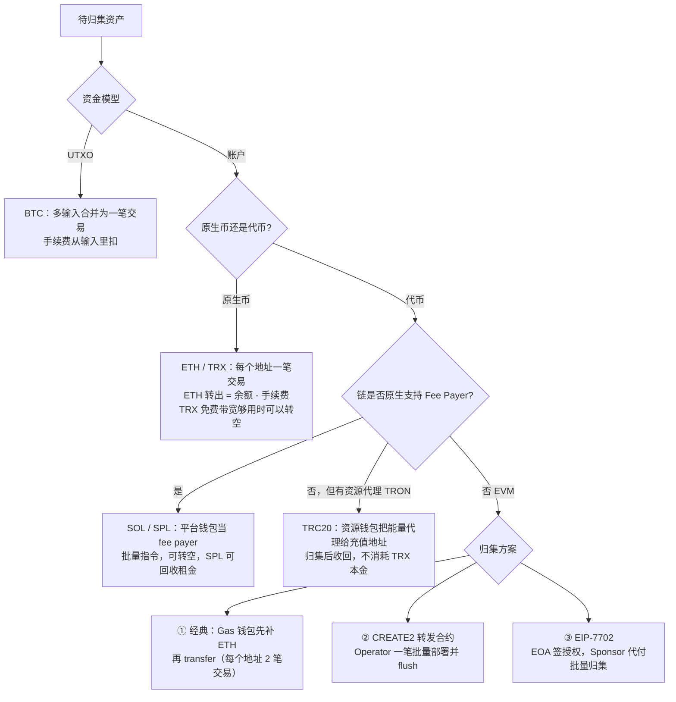

---

## 1. BTC（UTXO 模型）

### 业务解析

BTC 没有"账户余额"的概念，只有一张张**零钱**，即 UTXO（未花费输出）。用户每充值一次，充值地址上就多出一张零钱。

归集就像**把很多个钱包里的零钱一次性倒进一个大钱包**：一笔交易可以有很多个**输入**（来自不同充值地址的 UTXO），只有一个**输出**（热钱包）。手续费按交易的字节大小计算，直接从输入总额里扣，**不需要额外准备手续费**。

> 一句话：**一笔交易归集 N 个地址，手续费自带，最省事。**

### 流程图

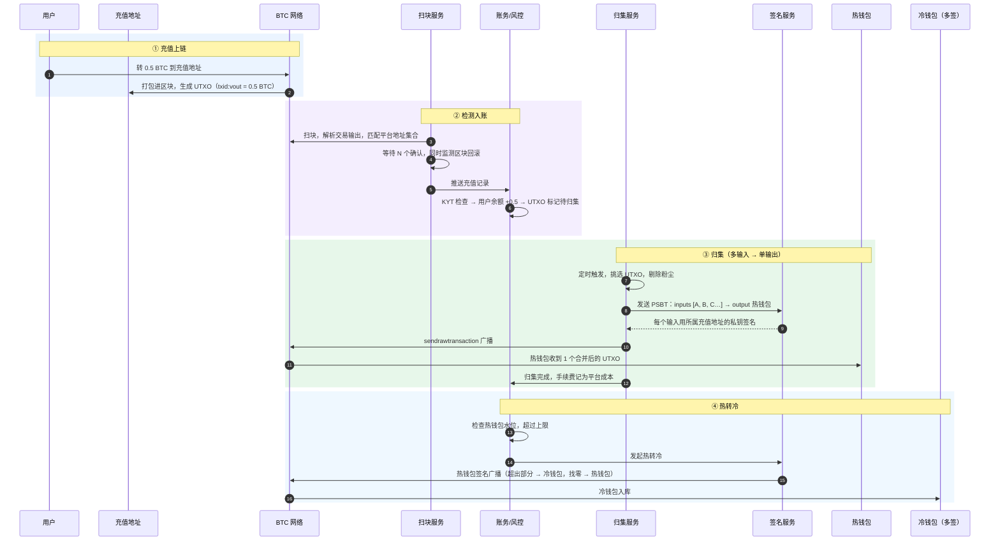

### 步骤说明

| # | 步骤 | 说明 |
|---|---|---|
| 1 | 用户充值 | 充值地址由 HD 钱包按 BIP84 派生（`m/84'/0'/0'/0/i`），一个用户一个地址，不需要 memo |
| 2 | 生成 UTXO | 同一地址充值多次，会产生多个独立的 UTXO，不会合并成一个余额 |
| 3 | 扫块识别 | 用 RPC `getblock` 轮询，或用 ZMQ 订阅新区块，把每笔交易的输出地址拿去和平台地址表比对 |
| 4 | 等待确认 | 一般 1~3 个确认入账，大额或可提现需要 6 个；保存区块哈希链，发现分叉（reorg）时回滚 |
| 5~6 | 风控入账 | KYT 检查来源地址风险（Chainalysis 等）；高风险资金冻结，不进入热钱包 |
| 7 | 触发归集 | 定时执行，或在链上费率低时集中执行；金额太小的"粉尘 UTXO"不值得花手续费去归集 |
| 8 | 构造交易 | 多个 UTXO 作为输入、热钱包作为唯一输出；用 PSBT（BIP174）在服务间传递未签名交易 |
| 9 | 签名 | 每个输入分别由对应充值地址的私钥签名，私钥留在 HSM / MPC 内 |
| 10 | 广播 | 长时间不确认时，可用 RBF（发更高费率的替换交易）或 CPFP（子交易带高手续费）加速 |
| 11~12 | 到账记账 | 热钱包得到 1 个大额 UTXO；手续费由平台承担，不扣用户余额 |
| 13~16 | 热转冷 | 热钱包超过上限水位，就把超出部分转入冷钱包；冷钱包通常是多签地址 |

### 交易结构示例

```text
inputs :  addr_A  txid1:0   0.50000000 BTC
          addr_B  txid2:1   0.20000000 BTC
          addr_C  txid3:0   0.03000000 BTC
outputs:  hot_wallet        0.72996310 BTC

vsize ≈ 10.5 + 68 × 3 + 31 ≈ 246 vB
fee   = 246 vB × 15 sat/vB = 3,690 sat   （输入总额 − 输出 = 手续费）
```

### 要点与风险

- **经济阈值**：一个 P2WPKH 输入约 68 vB，费率 20 sat/vB 时花掉它要约 1360 sat，金额比这还小的 UTXO 归集反而亏钱。
- **批量上限**：标准交易最大 100k vB，实践中每批 100~500 个输入。
- **0 确认不能入账**：未确认交易可能被替换（双花）。
- **区块回滚**：已入账的充值如果所在区块被回滚，需要冲正。
- 冷钱包常用 **P2WSH 2-of-3 / 3-of-5 多签**或 **Taproot MuSig2**，冷补热时多人在离线设备上签 PSBT。

---

## 2. ETH（账户模型 · 原生币）

### 业务解析

以太坊是**账户模型**，余额直接记在地址上，和银行账户很像，多次充值只是余额累加。

但账户模型有两个限制：

1. **每个地址只能自己发交易**，没法像 BTC 那样把多个地址合并进一笔交易，**N 个地址就要 N 笔交易**。
2. 手续费（Gas）从发送方自己的 ETH 里扣，所以**转出金额 = 余额 − 手续费**。好在要转的就是 ETH 本身，不用额外补手续费。

> 一句话：**逐个地址转，转出金额要预留手续费，会残留一点零头。**

### 流程图

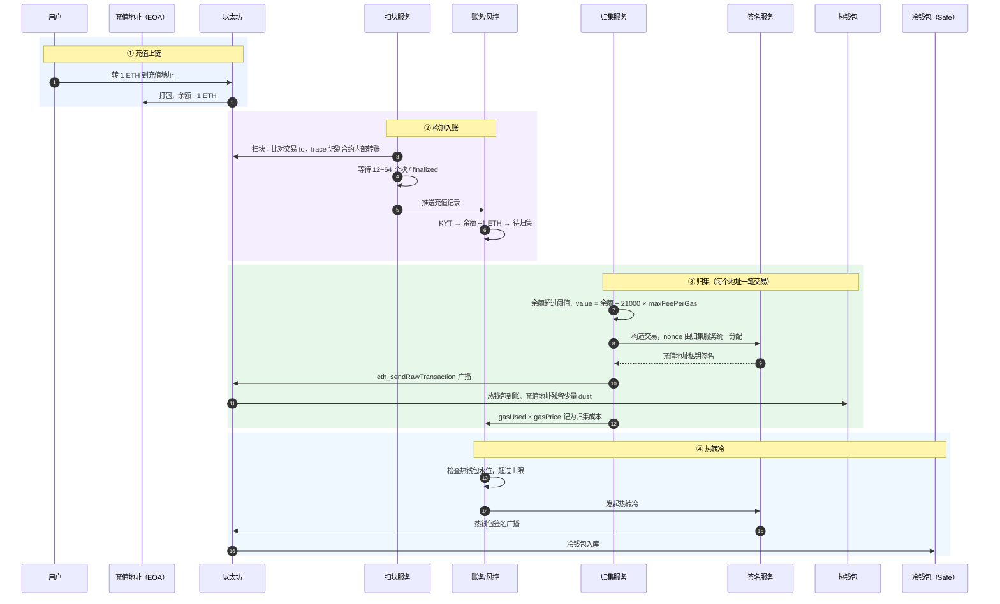

### 步骤说明

| # | 步骤 | 说明 |
|---|---|---|
| 1~2 | 用户充值 | 充值地址按 `m/44'/60'/0'/0/i` 派生；余额直接累加，没有 UTXO |
| 3 | 扫块识别 | `eth_getBlockByNumber` 比对交易的 `to`；从合约转进来的钱属于**内部交易**，要用 `debug_traceBlock` 才能看到 |
| 4 | 等待确认 | PoS 有最终性，约 12.8 分钟（2 个 epoch）后区块 finalized，不可回滚 |
| 5~6 | 风控入账 | 必须 `receipt.status = 1` 才算成功 |
| 7 | 计算金额 | 普通转账固定消耗 21000 gas，按最高单价预留手续费，剩余全部转出 |
| 8 | 构造交易 | 使用 EIP-1559（type 2）交易；**nonce 必须统一管理**，否则并发时会冲突或出现空洞，导致交易卡住 |
| 9 | 签名 | secp256k1 签名，带 chainId 防止跨链重放 |
| 10 | 广播 | 卡住时可以发一笔相同 nonce、更高费用的交易替换 |
| 11~12 | 到账记账 | 实际扣费按 baseFee + tip 计算，一般低于预留值，差额留在充值地址成为 dust |
| 13~16 | 热转冷 | 冷钱包常用 Safe 多签合约或 MPC |

### 要点与风险

- **归集阈值**要远大于一笔手续费，Gas 价格高峰时暂停小额归集。
- **dust 无法避免**：预留的手续费上限总会比实际消耗多一点，可以留到下次归集时一起转走。
- **内部交易漏扫**：只扫普通交易会漏掉从合约转进来的充值。

---

## 3. ERC-20 · 经典方案（Gas 钱包先补 ETH）

### 业务解析

ERC-20 代币（USDT、USDC 等）的余额**记在代币合约里**，转代币其实是调用合约的 `transfer` 方法，而调用合约要付 **ETH** 作为手续费。

问题来了：用户只往充值地址转了 USDT，没有转 ETH，于是充值地址**"有币没油"**，自己发不了交易。

经典做法是先**加油再开车**：

1. **Gas 钱包**先给充值地址转一点 ETH（第 1 笔交易）。
2. 等到账后，充值地址再把 USDT 转给热钱包（第 2 笔交易）。

> 一句话：**每个地址 2 笔交易，最常见，但也最费钱、最慢。**

### 流程图

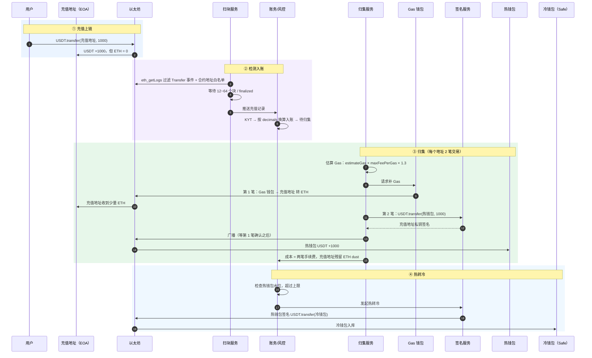

### 步骤说明

| # | 步骤 | 说明 |
|---|---|---|
| 1 | 用户转代币 | 本质是调用合约 `transfer(to, amount)`，代币余额记录在合约存储里 |
| 2 | 有币没油 | 充值地址 USDT = 1000，ETH = 0，这是 ERC-20 归集的核心难点 |
| 3 | 扫描事件 | 过滤 `Transfer(from, to, value)` 事件，**只认白名单里的合约地址**，防止假 USDT |
| 6 | 换算入账 | USDT / USDC 是 6 位小数，大多数代币是 18 位，入账时要按 decimals 换算 |
| 7 | 估算 Gas | 代币转账约 4.5~6.5 万 gas，再加 30% 左右缓冲，防止 Gas 价格上涨后不够用 |
| 8~10 | 补 Gas | Gas 钱包是专门存 ETH 的小额热钱包，这是额外多出来的第 1 笔交易 |
| 11 | 构造转账 | 交易的 `to` 是 **USDT 合约**，真正的收款人（热钱包）编码在 data 里（`0xa9059cbb…`） |
| 13 | 广播 | 必须等补 Gas 交易确认之后再发，否则会因为 ETH 不足而失败 |
| 14 | 判断成功 | USDT 的 `transfer` 不返回 bool（非标准实现），要靠 `receipt.status` + Transfer 事件判断 |
| 15 | 记账 | 归集成本是 2 笔交易的手续费；残留的 ETH 可以留到下次归集再用 |
| 16~19 | 热转冷 | 热钱包也要持有少量 ETH 作手续费 |

### 要点与风险

- **假币攻击**：任何人都能部署一个名叫 "USDT" 的合约，必须按合约地址白名单识别。
- **黑名单冻结**：USDT / USDC 的发行方可以冻结地址，归集前可以先检查 `isBlackListed`。
- **Gas 钱包并发瓶颈**：大量补 Gas 时，Gas 钱包的 nonce 会排队，可以用批量分发合约，一笔交易给多个地址打 ETH。
- **优化**：同一地址有多种代币时，补一次 Gas 依次归集所有代币。

---

## 4. ERC-20 · CREATE2 转发合约

### 业务解析

换一个思路：**充值地址不再是普通钱包，而是一个小合约（转发合约）**。

- 这个合约的地址可以用 CREATE2 **在链下提前算出来**，合约还没部署，地址就已经能收币了。原因是代币余额记在 USDT 合约里，跟目标地址上有没有代码无关。
- 合约里**写死了"只能把币转给热钱包"**，所以谁调用它都偷不走币。
- 归集时，平台用一个 **Operator 账户**调用工厂合约，**一笔交易里**把几百个地址的合约部署好，并把币全部转走，**手续费全部由 Operator 支付**。

> 一句话：**充值地址没有私钥，不用补 Gas，批量一笔搞定。BitGo 等大型托管机构采用这种方案。**

### 流程图

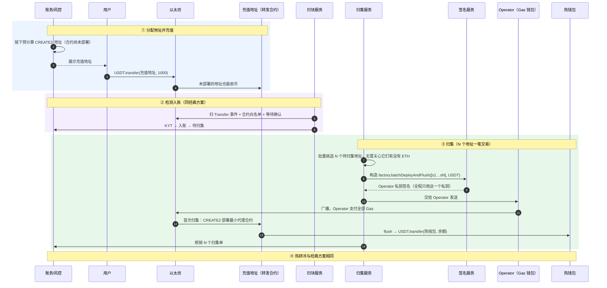

### 步骤说明

| # | 步骤 | 说明 |
|---|---|---|
| 1 | 预计算地址 | `address = keccak256(0xff ++ 工厂地址 ++ salt ++ keccak256(合约代码))[12:]`，salt 一般由用户 ID 生成 |
| 2~4 | 充值 | 对用户来说和普通地址没有区别；空地址也能正常收 ERC-20 |
| 5~6 | 入账 | 与经典方案相同 |
| 7 | 批量挑选 | 一次可以挑上百个地址，受区块 Gas 上限约束 |
| 8 | 构造调用 | 工厂合约对每个 salt：首次部署 EIP-1167 最小代理（约 45 字节，部署便宜），然后调用 `flush` 转出代币 |
| 9 | 签名 | **充值地址没有私钥**，全程只有 Operator 一个私钥，私钥管理压力大幅下降 |
| 10~11 | 发送并付费 | Operator 统一付 Gas，不用补 ETH，也没有 dust |
| 12 | 部署合约 | 只在该地址第一次归集时部署；已经部署过的地址，下次只调用 `flush`，更便宜 |
| 13 | 转出 | `flush` 只能转到合约里写死的热钱包地址，任何人调用都偷不走币 |
| 14 | 核销 | 按交易中的 Transfer 事件逐个核销归集单 |

### 要点与风险

- **合约必须审计**：权限控制、重入、对非标准代币的兼容。
- **老方案已失效**：Dencun 升级（EIP-6780）后 `SELFDESTRUCT` 不再删除合约代码，"部署 → 转账 → 自毁"的旧做法不能用了，改为常驻转发合约。
- **原生 ETH 充值**：需要合约的 `receive()` 自动转发，或者后续再 flush。

---

## 5. ERC-20 · EIP-7702 代付

### 业务解析

这是 2025 年 5 月以太坊 **Pectra 升级**后出现的新办法。

- 充值地址**仍然是普通钱包（EOA）**，有私钥。
- 充值地址可以签一张**"授权书"（authorization）**，让自己的账户临时拥有某个合约（SweepDelegate）的能力。签授权是**离线**的，不上链，也不花 Gas。
- 平台的 **Sponsor 账户**带着这些授权书发一笔特殊交易（type-4），**替充值地址付手续费**，并以充值地址的身份把代币转到热钱包，一笔交易可以处理一批地址。

> 一句话：**保留普通钱包，又能免补 Gas、批量归集；属于新方案，需要确认链和工具是否支持。**

### 流程图

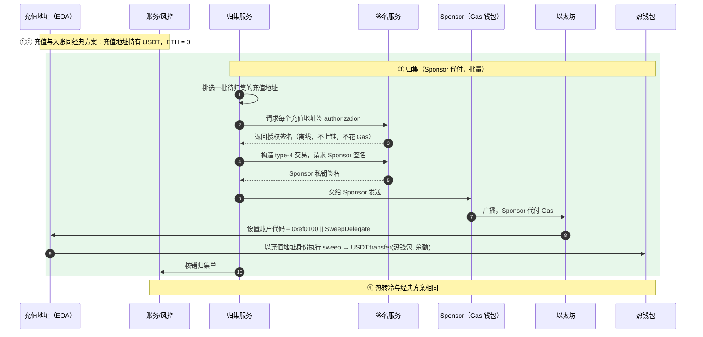

### 步骤说明

| # | 步骤 | 说明 |
|---|---|---|
| 1 | 挑选地址 | 不需要关心这些地址有没有 ETH |
| 2~3 | 签授权 | 签名内容为 `(chainId, 委托合约地址, nonce)`，表示"把我的代码委托给 SweepDelegate" |
| 4 | 构造交易 | type-4 交易携带 `authorization_list = [A, B, …]`，调用批处理合约对每个地址执行 sweep |
| 5~7 | 代付 | 外层交易由 Sponsor 签名并付 Gas，充值地址不需要 ETH，也没有 dust |
| 8 | 设置委托 | 链上把充值地址的代码设为"委托标记 + 合约地址"，之后它就具备合约的能力 |
| 9 | 执行归集 | 代币从充值地址直接转入热钱包 |
| 10 | 核销 | 委托一直有效，直到被新的授权覆盖；下次归集可以直接复用，不必重签 |

### 要点与风险

- **委托合约权限极大**：它可以操作该地址的全部资产，必须审计，并限制为"只允许 Sponsor 调用、只能转到白名单热钱包"。
- **兼容性**：需要确认节点、SDK、目标链（尤其是 L2）是否已经支持 7702。

### ERC-20 三种方案对比

| 维度 | ① 经典补 Gas | ② CREATE2 转发合约 | ③ EIP-7702 代付 |
|---|---|---|---|
| 充值地址 | 普通钱包（有私钥） | 合约地址（无私钥） | 普通钱包（有私钥） |
| 每个地址的交易数 | 2 笔 | 批量，一笔处理 N 个 | 批量，一笔处理 N 个 |
| 谁付手续费 | 充值地址（事先补入） | Operator | Sponsor |
| ETH 残留 | 有 | 无 | 无 |
| 合约依赖 | 无 | 工厂 + 转发合约 | 委托合约 |
| 适用场景 | 通用，实现最简单 | 大规模托管 | 新方案，看生态支持情况 |

---

## 6. SOL（Fee Payer 代付）

### 业务解析

Solana 有一个关键特性：**交易可以单独指定由谁付手续费（fee payer）**，付费人不必是转出资金的人。

因此平台可以让 **Gas 钱包当付费人**：

- 充值地址**不用预留手续费**，可以把 SOL **一分不剩全部转走**，没有 dust。
- 一笔交易里可以放**多条转账指令**，**同时归集多个地址**。
- 手续费极低（每个签名 5000 lamports ≈ 0.000005 SOL），可以低阈值、高频率归集。

> 一句话：**平台代付手续费，多地址一笔，全额转空。**

### 流程图

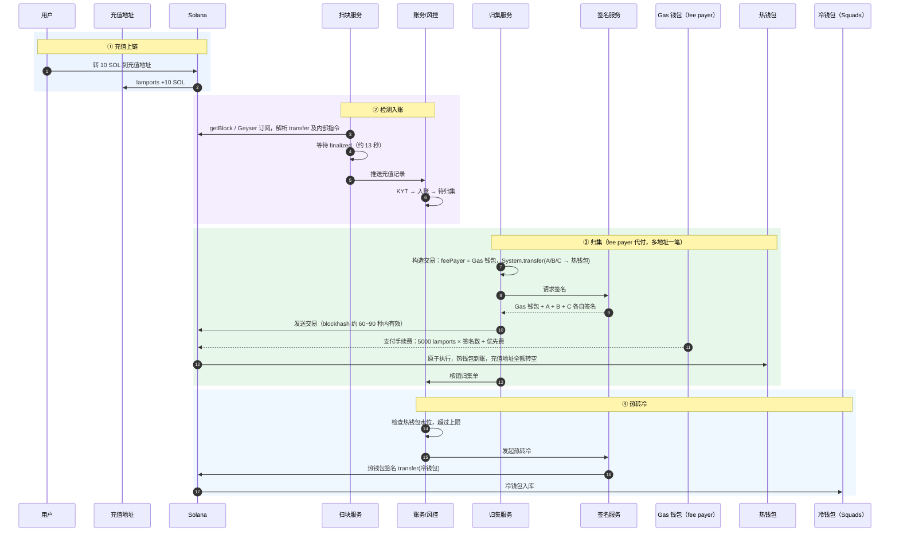

### 步骤说明

| # | 步骤 | 说明 |
|---|---|---|
| 1~2 | 用户充值 | 充值地址是 Ed25519 公钥（Base58），常用派生路径 `m/44'/501'/i'/0'`；1 SOL = 10⁹ lamports |
| 3 | 扫块识别 | 逐个 slot 解析转账指令，**包括内部指令**（合约调用产生的转账）；生产环境多用 Geyser / gRPC 实时订阅 |
| 4 | 等待确认 | 三级确认：processed → confirmed → **finalized**，交易所以 finalized 为准 |
| 7 | 构造交易 | 指定 Gas 钱包为 fee payer，每个充值地址一条 transfer 指令，金额 = 全部余额 |
| 8~9 | 多方签名 | fee payer 和每个充值地址都要签名 |
| 10 | 发送 | 交易里带有最近的区块哈希，约 60~90 秒后过期，过期要重新构造 |
| 11 | 代付 | 手续费全部从 Gas 钱包扣 |
| 12 | 原子执行 | 整笔交易要么全部成功，要么全部失败 |
| 14~17 | 热转冷 | 冷钱包常用 Squads 多签或 MPC |

### 要点与风险

- **可以转空**：Solana 账户余额要么为 0，要么不低于"免租最低值"（约 0.00089 SOL）。全部转走是合法的，转出后剩一点点反而会失败。
- **交易大小限制**：单笔交易最大 1232 字节，一笔通常能归集 8~12 个地址。
- **跳过的 slot**：有些 slot 没有出块，扫块时要能容忍。

---

## 7. SPL 代币（ATA + 回收租金）

### 业务解析

SPL 代币（Solana 上的 USDC、USDT 等）**不直接存在钱包地址里**，而是存在钱包名下的**代币子账户**，即 **ATA（关联代币账户）**。每种代币对应一个 ATA。

- 开一个 ATA 要押约 **0.002 SOL 租金**，一般由**转账方**在第一次转账时顺带创建并支付。
- 归集时和 SOL 一样，由 **Gas 钱包当 fee payer**，充值地址不需要持有 SOL。
- 代币转走之后，可以**关闭空的 ATA，把押金退回平台**（closeAccount）。

> 一句话：**代币存在子账户里；平台代付手续费；转完可以退押金。**

### 流程图

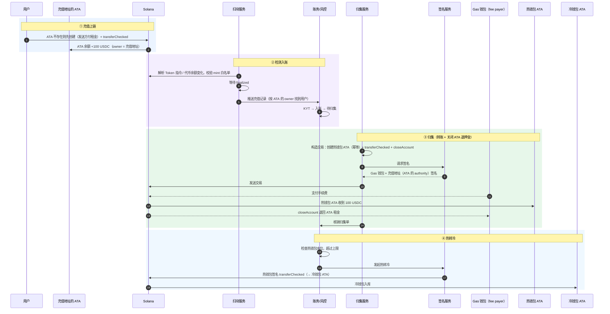

### 步骤说明

| # | 步骤 | 说明 |
|---|---|---|
| 1 | 用户转账 | ATA 地址由"钱包地址 + 代币 mint"推导出来；不存在时，发送方钱包会自动创建并付租金（约 0.00204 SOL） |
| 2 | 到账 | 代币存在 ATA 里，ATA 的 owner 字段是充值地址；充值地址本身的 SOL 余额可以为 0 |
| 3 | 识别充值 | **按 mint 地址白名单识别**，防假币；用户可能转到非 ATA 的其他代币账户，要按 owner 判断 |
| 5 | 找到用户 | 代币账户 → owner（充值地址）→ 用户 |
| 7 | 构造交易 | 三条指令：①确保热钱包 ATA 存在；②转出全部代币；③关闭空 ATA，租金退回 Gas 钱包 |
| 8~9 | 签名 | 充值地址作为 ATA 的 authority 签名，Gas 钱包作为 fee payer 签名 |
| 11 | 代付 | 手续费由 Gas 钱包支付 |
| 13 | 退押金 | 约 0.002 SOL 回到 Gas 钱包，基本能覆盖手续费 |
| 15~18 | 热转冷 | 冷钱包 ATA 不存在时，也要先幂等创建 |

### 要点与风险

- **关不关 ATA 要权衡**：关闭可以退押金；不关的话，用户下次充值时发送方就不用再付租金，体验更好。
- **Token-2022 扩展**：转账手续费扩展会让实际到账少于发送数量（要按余额变化入账）；transfer hook 会调用外部程序，可能导致转账失败。
- **冻结权限**：USDC 等代币的发行方可以冻结代币账户。
- 每个地址占用的账户和指令更多，一笔交易约可归集 5~8 个地址。

---

## 8. TRX（账户模型 · 带宽免费额度）

### 业务解析

TRON 是账户模型，和 ETH 很像：每个充值地址单独发一笔交易，把 TRX 转到热钱包。最大的区别在**手续费**：

- TRON 没有 Gas，用的是**带宽**（按交易字节数计算）和**能量**（执行合约才消耗）两种资源；
- TRX 普通转账**只消耗带宽**，而每个账户每天都有一小份**免费带宽**，通常够发 1~2 笔普通转账（具体额度以当前网络参数为准）；
- 免费带宽够用时，**手续费为 0，可以把余额全部转空**，没有 ETH 那样的 dust 问题。

另外两个 TRON 特有的概念：

1. **账户激活**：TRON 的新地址第一次收到 TRX 时才会在链上"创建账户"，由**转账发送方**额外支付约 1 TRX 的激活费。用户往充值地址转 TRX，激活费由用户承担。
2. **没有 nonce**：交易里带的是最近一个块的引用和**过期时间**，重发规则和 Solana 类似（见下方"要点与风险"）。

> 一句话：**和 ETH 一样每个地址一笔，但免费带宽通常够用，能转空、零成本。**

### 流程图

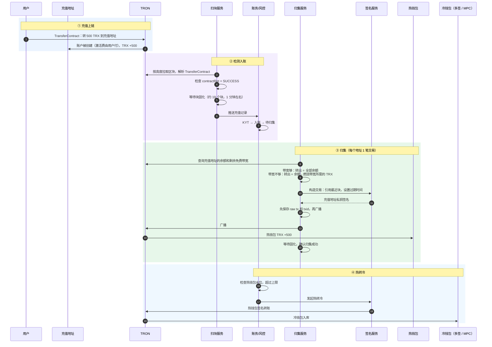

### 步骤说明

| # | 步骤 | 说明 |
|---|---|---|
| 1~2 | 用户转 TRX | 新地址收到 TRX 时被激活，激活费由发送方（用户）付 |
| 3 | 解析区块 | TRX 转账是区块里的 `TransferContract`；合约内部转出的 TRX 要看 `internal_transactions` |
| 4 | 检查执行结果 | **必须检查执行结果为 SUCCESS**。历史上有交易所只看交易在不在块里，被"假充值"攻击 |
| 5 | 等待固化 | TRON 有 27 个超级代表（SR），3 秒一个块；一个块被超过 2/3 的 SR 后续确认后就**固化**，不可回滚，约 1 分钟 |
| 8 | 查余额和带宽 | 用 `getaccountresource` 查剩余免费带宽 |
| 9 | 计算转出金额 | 免费带宽够就全部转走；不够时燃烧 TRX 支付带宽，转出金额要扣掉这部分 |
| 10 | 构造交易 | 交易带 `ref_block_bytes / ref_block_hash`（引用最近一个块）和 `expiration`（SDK 默认约 60 秒，最长 24 小时）。**没有 nonce** |
| 12 | 先落库后广播 | 交易 ID 是交易原始数据的 SHA256，签名前就能算出来 |
| 15 | 确认成功 | 以固化块为准，查 `gettransactioninfobyid` 的执行结果 |

### 要点与风险

- **重发陷阱**：交易没确认时，不能马上换一个引用块重新构造，否则旧交易也可能上链，**同一笔归集执行两次**。必须先确认旧交易已经过期（当前时间超过 expiration）且链上查不到，才能重建。
- **相同交易会被拒绝**：两笔内容完全相同的交易（收款人、金额、引用块、过期时间都一样），交易 ID 也相同，第二笔会被当成重复交易拒绝。批量归集时要保证每笔交易的时间戳不同。
- **地址格式**：Base58Check 编码，`T` 开头；底层就是 20 字节的 EVM 风格地址加 `0x41` 前缀。密钥用 secp256k1，HD 路径 `m/44'/195'/0'/0/i`，可以用 xpub 派生。
- **小额不归集**：金额太小、带宽又不够时，燃烧的 TRX 可能比余额还多，设经济阈值。

---

## 9. TRC20（USDT · 资源代理）

### 业务解析

USDT-TRC20 是交易所充提量最大的币种之一，几乎是必接资产。

它和 ERC-20 一样存在**"有币没油"**问题：转代币要调用合约，消耗**能量**，而充值地址只有 USDT，没有能量也没有 TRX。还有一个额外的麻烦：**只收到 TRC20 的地址没有被激活**（激活只在收到 TRX 时发生），未激活的地址不能发交易，也不能接收资源代理。

USDT 转账的能量消耗：
- 收款地址**已有** USDT 余额：数万能量；
- 收款地址**没有** USDT 余额：要新写一个存储槽，消耗约**翻倍**；
- 归集的收款方是热钱包，热钱包一直持有 USDT，所以**归集按低档计算**。

没有能量时，直接**燃烧 TRX** 抵扣，一笔 USDT 转账可能要几个甚至十几个 TRX，这就是"USDT-TRC20 转账费贵"的来源。

平台有三种办法解决"没油"：

| 方案 | 做法 | 成本 |
|---|---|---|
| ① 补 TRX | 资源钱包给充值地址转 TRX，归集时燃烧 TRX 付能量 | **最贵**，TRX 真实消耗 |
| ② 租赁能量 | 从第三方能量市场租能量，代理到充值地址 | 中等，按次付租金 |
| ③ **自己质押后代理**（主流） | 平台质押大量 TRX 获得能量，归集前**代理**（delegate）给充值地址，归集后**收回**（undelegate） | **最低**，TRX 本金只是锁定，不消耗 |

> 一句话：**先激活，再把能量借给充值地址，转完收回。每个地址 3~4 笔交易，但几乎不花 TRX。**

### 流程图（方案③：自己质押后代理）

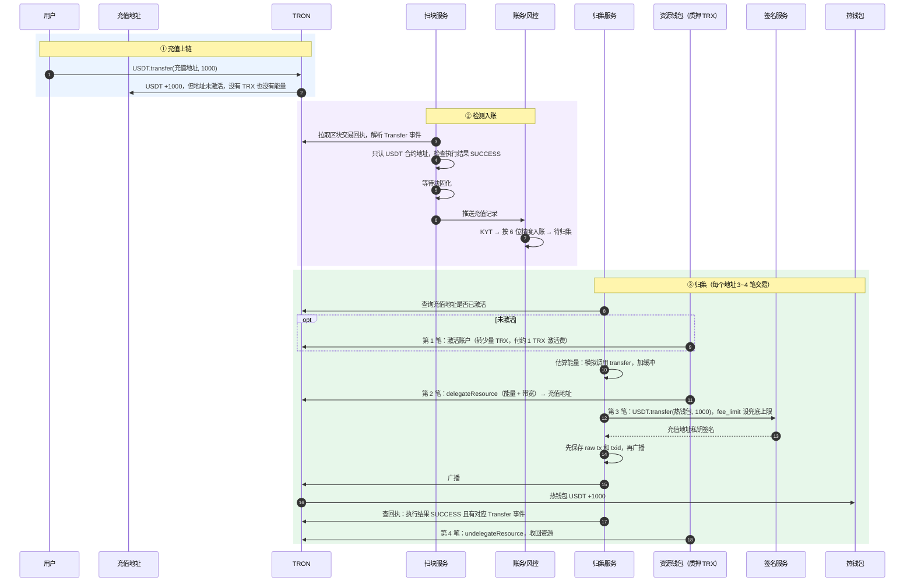

### 步骤说明

| # | 步骤 | 说明 |
|---|---|---|
| 1~2 | 用户转 USDT | 调用合约 `transfer`；充值地址只收到代币，**不会被激活** |
| 3 | 解析事件 | 从交易回执的日志里解析 `Transfer` 事件；也可以用 TronGrid 的事件接口 |
| 4 | 防假币、防假充值 | 只认 USDT 合约地址 `TR7NHqjeKQxGTCi8q8ZY4pL8otSzgjLj6t`；执行结果必须是 SUCCESS |
| 7 | 换算入账 | USDT-TRC20 是 6 位精度 |
| 8~10 | 激活 | 未激活的地址不能发交易、不能接收资源代理。激活成本是平台承担的固定成本 |
| 11 | 估算能量 | 用 `triggerconstantcontract` 模拟执行拿到能量消耗。USDT 合约受**动态能量模型**影响，热门合约的消耗会上浮，要实时估算 |
| 12 | 代理资源 | 资源钱包把质押获得的能量（和带宽）代理给充值地址。代理时不选锁定期，就可以随时收回 |
| 13 | 构造转账 | **fee_limit** 是这笔交易最多愿意燃烧的 TRX。能量代理够用就不会燃烧；设置一个兜底上限，防止异常时烧掉大量 TRX |
| 15~16 | 广播 | 同样先落库后广播；重发规则和 TRX 一样，必须等旧交易过期 |
| 18 | 判断成功 | **执行结果 SUCCESS + 一条从充值地址到热钱包、金额匹配的 Transfer 事件**。能量不够会失败（OUT_OF_ENERGY），**已经消耗的资源不退** |
| 19 | 收回资源 | 收回后资源回到资源钱包，可以给下一个地址用 |

### 要点与风险

- **资源池规划**：能量用掉后要 24 小时逐步恢复，所以质押量要按"每天的归集笔数 × 单笔能量"来规划，高峰期不够时临时租赁补充。
- **批量化**：可以把"代理资源"集中做——一次给多个地址代理，全部归集完再统一收回，减少资源钱包的交易数。
- **激活成本**：每个新充值地址激活一次（约 1 TRX），之后再充值就不用了。地址复用率越高，摊薄后成本越低。
- **黑名单**：USDT 发行方可以冻结地址，归集前可以先检查充值地址是否在黑名单里。
- **其他方案**：TRON 支持 CREATE2，也可以用类似 ERC-20 的"转发合约"方案批量归集，但部署合约本身要消耗能量，需要算账比较。

### TRX、TRC20 与 ETH、ERC-20 对比

| 维度 | ETH / ERC-20 | TRX / TRC20 |
|---|---|---|
| 手续费 | Gas，花 ETH | 带宽 + 能量，可以质押获得、可以代理给别人 |
| 防重放 | nonce，必须连续 | 引用块 + 过期时间，没有 nonce |
| 卡单处理 | 同 nonce 加价替换 | 等过期后重建 |
| 新地址 | 无需激活 | 收到 TRX 才激活，激活费约 1 TRX |
| 代币"没油" | 补 ETH / CREATE2 / EIP-7702 | 代理能量（主流）/ 补 TRX / 租能量 |
| 最终性 | finalized 约 12.8 分钟 | 固化块约 1 分钟 |
| 判断成功 | `receipt.status = 1` | 执行结果 `SUCCESS` |

---

## 10. 方案对比速查

| 维度 | BTC | ETH | ERC-20 | SOL | SPL | TRX | TRC20 |
|---|---|---|---|---|---|---|---|
| 资金模型 | UTXO（零钱） | 账户 | 账户（余额记在合约里） | 账户 | 代币子账户 ATA | 账户 | 账户（余额记在合约里） |
| 充值识别 | 交易输出地址 | 交易 to + 内部交易 | Transfer 事件 + 合约白名单 | transfer 指令 / 余额变化 | Token 指令 + mint 白名单 | TransferContract + 内部交易 | Transfer 事件 + 合约白名单 |
| 入账确认 | 1~6 确认 | 12~64 块 / finalized | 同 ETH | finalized ≈ 13 秒 | 同 SOL | 固化块 ≈ 1 分钟 | 同 TRX |
| 谁付手续费 | 从输入里扣 | 充值地址自己 | 补 Gas / Operator / Sponsor | Fee Payer（平台） | Fee Payer（平台） | 免费带宽 / 充值地址自己 | 资源钱包代理能量 |
| 要先补 Gas | 否 | 否 | 经典方案要 | 否 | 否 | 否 | 要激活 + 代理能量 |
| N 个地址的交易数 | 1 | N | 2N / 批量 1 | ≈ N/10 | ≈ N/6 | N | 约 3N~4N（代理可以批量） |
| 余额残留 | 无 | dust | dust（经典方案） | 无 | 可退回租金 | 无（带宽够时） | 无 |
| 冷钱包 | 多签 P2WSH / Taproot | Safe / MPC | Safe / MPC | Squads / MPC | Squads / MPC | 原生多签（权限管理）/ MPC | 同 TRX |
| 复杂度 | ★★ | ★ | ★★★★ | ★★ | ★★★ | ★ | ★★★ |

## 11. 通用工程要点（与链无关）

| 方面 | 要点 |
|---|---|
| 触发策略 | 定时批量 + 金额阈值；链上费率低时集中归集；热钱包余额不足时紧急归集 |
| 成本控制 | 只归集"金额远大于手续费"的地址；能批量就批量；归集手续费是平台成本，不扣用户余额 |
| 安全 | 私钥放在 HSM / MPC；归集目标只能是白名单热钱包；KYT 高风险资金隔离 |
| 可靠性 | 归集单幂等；nonce / UTXO 锁统一管理；区块回滚时冲正；交易被替换或丢弃时重试；链上余额与账面定期对账 |
| 热钱包水位 | 上限常按平台总资产的 2%~5%，或 1~2 天的提现量设定；超过上限转冷，低于下限由冷钱包补充（需多人审批） |

归集单状态机：

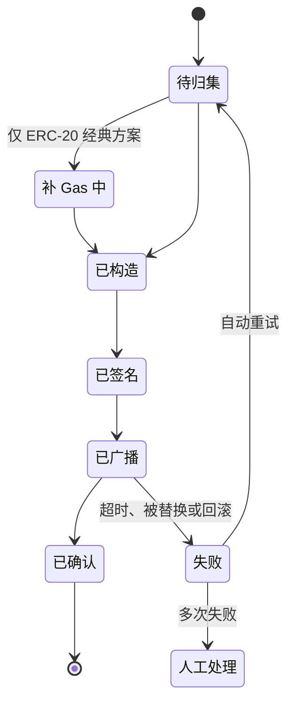
