# 钱包核心业务流程（自建托管视角）

> 覆盖归集以外的钱包核心业务：**充值、提现、提现风控、冷热水位、对账差异处理、各链充提差异、多链适配层、新链上线**。
> 视角是**交易所 / 托管机构自建钱包**（大部分交易所的做法）。基于 Fireblocks 的第三方托管版本见 [Fireblocks资金归集平台规划.md](./Fireblocks资金归集平台规划.md)。
> 图为 Mermaid 时序图，图中序号与下方「步骤说明」表的序号一一对应。标注「本项目」的内容都和代码核对过，其余是行业主流做法。
> 相关文档：归集流程见 [主流资产归集流程.md](./主流资产归集流程.md)；重点问题的深度分析见 [归集重点问题深度解析.md](./归集重点问题深度解析.md)；密钥与 MPC 见 [HD钱包原理与托管实践.md](./HD钱包原理与托管实践.md)；面试速记见 [归集面试问答速记.md](./归集面试问答速记.md)。

---

## 0. 全景

### 0.1 系统模块

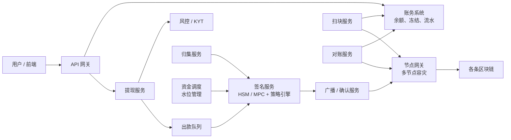

| 模块 | 职责 | 对应章节 |
|---|---|---|
| 扫块服务 | 发现充值、跟踪确认数、发现回滚 | 第 1 章 |
| 账务系统 | 用户余额、冻结、流水；所有资金变动的唯一记账入口 | 第 1、2 章 |
| 提现服务 + 风控 | 受理提现、风控审核、冻结余额、生成出款任务 | 第 2、3 章 |
| 签名服务 | 托管私钥，签名前独立校验；业务系统拿不到私钥 | 第 3 章、HD 文档 |
| 归集服务 | 充值地址 → 热钱包 | 主流资产归集流程 |
| 资金调度 | 热、冷钱包之间的调拨，保证热钱包够用又不放太多 | 第 4 章 |
| 对账服务 | 账本 vs 链上，发现差异就告警，必要时暂停出款 | 第 5 章 |
| 节点网关 | 多节点负载、故障切换、节点落后检测 | 第 7 章 |

### 0.2 资金流向

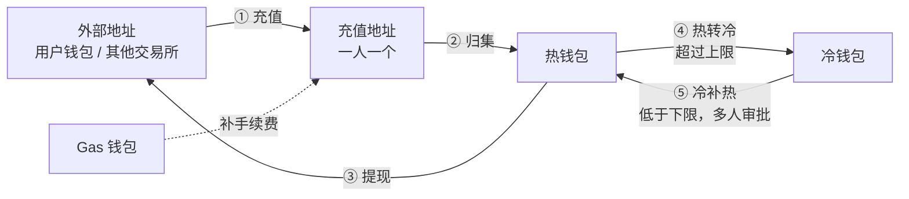

> 一句话：**钱从外部进充值地址，汇总到热钱包，大部分沉到冷钱包；提现从热钱包出，热钱包不够了从冷钱包补。**

### 0.3 贯穿所有流程的 5 条原则

| 原则 | 含义 | 在哪里体现 |
|---|---|---|
| **先记账，后动钱** | 冻结余额、写好任务之后才签名；签名结果先落库再广播 | 提现、归集、调拨 |
| **幂等** | 每个请求、每笔交易、每条流水都有唯一标识，重试不会重复执行 | 全部 |
| **状态机** | 每个单据只能按合法路径推进，终态不可逆 | 全部 |
| **宁可卡住，不能错发** | 判断不了的情况一律转人工，不自动重试、不自动退款 | 提现、归集 |
| **独立校验** | 签名服务、对账服务都不信任上游数据，自己重新核验 | 签名、对账 |

---

## 1. 充值全流程

### 业务解析

充值看起来最简单（用户转进来，我们记一笔账），但它是**平台最容易被"凭空印钱"的入口**：只要识别错一次（假币、失败交易、被回滚的块、重复入账），平台就白白多给了用户余额，用户再把钱提走，损失就是真金白银。

所以充值流程的核心问题只有一个：**怎么确保每一笔入账都对应一笔真实、最终、只记一次的链上转账。**

### 流程图

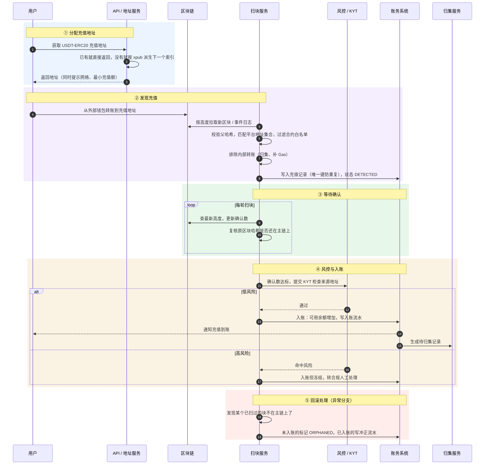

### 步骤说明

| # | 步骤 | 说明 |
|---|---|---|
| 1~3 | 分配地址 | 业务服务只持有 xpub，只能派生地址，不能签名。地址**先落库，后展示**，否则扫块服务不认识这个地址，会漏掉充值 |
| 4 | 用户转账 | 用户最常出错的地方：选错网络、memo 链漏填 memo、转了平台不支持的代币 |
| 5 | 拉取区块 | EVM 原生币看区块里的交易，ERC-20 看 Transfer 事件，BTC 看交易输出；只扫"安全深度"以内的块 |
| 6 | 匹配与过滤 | 父哈希不对就先回退再扫；**代币只认合约地址白名单**；必须检查交易执行成功（防"假充值"） |
| 7 | 排除内部转账 | 归集、补 Gas 的交易也会转进平台地址，要在广播前登记，扫块时排除，否则会被当成用户充值 |
| 8 | 写充值记录 | 唯一键：EVM 原生币 `tx_hash + 地址`，代币 `tx_hash + log_index`，BTC `txid + vout`。充值记录和扫块检查点在同一个事务里提交 |
| 9~11 | 等待确认 | 每轮更新确认数；**入账前再核对一次原区块哈希**，防止确认期间发生了回滚 |
| 12~15 | KYT 与入账 | 入账写余额和流水在同一个事务里；流水有唯一约束，同一笔充值只能入账一次 |
| 16 | 生成待归集 | 入账之后才允许归集；未确认的钱不能转走 |
| 17~18 | 高风险资金 | 入账但冻结，不能和其他资金一起归集进热钱包（避免"污染"热钱包） |
| 19~20 | 回滚 | 详见 [归集重点问题深度解析.md](./归集重点问题深度解析.md) 专题五 |

### 充值单状态

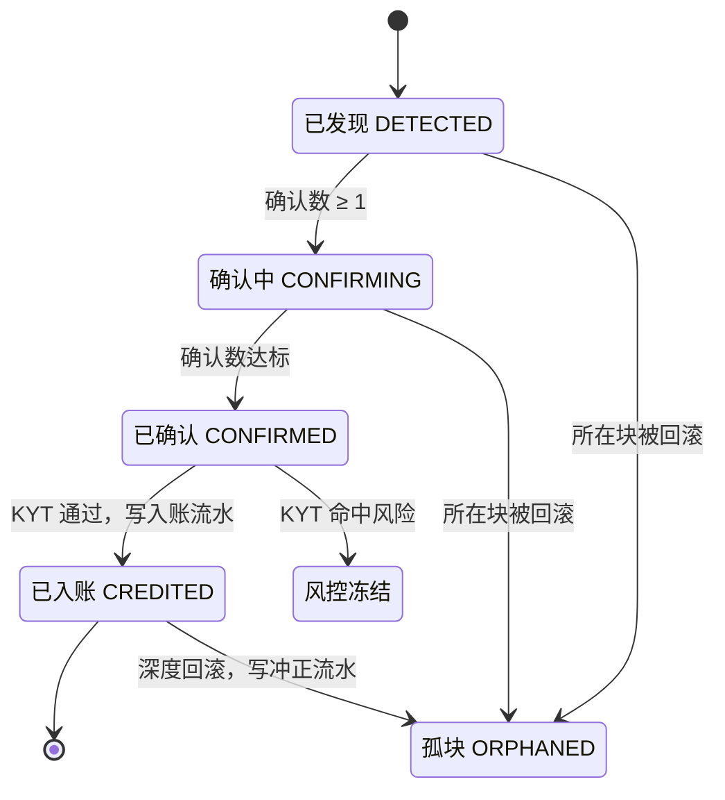

> 本项目实现了 DETECTED → CONFIRMING → CONFIRMED → CREDITED 和 ORPHANED，**没有 KYT 和风控冻结**。

### 分级确认：既快又安全

| 阶段 | 用户能做什么 | 典型确认数（BTC / ETH） |
|---|---|---|
| 已发现 | 看到"充值中"，不能用 | 0 |
| 到账可交易 | 可以买卖，**不能提现** | BTC 1 个 / ETH 若干个块 |
| 到账可提现 | 完全可用 | BTC 2~6 个 / ETH finalized |

原因：交易只是平台内记账，就算块被回滚，也能把余额扣回来；提现会让钱真正离开平台，回滚之后就追不回来了。

### 充值异常处理（面试常问）

| 异常 | 现象 | 常见处理 |
|---|---|---|
| 选错网络 | 用户把 BSC 上的 USDT 转到了平台的 ETH 地址 | 如果平台控制这个地址在 BSC 上的私钥（同一私钥），可以人工找回，通常收取找回费 |
| memo 漏填 | XRP、TON 等链没填 memo，钱进了平台总地址 | 用户提交 txid 申诉，人工核对后补入账 |
| 不支持的代币 | 转了平台没上线的代币 | 不入账；按需人工找回，或长期不处理 |
| 低于最小充值额 | 金额太小 | 不入账，或累计达到最小额后再入账（各平台规则不同） |
| 合约内部转账 | 从别的交易所的批量提现合约转入，普通扫块看不到 | 用 trace 接口识别；漏了就靠用户申诉补录 |
| 充值到已停用的地址 | 用户使用了历史地址 | 扫块的地址集合要包含历史地址，不能删 |

### 本项目对照

| 环节 | 本项目做法 |
|---|---|
| 地址分配 | EVM 按 BIP44 派生，BTC 按 BIP84 派生，一人一地址 |
| 防重复入账 | ETH `UNIQUE (network, tx_hash, address_id)`；ERC-20 `UNIQUE (asset_id, tx_hash, log_index)`；流水 `UNIQUE (entry_type, reference_type, reference_id)` |
| 防漏地址 | 增量加载地址时往回多看一个窗口，再定期全量刷新（自增 ID 提交顺序是乱的） |
| 防分叉日志 | `getLogs` 之后重新拉区块头，逐条比对日志的 blockHash |
| 确认数 | ETH、ERC-20、BTC 默认都是 3（测试网），可配置；回退块数不能小于确认数 |
| 回滚 | 检查点父哈希校验 + 入账前复核 + 已入账充值独立审计；冲正写 DEPOSIT_REVERSAL |
| 单条异常隔离 | 某笔充值出错写入 `worker_errors` 后跳过，不阻塞其他充值 |
| **没有** | KYT、风控冻结、分级确认、内部交易识别 |

### 要点与风险

- **入账只认三件事**：合约在白名单里、交易执行成功、所在块在主链上并且确认数够。
- **扫块检查点和充值记录必须原子提交**，否则崩溃重启后要么漏、要么重。
- **地址集合只增不删**，历史地址也要继续扫。
- **单条异常不能拖垮整个扫块服务**：出错的那一笔记录告警后跳过，其他充值照常入账。

---

## 2. 提现全流程

### 业务解析

提现是**钱真正离开平台**的唯一出口，也是黑客、内鬼、bug 最终造成损失的地方。和充值相反，提现的风险是"多付"：重复出款、付错地址、付错金额、退了款又上链。

提现流程的核心问题：**确保每一笔出款都经过授权、只执行一次，并且账务和链上始终一致。**

### 流程图

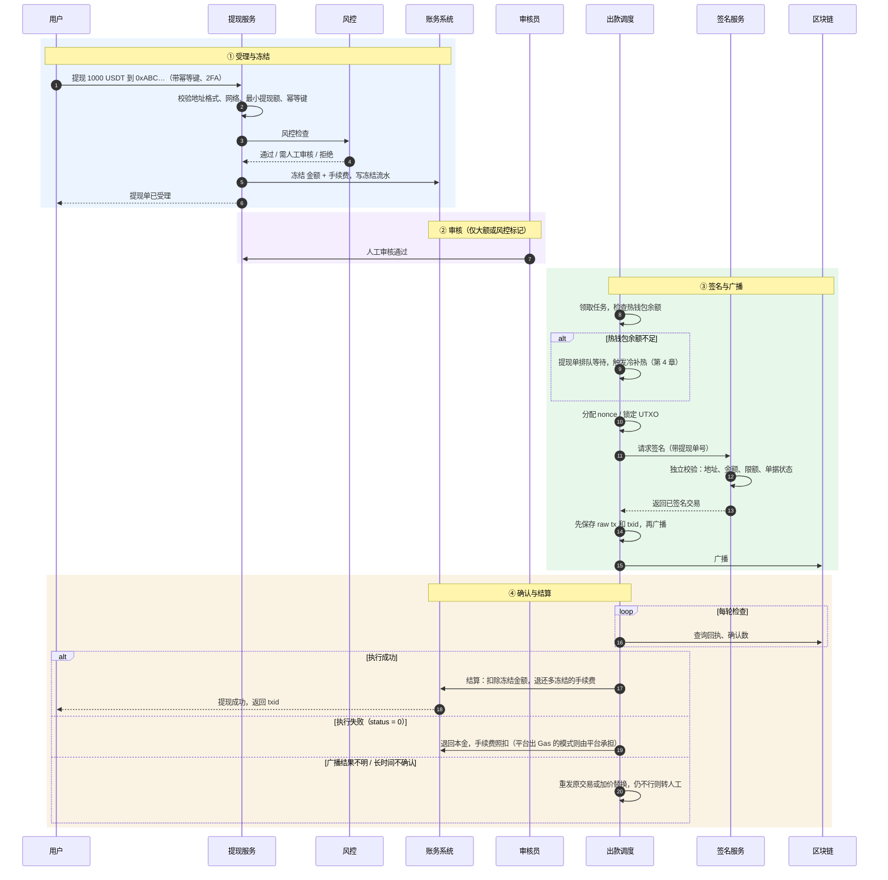

### 步骤说明

| # | 步骤 | 说明 |
|---|---|---|
| 1 | 发起提现 | **幂等键由客户端生成**，网络重试时带同一个键，服务端才能识别出是同一笔 |
| 2 | 参数校验 | 地址格式（EIP-55、BTC 网络前缀、TRON Base58Check）、网络是否开放提现、最小额、精度 |
| 3~4 | 风控 | 见第 3 章。结果分三种：直接通过、转人工审核、拒绝 |
| 5 | 冻结 | `可用 −= 金额 + 手续费`，`冻结 += 同样的数`。余额检查和冻结在**同一个行锁事务**里，防止并发超提 |
| 7 | 人工审核 | 大额、新地址、风控标记的提现需要审核员通过 |
| 8~9 | 热钱包余额不足 | **提现单排队，不能直接失败**；同时触发冷补热 |
| 10 | 分配资源 | EVM 在行锁内分配 nonce；BTC 锁定 UTXO 并保存输入快照，重启后复用同一份快照 |
| 11~12 | 签名 | 签名服务不信任业务库，自己核对单据状态、地址白名单、金额和限额 |
| 14 | 先落库后广播 | 保存 raw tx 和 txid 之后才广播，重试只重发同一笔交易，txid 不变 |
| 16~17 | 确认 | 必须看回执状态，只看到"已打包"不算成功 |
| 18 | 成功结算 | 冻结余额转为已扣除；按实际手续费结算，多冻结的部分退回 |
| 20 | 链上执行失败 | 交易上链但 revert：本金退回，手续费已经真实消耗 |
| 21 | 卡单 | 重发原交易 → 加价替换（EVM 同 nonce / BTC RBF）→ 超过次数转人工 |

### 提现单状态

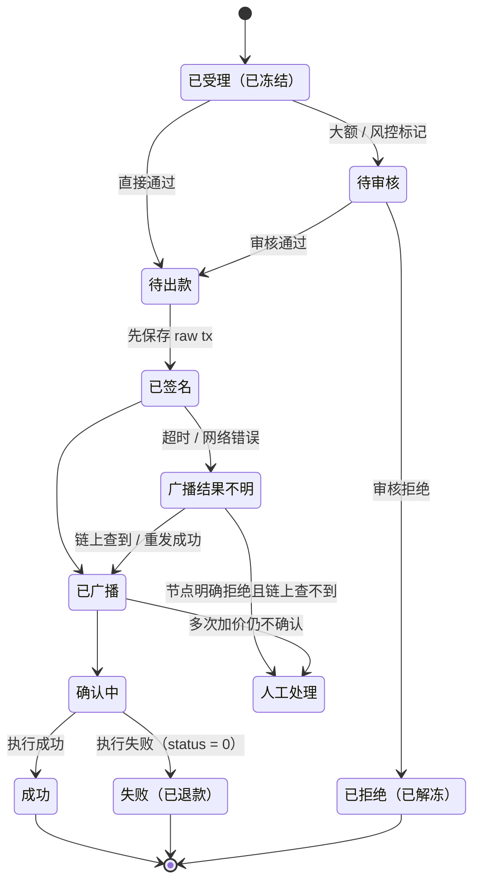

> 本项目 ETH 提现的真实状态：`CREATED → SIGNING → SIGNED → BROADCASTING → BROADCASTED / BROADCAST_UNKNOWN → CONFIRMING → COMPLETED / FAILED`，外加 `MANUAL_REVIEW`；BTC 在 CREATED 后多一个 `INPUTS_LOCKED`。**没有审核相关状态**。

### 最关键的规则：什么时候可以退款

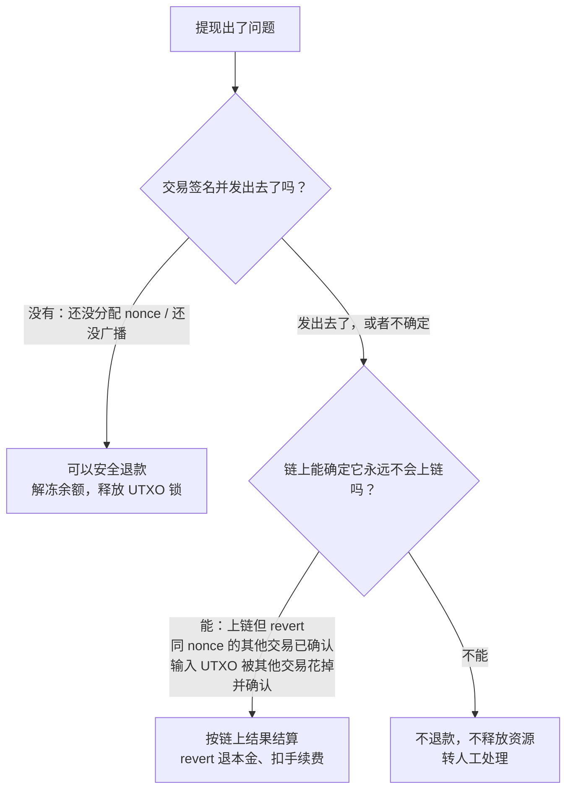

> 退了款、交易后来又上链，就是**双重出款**：用户余额回来了，链上的钱也转出去了。本项目的实现：ETH 只有在 CREATED 且未分配 nonce 时才能释放（否则报 `ErrUnsafeRelease`）；BTC 只允许在广播前（CREATED / INPUTS_LOCKED）失败并释放。

### 手续费的两种模式

| 模式 | 谁出 Gas | 向用户收多少 | 典型场景 |
|---|---|---|---|
| 统一出款（交易所主流） | 平台热钱包 | **固定提现手续费**，按币种和网络配置，定期根据链上费用调整 | 交易所、托管机构 |
| 用户地址直接出款 | 用户自己的地址 | 实际 Gas，先按最高可能值冻结，确认后多退少不补 | 本项目 ETH（隔离子钱包） |

本项目两种都有：
- **ETH 提现**：从用户自己的地址出款，冻结 `gasLimit × (2 × baseFee + tip)`，确认后按实际手续费结算，多冻结的部分退回。
- **ERC-20 提现**：从平台热钱包出款，用户只冻结代币，ETH Gas 由平台承担。

### 内部转账

提现目标地址如果是**本平台另一个用户的充值地址**，直接在账本里划转，不上链：
- 零手续费、秒到账；
- 实现方式：提现受理时查一下目标地址是否在平台地址库里；
- 注意：内部转账也要过风控，否则可以被用来绕过限额、洗钱。

### 本项目对照

| 环节 | 本项目做法 |
|---|---|
| 幂等 | `UNIQUE (user_id, idempotency_key)`；同一个键但地址或金额不同，返回幂等冲突 |
| 冻结 | 行锁事务里检查余额并冻结，写 WITHDRAW_RESERVE 流水 |
| nonce / UTXO | ETH 取 `max(链上 pending nonce, 数据库 next_nonce)`；BTC 锁定 UTXO 并保存输入快照 |
| 先落库后广播 | 签名后先保存 raw tx 和 txid |
| 广播不明 | 标记 BROADCAST_UNKNOWN，按 txid 查链；BTC 先 `testmempoolaccept` 预检再重发 |
| 卡单 | 60 秒未进内存池重发；180 秒未确认加价 15% 替换，最多 3 次 |
| 结算 | WITHDRAW_FINALIZE 流水；revert 退本金扣手续费；实际手续费超过冻结额时拒绝结算 |
| **没有** | 风控、人工审核、热钱包余额不足排队、内部转账 |

### 要点与风险

- **冻结在前，签名在后**；**落库在前，广播在后**。
- **签名之后的失败都不能自动退款**，必须等链上给出确定结果。
- 热钱包余额不足时**排队而不是失败**，否则用户会看到大量莫名失败的提现。
- 提现到合约地址时，Gas 估算可能不够（对方合约的 receive 逻辑复杂），要留余量或限制。

---

## 3. 提现风控

### 业务解析

风控回答一个问题：**这笔提现真的是账户本人发起的、合法的吗？**

被盗号（撞库、钓鱼、SIM 卡劫持）是交易所最常见的资金损失来源，盗号者拿到账户后第一件事就是加一个新地址、把钱提走。风控的目标就是让这条路走不通，同时尽量不打扰正常用户。

### 风控决策流程

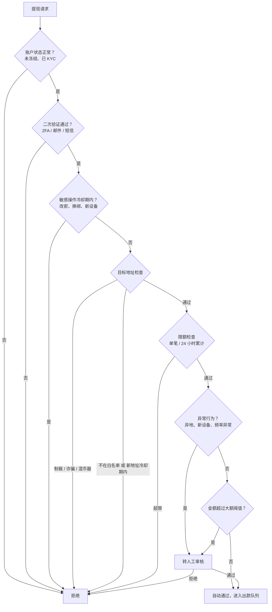

### 规则清单

| 类别 | 规则 | 典型配置 |
|---|---|---|
| 身份 | 二次验证 | 2FA（TOTP）+ 邮件或短信确认 |
| 身份 | 敏感操作冷却 | 改密码、换绑手机或邮箱、关闭 2FA 后 24~48 小时禁止提现 |
| 地址 | 地址白名单 | 用户开启后只能提到白名单地址 |
| 地址 | 新地址冷却期 | 新加入白名单的地址 24 小时后才能使用 |
| 地址 | KYT 地址筛查 | 制裁名单、暗网、混币器、已知诈骗地址 |
| 金额 | 单笔 / 日累计限额 | 按 KYC 等级、VIP 等级区分 |
| 金额 | 大额人工审核 | 超过阈值（例如等值 5 万 USDT）进入审核 |
| 行为 | 设备与登录地 | 新设备、异地登录后的首次提现转审核 |
| 行为 | 资金快进快出 | 充值后很快全额提到新地址，是典型的盗号或洗钱特征 |
| 平台 | 出款熔断 | 某个币种一段时间内出款总额超阈值，自动暂停该币种提现 |

### 签名服务的二次校验（最后一道防线）

业务风控在提现服务里，**业务库被攻破、或者提现服务有 bug，风控就形同虚设**。所以签名服务要独立再校验一遍：

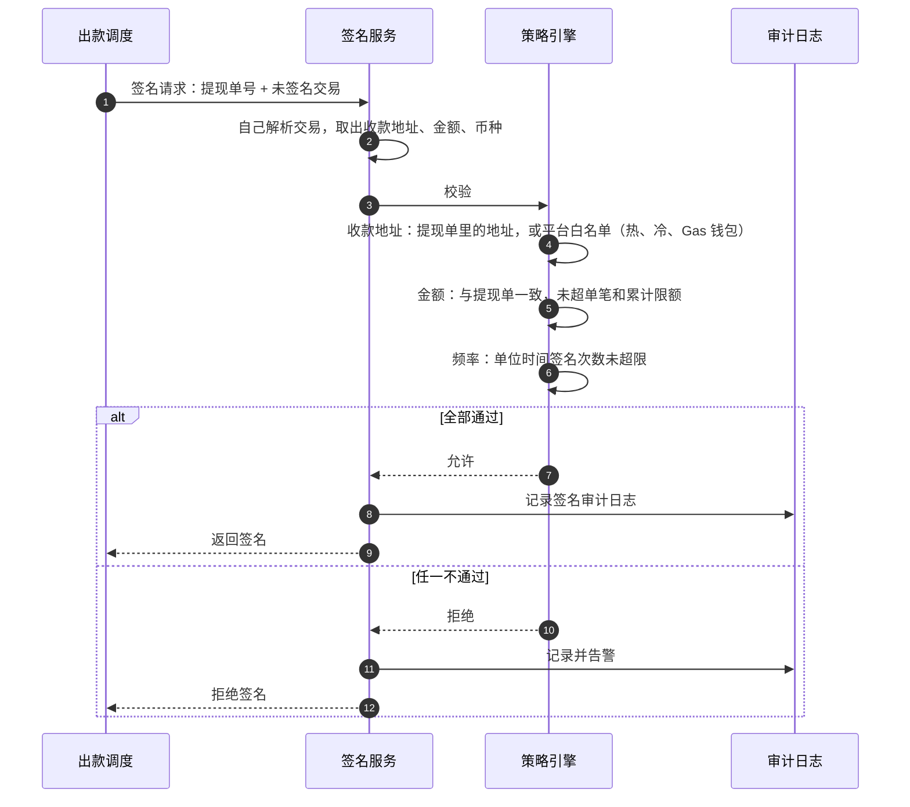

| # | 说明 |
|---|---|
| 2 | **签名服务自己解析交易**，不使用调用方传来的"金额、地址"字段。调用方说转 1 ETH，交易里实际是 100 ETH，以交易为准 |
| 4 | 归集、热转冷只能转到平台自己的地址；提现只能转到提现单里登记的地址 |
| 5~6 | 签名服务维护自己的累计额度，不依赖业务库的数据 |

> Fireblocks 的 Policy + Callback Handler 就是这套设计的产品化，见 [Fireblocks资金归集平台规划.md](./Fireblocks资金归集平台规划.md) 第 3 章。

### 本项目差距

本项目只做了地址格式、金额、余额、用户状态的校验，**没有风控和签名二次校验**。面试时可以这样说：

> 项目里风控没做，因为是测试网演示。生产上我会分两层：提现服务里做业务风控（2FA、白名单、冷却期、限额、KYT、大额审核），签名服务里再做一层独立校验，自己解析交易，只允许转到提现单地址或平台白名单地址，并维护独立的限额。这样业务系统被攻破也签不出异常交易。

---

## 4. 冷热水位管理

### 业务解析

热钱包放多少钱，是一个**安全和可用性的权衡**：
- 放多了：热钱包私钥在线，一旦被盗，损失就是热钱包里的全部余额；
- 放少了：提现经常因为余额不足排队，而冷补热要多人审批、离线签名，往往要几个小时。

水位管理就是给热钱包设**上限、目标值、下限**三条线，自动把余额维持在合理区间。

### 三条线怎么定

| 线 | 计算思路 | 超过 / 低于时 |
|---|---|---|
| **下限** | 冷补热所需时间（例如 4 小时）内的预计提现量 × 安全系数 | 低于下限：发起冷补热，**补到目标值** |
| **目标值** | 日均提现量 × 覆盖天数（1~2 天）+ 当前排队中的提现 | — |
| **上限** | 目标值 × 1.5 左右，或平台该币种总资产的 2%~5% | 超过上限：发起热转冷，**转到目标值** |

> **补到目标值、转到目标值**，而不是刚好补到下限或转到上限。否则余额在线附近来回波动，会频繁触发调拨。

**易错点：每个"币种 + 网络"单独一个池子。** USDT-ERC20 和 USDT-TRC20 是两条链上的资产，热钱包也是两个不同的地址，不能互相补。TRC20 的热钱包空了，ERC20 的热钱包再满也没用，只能各自调拨（或者通过跨链桥 / 交易所做跨链调拨，成本高、要审批）。

### 热转冷（资金往安全的地方走，可以自动）

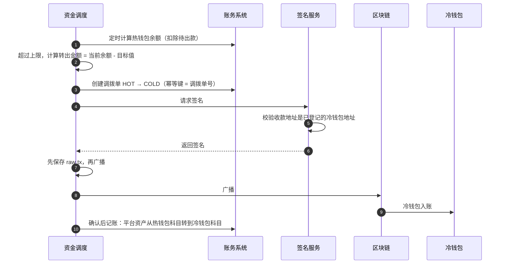

| # | 说明 |
|---|---|
| 1~2 | 计算余额时要**扣掉已冻结、待出款**的金额，否则会把马上要用的钱转走 |
| 5 | 签名服务只允许热转冷转到**登记过的冷钱包地址**，所以这一步可以全自动 |
| 9 | 冷热之间的调拨是**平台内部资金搬家**，不影响任何用户余额；扫块服务要把它识别为内部转账，不能当成充值 |

### 冷补热（资金往有风险的地方走，必须人工）

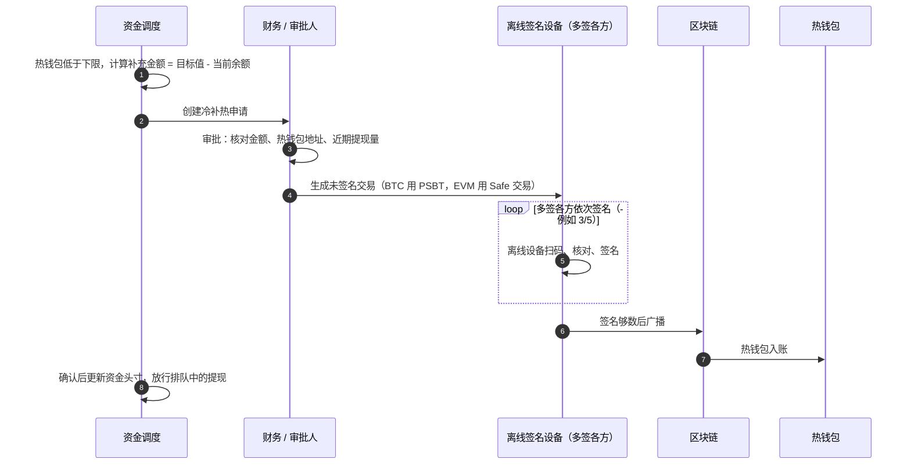

| # | 说明 |
|---|---|
| 3 | 审批要核对**收款地址确实是平台热钱包**，冷补热被骗到攻击者地址，就是最严重的事故 |
| 4 | BTC 多签冷钱包用 **PSBT**（BIP174）在多方之间传递部分签名的交易；EVM 用 Safe 多签合约 |
| 5~6 | 签名人分散在不同地点、使用不同设备，私钥从不联网 |
| 9 | 冷补热到账后，**排队中的提现**自动继续执行 |

### 热钱包不够用时的处理顺序

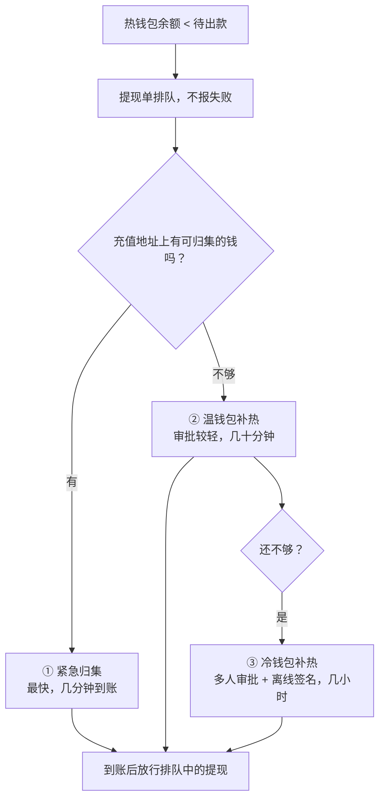

### 本项目差距

本项目**没有冷钱包和水位管理**：ETH 是隔离子钱包，钱留在用户地址；ERC-20 和 BTC 只有一个平台热钱包（BTC 是平台找零地址）。面试时可以说：生产上会按"币种 + 网络"配置三条线，热转冷自动执行、冷补热走多签审批，并和提现排队联动。

---

## 5. 对账与差异处理

> 对账的原理（四层对账、在途处理、快照高度）见 [归集重点问题深度解析.md](./归集重点问题深度解析.md) 专题六。本章只讲**发现差异之后怎么处理**，这是运营中最常发生、面试也常追问的部分。

### 日终对账流程

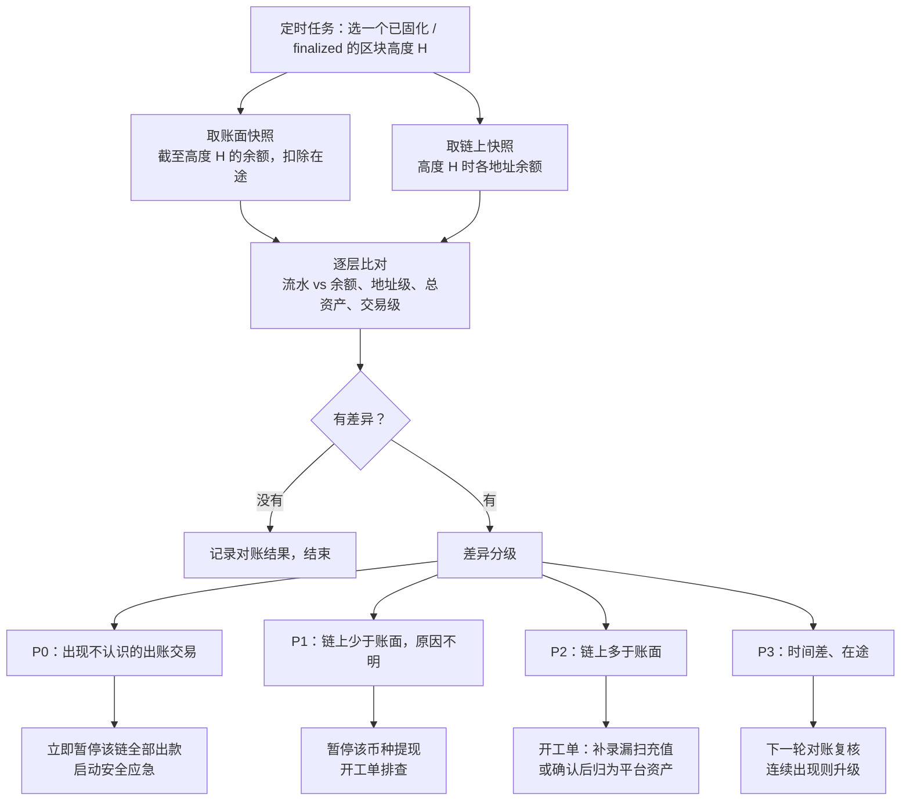

### 差异分级处理

| 级别 | 典型原因 | 自动动作 | 人工处理 |
|---|---|---|---|
| **P0** | 私钥泄露、签名服务被绕过 | 暂停该链所有自动出款（提现、归集、调拨） | 安全应急：转移剩余资金、轮换密钥、追踪资金 |
| **P1** | 重复出款 bug、手续费漏记、回滚未冲正 | 暂停该币种提现 | 逐笔核对交易，定位 bug，走调账流程 |
| **P2** | 漏扫的充值（内部交易、memo 漏填）、空投、他人误转 | 无 | 有对应用户的补录入账；无主资金归平台 |
| **P3** | 对账快照和交易确认的时间差 | 无 | 连续几轮都对不上才升级为 P1 |

### 调账：修复差错的唯一正确方式

发现账错了，**绝不能直接改余额表**，必须走调账流程：

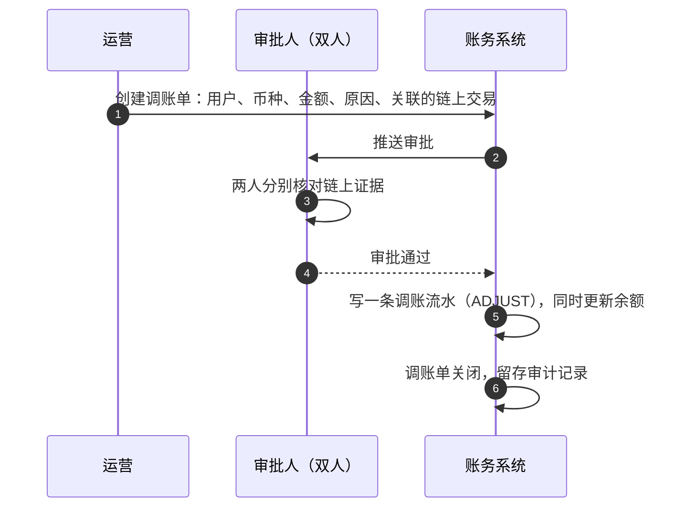

- 调账也是一种流水，**有唯一键、可追溯**，余额永远等于流水累计；
- 调账要**双人审批**，防止内部人员利用调账给自己加钱；
- 调账单必须关联原因和链上证据（txid）。

### 本项目差距

本项目有余额表 + 唯一键流水表，但**没有链上对账和调账流程**。可以补：每天定时比对流水 vs 余额、BTC UTXO 合计 vs 链上、ERC-20 热钱包 `balanceOf` vs 归集累计 − 提现累计，差异写入对账结果表并按上面的级别告警。

---

## 6. 各链充提差异

前面第 1、2 章的流程对所有链通用，不同链的差异集中在**怎么识别充值、怎么防重放、卡单怎么处理**。

### 6.1 对比总表

| 维度 | BTC | EVM（ETH / ERC-20） | TRON（TRX / TRC20） | Solana（SOL / SPL） | Memo 类（XRP / TON） |
|---|---|---|---|---|---|
| 充值地址 | 一人一地址 | 一人一地址 | 一人一地址 | 一人一地址（SPL 看 ATA 的 owner） | **平台一个地址 + 用户 memo** |
| 充值识别 | 交易输出 | 交易 to / Transfer 事件 | TransferContract / Transfer 事件 | 余额变化 / Token 指令 | 交易 memo 字段 |
| 入账确认 | 1~6 个确认 | finalized | 固化块 | finalized | 账本关闭 / 确认 |
| 防重放 | UTXO 只能花一次 | nonce 连续递增 | 引用块 + 过期时间 | blockhash 约 60~90 秒过期 | 序号（sequence）/ seqno |
| 卡单处理 | RBF / CPFP | 同 nonce 加价替换 | 等过期后重建 | 等过期后重建 | 视链而定 |
| 提现资源管理 | UTXO 选币与锁定 | nonce 串行分配 | 能量和带宽池 | 优先费；目标没有 ATA 要代建 | — |
| 特殊坑 | 粉尘、找零、交易链长度 | 内部交易、nonce 空洞 | 账户激活、OUT_OF_ENERGY | 租金、Token-2022 扩展 | memo 漏填 |

### 6.2 TRON 提现

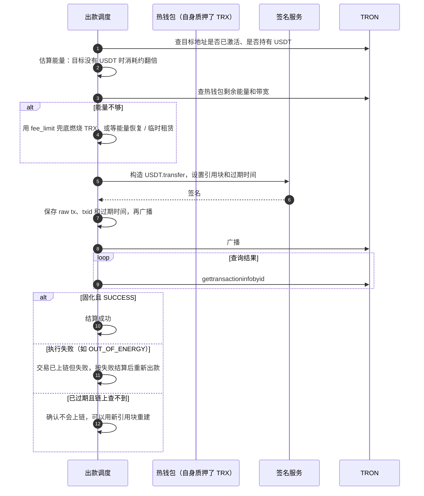

| # | 说明 |
|---|---|
| 1~2 | 提现到"从没收过 USDT 的新地址"，能量消耗约翻倍，**向用户收取的固定提现手续费要覆盖这种情况** |
| 3 | 热钱包自己也质押 TRX 获得能量，提现量大时能量是瓶颈，要监控 |
| 7 | 必须保存**过期时间**，后面靠它判断旧交易还会不会上链 |
| 13~14 | OUT_OF_ENERGY 失败的交易已经上链，**同一笔交易不会再执行**，所以可以安全地重新出款（新交易） |
| 15~16 | 只有"已过期 + 链上查不到"两个条件同时满足才能重建，这一点和 Solana 一样 |

### 6.3 Solana 提现

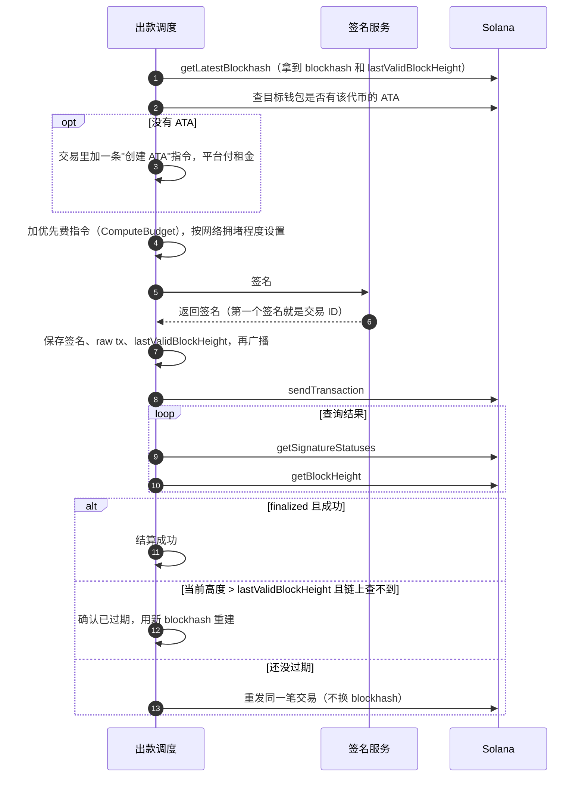

| # | 说明 |
|---|---|
| 1 | blockhash 大约 150 个块（60~90 秒）后失效，`lastValidBlockHeight` 就是它最后有效的高度 |
| 2~4 | SPL 代币要转到目标钱包的 ATA；目标没有 ATA 时由**发送方**创建并付租金（约 0.002 SOL），提现手续费要考虑这部分 |
| 5 | 网络拥堵时不加优先费，交易可能一直不被打包 |
| 8 | Solana 交易 ID 就是第一个签名，签名完就确定了，和"先落库后广播"天然契合 |
| 14~15 | **最容易出事故的地方**：没过期就换 blockhash 重建，旧交易和新交易可能都上链，造成重复出款 |
| 16~17 | 没过期时只重发**同一笔**交易，Solana 节点会自动去重 |

### 6.4 Memo 类链（XRP、TON、EOS 等）

- **充值**：平台只有一个（或少量）充值地址，用 memo / tag 区分用户。扫块时**必须同时匹配地址和 memo**；memo 为空或不认识的充值进入"待认领"，由用户申诉后人工入账。
- **提现**：提到其他交易所时，用户必须填写对方给的 memo，前端要强提示。
- **为什么要这样设计**：XRP 每个账户要锁定一定数量的 XRP 作为储备金，TON 地址部署钱包合约也有成本，"一人一地址"太贵。

---

## 7. 多链适配层

### 业务解析

一个交易所要接几十条链。如果每条链都从头实现一遍充值、提现、归集，代码量和出错概率都会失控。

所以架构上要把**"所有链都一样的业务逻辑"**和**"每条链不一样的技术细节"**分开：前者写一次，后者每条链实现一份接口。

### 分层架构

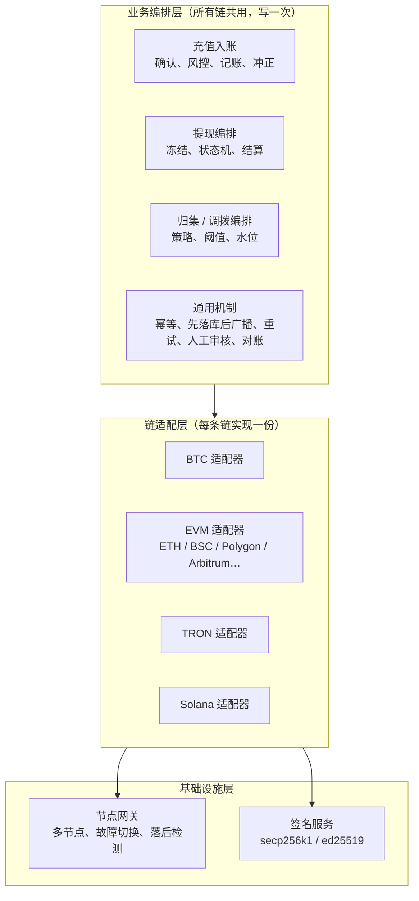

> 一个 EVM 适配器可以服务所有 EVM 兼容链，只是配置不同（链 ID、确认数、节点地址、Gas 策略）。这也是为什么新上一条 EVM 链很快，新上一条非 EVM 链很慢。

### 适配器要实现哪些能力

| 能力 | 说明 | 不同链的差异点 |
|---|---|---|
| 地址派生与校验 | 生成充值地址；校验提现地址 | 曲线（secp256k1 / ed25519）；能不能用 xpub 派生；编码格式 |
| 扫块 / 识别充值 | 给定区块范围，返回属于平台地址的充值 | 交易 / 事件日志 / UTXO / memo |
| 最终性判断 | 给定交易，返回确认状态 | 确认数 / finalized / 固化块 |
| 构造交易 | 给定"从哪、到哪、多少"，返回未签名交易 | 账户 vs UTXO；nonce vs 过期时间 |
| 手续费估算 | 返回手续费和费率参数 | gas / vsize / 能量带宽 / 优先费 |
| 广播 | 返回明确的结果：成功、已存在、明确拒绝、不确定 | 各链节点的错误信息各不相同，要逐条分类 |
| 查询交易状态 | 返回：未找到、待确认、成功、失败、已过期 | 失败的判断方式不同 |
| 卡单处理 | 返回下一步动作：等待、重发、加价替换、重建 | RBF / 同 nonce 替换 / 过期后重建 |

**关键设计：广播和查询的返回值要统一成有限的几种状态**。业务编排层只看这几种状态推进状态机，不关心底层是哪条链。比如"already known""nonce too low 但查到是我们的交易""txn-already-in-mempool"在各自的适配器里都翻译成"已存在"。

### 节点网关

| 问题 | 处理 |
|---|---|
| 单个节点宕机 | 多节点主备或负载均衡，自动切换 |
| 节点落后 | 定时比较各节点的最新高度，落后太多的节点暂时摘除 |
| 不同节点数据不一致 | 同一轮扫块尽量用同一个节点；关键数据（区块哈希）交叉核对 |
| 业务错误不应切节点 | revert、nonce 冲突、余额不足是**链上结果**，换节点也一样，不能触发切换 |
| 第三方节点限流 | 批量 RPC、缓存区块头、控制并发 |

### 本项目对照

- EVM 的手续费估算、广播、确认抽成了共享组件（`FeeEstimator`、`Broadcaster`、`Confirmer`），ETH 提现、ERC-20 提现、ERC-20 归集、补 Gas 这 4 个 worker 都复用它们（Batch F2）；
- EVM 节点客户端会对错误分类：同一节点可重试的错误先退避重试，节点故障才切换到备用节点；**业务错误（revert、nonce 冲突、余额不足）不切换节点**；
- BTC 单独一套，因为 UTXO 模型和账户模型差异太大，强行抽象反而更复杂；
- 差距：业务编排层没有抽成和链无关的通用框架，ETH、ERC-20、BTC 各自有一套状态机。

---

## 8. 新链 / 新币上线流程

### 新链上线

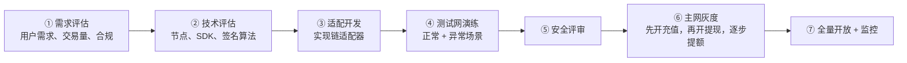

| 阶段 | 要确认的事 |
|---|---|
| ② 技术评估 | 自建节点还是第三方 RPC；至少两个节点做容灾；**签名服务是否支持这条链的曲线和交易格式**；最终性机制；有没有历史回滚或停链记录 |
| ③ 适配开发 | 地址派生路径、精度、最小充提额、确认数、手续费策略、提现手续费 |
| ④ 测试网演练 | 正常充值、提现、归集；**异常场景**：回滚、卡单、节点宕机、广播超时、重复请求 |
| ⑤ 安全评审 | 私钥管理、签名策略、地址白名单、限额 |
| ⑥ 主网灰度 | 先只开充值（只进不出，风险最小）→ 小额度开放提现 → 观察对账一段时间无差异后逐步提额 |
| ⑦ 监控 | 扫块延迟、节点高度差、热钱包水位、卡单数量、对账差异 |

### 新币上线（已有链上加一个代币）

链适配器已经有了，新币主要是**配置 + 风险评估**：

| 项目 | 说明 |
|---|---|
| 合约地址 | 加入白名单；核对是官方合约，不是同名假币 |
| 精度 | 同一个币在不同链上精度可能不同（USDT 在以太坊和 TRON 上是 6 位，在 BSC 上是 18 位） |
| 合约风险 | 是否可升级、是否有黑名单 / 冻结、是否可暂停、是否可增发、是否转账扣费（详见速记 Q68） |
| 业务参数 | 最小充值额、最小提现额、提现手续费、确认数、热钱包水位 |
| 归集方案 | 用哪种"没油"方案（补 Gas、代理能量、fee payer） |

### 下线流程

暂停充值 → 公告（通常提前一个月以上）→ 用户提走资产 → 暂停提现 → 剩余资产按公告处理。**先停充值、后停提现**，顺序反过来会把用户的钱困在平台里。

---

## 9. 面试怎么讲

### 充值（1 分钟）

> 充值分五步：分配地址、扫块识别、等待确认、风控入账、回滚处理。核心是保证每笔入账都对应一笔真实、最终、只记一次的链上转账。
> 真实：只认合约白名单、只认执行成功的交易；最终：确认数够了才入账，入账前再核对一次区块哈希；只记一次：充值记录有唯一键，入账流水也有唯一键，扫块检查点和充值记录在同一个事务里提交。
> 我项目里还处理了两个细节：新地址按自增 ID 增量加载会漏，所以加了回看窗口；getLogs 返回的日志可能来自别的分叉，所以查完会重新拉区块头逐条比对哈希。

### 提现（1 分钟）

> 提现是钱离开平台的唯一出口，核心是每笔出款都经过授权、只执行一次、账链一致。
> 流程是：幂等键受理、风控、冻结余额、必要时人工审核、分配 nonce 或锁 UTXO、签名、先落库再广播、确认后结算。
> 最关键的规则是退款时机：交易一旦签名发出，哪怕节点报错也不能退款，必须等链上给出确定结果，比如上链但 revert、同 nonce 的另一笔交易已确认。否则退了款交易又上链，就是双重出款。我项目里只有在没分配 nonce 之前才允许释放冻结，否则直接报错。

### 风控与安全（1 分钟）

> 分两层。提现服务里做业务风控：二次验证、改密后冷却、地址白名单和新地址冷却期、限额、KYT、大额人工审核。签名服务里再做一层独立校验：自己解析交易，只允许转到提现单地址或平台白名单地址，维护独立的限额。这样业务系统被攻破，也签不出异常交易。

### 水位与对账（1 分钟）

> 热钱包按币种加网络单独设上限、目标值、下限。超过上限自动转冷，转到目标值；低于下限发起冷补热，走多签审批和离线签名。热钱包不够时提现排队，优先紧急归集，再温补热，最后冷补热。
> 对账每天按一个已固化的高度取快照，差异分四级：不认识的出账交易立即暂停出款；链上少于账面暂停该币种提现排查；链上多于账面补录；时间差下一轮复核。修复差错必须走双人审批的调账流程，不能直接改余额。

### 多链（1 分钟）

> 我会把架构分成业务编排层和链适配层。幂等、状态机、冻结结算、对账这些所有链都一样，写一次；地址、扫块、构造交易、手续费、广播、卡单处理这些每条链实现一个适配器。关键是适配器要把各链五花八门的广播和查询结果翻译成统一的几种状态，编排层只看这几种状态。
> 比如 TRON 没有 nonce，用引用块加过期时间，卡单不能加价替换，只能等过期后重建，这和 Solana 一样；而 EVM 是同 nonce 加价替换，BTC 是 RBF。这些差异都封装在适配器里。

---
